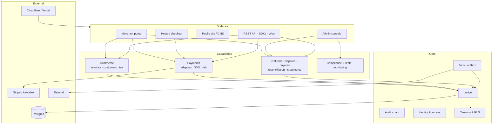

# KD PAY — Core Components

> A map of the platform for people who need to *understand* it: a new developer, an agency you hire, a partner doing due diligence, an auditor, or a non-technical stakeholder.
>
> It answers "what are the moving parts, what does each one do, and how do they fit together?" — without requiring you to read 6,000 lines of specification.
>
> Depth controls: **§1 and §2** = 5 minutes. **§3 and §4** = 20 minutes. Everything else = reference.

---

## 1. The 60-second version

KD PAY is a **payment platform for Asian sub-merchants**, run by a US LLC. It lets a merchant (say, a software studio in Dhaka) send an invoice to a buyer anywhere, take the card payment on a hosted page, watch the money land in an immutable ledger, refund it, and withdraw it to their bank — while KD PAY stays compliant, keeps the books straight, and never touches a card number.

Four promises shape every component:

1. **No card data, ever.** Card fields live in the processor's iframe. KD PAY is PCI **SAQ-A** — the lightest possible compliance burden, and non-negotiable.
2. **No floating-point money.** Amounts are `numeric(18,4)` in Postgres and integer micro-USD in code. Every movement is a balanced double-entry transaction that cannot be edited or deleted.
3. **No tenant leaks.** Every table is protected by row-level security; asking for another merchant's record returns *not found*, not *forbidden*.
4. **No unverifiable claims.** Every action is written to a hash-chained audit log; every requirement has an owner step and a test.

---

## 2. The shape of the system

Four layers. Each layer may only call the one below it.

```text
┌──────────────────────────────────────────────────────────────────────┐
│  SURFACES          merchant portal · admin console · public site     │  C8
│                    hosted checkout · REST API · SDKs · WooCommerce   │
├──────────────────────────────────────────────────────────────────────┤
│  CAPABILITIES      commerce · payments · refunds · disputes          │  C4 C5 C6 C7
│                    payouts · compliance · risk · reporting           │
├──────────────────────────────────────────────────────────────────────┤
│  CORE              ledger · audit chain · jobs/outbox · auth · tenancy│  C1 C2 C3 C9 C10
├──────────────────────────────────────────────────────────────────────┤
│  PLATFORM          Postgres/Supabase · Vercel · Cloudflare · Stripe   │
│                    Airwallex · Resend · Turnstile · Sentry            │
└──────────────────────────────────────────────────────────────────────┘
```



---

## 3. The ten core components

Each card: what it does in plain language, what it owns, what it depends on, how you'd notice if it broke, and where it is built.

---

### C1 · Identity & Access

**In one sentence:** proves who someone is, what they are allowed to do, and lets them be kicked out instantly.

- **Does:** email/password sign-up with verification, opaque server-side sessions (the browser holds a random token, not a JWT), TOTP two-factor, step-up re-authentication for sensitive actions (≤ 5 min), device list and revocation, breached-password checks, lockout after repeated failures, passkeys later, and a role/permission system with two scopes — platform staff and merchant team.
- **Owns:** `app_users`, `sessions`, `device_fingerprints`, `mfa_factors`, `recovery_codes`, `login_attempts`, `step_up_challenges`, `blocked_ips`, `role_permissions`, `user_roles`, `merchant_members`, `approval_requests`.
- **Depends on:** C2 (to reach the data), Supabase Auth (password/totp primitives only — sessions are ours).
- **If it breaks you'd notice by:** everyone logged out, or worse, a revoked session still working.
- **Built in:** S0.6 (auth), S0.7 (RBAC), S3.4 (passkeys).
- **Spec:** master spec §20.

---

### C2 · Tenancy & Data Access

**In one sentence:** the wall between merchants — the reason one customer can never see another's invoice.

- **Does:** one way to talk to the database (no ORM), a transaction helper that stamps the caller's user, merchant and role onto every query, default-deny row-level security on every table, a helper layer so policies stay readable, and a test harness that proves isolation by trying to read across tenants.
- **Owns:** `src/lib/db/*`, all RLS policies, the isolation test matrix, the database roles (`app_runtime`, `app_service`, `authenticated`, `anon`).
- **Depends on:** Postgres.
- **If it breaks you'd notice by:** a merchant opening a URL with someone else's id and seeing data. This is the single most damaging failure in the product.
- **Built in:** S0.3 (schemas/roles), S0.5 (data layer + money math), S0.8 (RLS + isolation harness).
- **Spec:** master spec §23, §6.15.

---

### C3 · Money Core (Ledger)

**In one sentence:** the source of truth for every cent — a double-entry ledger where money can only be added by posting a balanced transaction.

- **Does:** provisions six accounts per merchant (pending, available, reserve, disputed, fees payable, tax withholding) plus platform accounts; posts balanced entries for capture, fees, refunds, disputes, payouts, reserves and adjustments; rejects any unbalanced transaction at commit; blocks `UPDATE`/`DELETE` on ledger rows; chains each transaction to the previous one by hash so tampering is detectable; exposes balances as a view; supports period close.
- **Owns:** `ledger_accounts`, `ledger_transactions`, `ledger_entries`, `ledger_periods`, `ledger_adjustments`, `merchant_balances` view, `private.ledger_post()`.
- **Depends on:** C2. Business code may not write ledger tables directly — ever.
- **If it breaks you'd notice by:** a merchant's balance disagreeing with their payments. In production this is an incident, not a bug.
- **Built in:** S1.5 (core), S2.3 (adjustments, period close).
- **Spec:** master spec §7, §8.

**The four buckets a merchant's money passes through:**

```text
PENDING  ──(T+2 settlement)──►  AVAILABLE  ──(payout)──►  bank
   │                                │
   │                                └──(dispute opens)──► DISPUTED ──(lost)──► gone
   └────────────────────────────────└──(reserve rule)───► RESERVE ──(day 90)──► AVAILABLE
```

---

### C4 · Commerce

**In one sentence:** everything that exists before the money moves — customers, products, invoices, tax, and the document the buyer receives.

- **Does:** customer records and consents; a product catalog with tax codes; invoices with line items, per-line tax, discounts and shipping; **gapless numbering** per merchant per year; an immutable snapshot at finalize; status tracking (sent, viewed, overdue, paid, void); credit memos; attachments; CSV import; partial payments; payment-reminder scheduling; and American-standard invoice PDFs with guilloche pattern, watermark, QR code and document hash.
- **Owns:** `customers`, `customer_consents`, `products`, `tax_rates`, `tax_exemptions`, `invoices` (+ lines, tax lines, events, attachments, counters), `credit_memos`, `payment_links`, `import_jobs`.
- **Depends on:** C3 (to read balances), C6-fees (pricing), C2.
- **If it breaks you'd notice by:** two invoices with the same number, or a "paid" invoice whose totals changed after the fact.
- **Built in:** S1.6 (fee engine), S1.7 (invoices), S1.8 (PDF), S2.13 (catalog, imports, partial payments).
- **Spec:** master spec §15, §9, §14.

---

### C5 · Checkout & Payments

**In one sentence:** turns a link into captured money — safely, once, and provably.

- **Does:** tokenised payment links that expire and can be revoked; a hosted checkout page in English and Bangla with no trackers; processor-hosted card fields (the card number never touches our code); 3-D Secure 2 whenever the rules require it; address-verification rules for US/CA/UK; risk scoring (velocity, blocklists, card fingerprints, Tor/VPN checks); manual review for medium risk with a 5-day authorisation hold; one authoritative completion path that locks the invoice row, re-verifies with the processor, records the payment, posts to the ledger and sends the receipt — all exactly once, even under 50 simultaneous requests; and drop-in processor adapters (sandbox, Stripe, Airwallex) behind one interface.
- **Owns:** `checkout_sessions`, `payments`, `payment_methods`, `payment_attempts`, `card_blocklist`, `fraud_rules`, `risk_decisions`, `manual_review_queue`, `velocity_counters`, `payment_retries`, `idempotency_keys`, `processor_webhook_events`, `wallet_tokens`, `offline_payments`.
- **Depends on:** C3 (ledger), C4 (invoice), C1/C2, and an external processor.
- **If it breaks you'd notice by:** a buyer charged twice, a paid invoice still showing unpaid, or a payment with no matching ledger entry.
- **Built in:** S1.9 (checkout), S1.10 (adapters), S1.11 (completion), S1.12 (webhooks), S2.14 (wallets, partial capture, retries, offline payments).
- **Spec:** master spec §16, §17, §26.

---

### C6 · After the Money (refunds, disputes, payouts, reconciliation)

**In one sentence:** what happens to money after it has been taken — giving it back, defending it, paying it out, and proving the books balance.

- **Does:**
  - **Refunds** — bounded by the captured amount, blocked while disputed, over a threshold require a second approver, processor call is idempotent, ledger reversal + credit memo + buyer email.
  - **Disputes** — intake from processor webhooks, freeze the exact amount into `DISPUTED`, evidence checklists per reason code, deadline alerts at 72/48/24 h, submission with confirmation, won/lost accounting, chargeback-ratio monitoring.
  - **Payouts** — ten eligibility checks in one transaction, T+N scheduling with cut-off times and holidays, maker-checker approval, submission with idempotency, failure handling that returns funds to `AVAILABLE`, receipt PDF.
  - **Reconciliation** — import settlement reports, match every payment/refund/fee/payout, exception queue with codes, daily close that refuses to pass when something is unexplained, monthly statements.
  - **Reserves & negative balances** — rolling holds and release, dunning ladder, offsets from future volume, write-off with two approvers.
- **Owns:** `refunds`, `disputes` (+ evidence, responses, events), `payouts`, `payout_items`, `payout_holds`, `reserves`, `settlement_reports`, `settlement_items`, `reconciliation_runs`, `statements`, `negative_balance_events`, `dunning_attempts`, `write_offs`.
- **Depends on:** C3, C5.
- **If it breaks you'd notice by:** a merchant paid twice, a refund that exceeded the capture, or a month-end where the ledger and the bank disagree.
- **Built in:** S1.13 (refunds), S1.14 (payouts), S1.20 (reconciliation, statements), S2.1 (disputes), S2.2 (reserves/dunning), S2.6 (reports at scale).
- **Spec:** master spec §8, §10, §11, §12, §13.

---

### C7 · Compliance & Risk

**In one sentence:** decides whether a business is allowed on the platform, and keeps watching it afterwards.

- **Does:** a five-step onboarding wizard with save/resume; business profile and ownership (UBO ≥ 25 %) capture; document upload with signed URLs, magic-byte checks, size limits and hashing; sanctions/PEP/adverse-media screening; a review workflow with reason codes and "more information" loops; approve / suspend / reinstate / terminate with separate switches for *can take payments* and *can receive payouts*; tax forms (W-9/W-8BEN/W-8BEN-E); bank account verification with maker-checker + 24 h cooling; periodic reviews by risk level; ongoing monitoring of volume, dispute and refund spikes; fraud rules and blocklists.
- **Owns:** `kyb_applications`, `kyb_documents`, `beneficial_owners`, `kyc_verifications`, `screening_results`, `merchant_compliance_flags`, `tax_documents`, `bank_accounts`, `bank_verification_attempts`, `bank_account_changes`, `review_schedules`, `monitoring_events`, `tax_filings`.
- **Depends on:** C1 (roles/step-up), C4 (storage helpers), C8 (review UI).
- **If it breaks you'd notice by:** a prohibited business approved, or a merchant whose bank account quietly changed.
- **Built in:** S1.2 (onboarding), S1.3 (review, lifecycle, tax forms), S1.4 (banking), S2.12 (monitoring, periodic review), S2.15 (risk console), S3.3 (filings).
- **Spec:** master spec §3, §19, §21.

---

### C8 · Platform Shell & Content

**In one sentence:** everything a human looks at, and the white-label identity behind it.

- **Does:** the design system (tokens, components, light/dark, high contrast, EN/BN); three shells — marketing, merchant portal, admin console — all responsive to 320 px; the 17 CMS pages, blog, navigation, media library and versioned legal documents that merchants must re-accept; SEO (sitemap, hreflang, structured data); the white-label **platform profile** (logo, address, header, footer from the database — no brand string hardcoded anywhere); the merchant dashboard (≤ 6 queries, skeleton, empty and error states); the admin console with its queues, maker-checker approvals, audit search and merchant tabs; and the support ticket UI.
- **Owns:** `platform_settings`, `cms_pages` (+ localizations, versions, navigation), `media_assets`, `legal_versions`, `legal_acceptances`, `blog_posts`, `notifications` UI, `support_tickets`, and all of `src/app/**` plus `src/components/**`.
- **Depends on:** every capability below it (it only renders).
- **If it breaks you'd notice by:** the brand name appearing hardcoded somewhere, or a screen that looks fine on desktop and breaks on a phone.
- **Built in:** S0.4 (design system), S0.11 (white-label), S1.15 (portal), S1.16 (admin), S1.17 (CMS), S2.9 (CMS scale), S2.10 (support), S2.15 (admin scale), S2.16 (dark mode, Bangla parity, a11y).
- **Spec:** master spec §24, §25, §27, §31.

---

### C9 · Integrations & Delivery

**In one sentence:** how the outside world talks to KD PAY, and how KD PAY talks back — reliably.

- **Does:** the public REST API v1 with API keys (hashed, scoped, sandbox vs live), idempotency on every mutation, cursor pagination, rate limits and an OpenAPI document; outbound webhooks signed with HMAC, retried with backoff, replayable; inbound processor webhooks verified, deduplicated and re-fetched; a job system with an outbox table, leases, retries and dead letters (so a slow email never blocks a payment); transactional email with delivery logs and suppression; in-app notifications and preferences; Node SDK, embeddable checkout SDK and a WooCommerce plugin; scheduled digests and report emails.
- **Owns:** `api_keys`, `api_request_logs`, `webhook_endpoints`, `webhook_events`, `webhook_deliveries`, `private.outbox`, `private.jobs`, `email_log`, `email_suppressions`, `notifications`, `notification_preferences`, `report_schedules`.
- **Depends on:** C3 and the capability it is delivering; everything idempotent.
- **If it breaks you'd notice by:** a merchant not receiving webhooks, or the same receipt email arriving five times.
- **Built in:** S0.10 (jobs/outbox/flags), S1.12 (webhooks), S1.18 (email/notifications), S1.19 (REST API), S2.7 (SDKs, docs), S2.8 (WooCommerce), S2.11 (email at scale), S3.7 (digests).
- **Spec:** master spec §18, §28, §29.

---

### C10 · Assurance & Operations

**In one sentence:** the evidence that everything above actually works, and the ability to prove it after the fact.

- **Does:** a hash-chained, append-only audit log (UPDATE/DELETE revoked) with daily signed checkpoints and a verification CLI; structured logs with PII redaction; request ids end-to-end; health and metrics endpoints; security headers and a nonce-based CSP; WAF/DDoS/DNSSEC/HSTS at the edge; backups with point-in-time recovery and a quarterly restore drill; runbooks and an incident-response ladder; CI gates (lint, types, tests, RLS, secrets, dependencies, docs and requirement traceability); the smoke script that drives a full payment on staging after every deploy; the load and chaos tests.
- **Owns:** `audit.log`, `audit.checkpoints`, `docs/runbooks/**`, `docs/OPERATIONS.md`, `.github/workflows/*`, `scripts/*`, `tests/{rls,load,e2e}/**`.
- **Depends on:** everything (it observes them).
- **If it breaks you'd notice by:** you cannot answer "who changed this and when", or a deploy goes out that nobody tested.
- **Built in:** S0.2 (CI), S0.9 (audit), S0.12 (headers/CSP), S0.13 (backups, runbooks), S1.21 (hardening gate), S2.17 (retention/DSAR), S2.18 (pentest, load), S3.6 (WORM export).
- **Spec:** master spec §22, §33, §36.

---

## 4. Follow the money — one $100 invoice, end to end

The fastest way to understand the system is to trace one payment and see which component does what.

Pricing in this example: **2.9 % + $0.30** → KD PAY fee **$3.20**; the processor costs us **$2.20**.

| # | What happens | Component | Money effect (ledger) |
|---|---|---|---|
| 1 | Merchant writes an invoice, adds one $100 line, finalizes it. Number is allocated, totals are frozen, a PDF is rendered. | C4 | none |
| 2 | Merchant sends it; buyer opens `/pay/<token>`. Turnstile and rate limits run; the page shows the merchant's branding and a PCI/TLS/3DS badge bar. No card field exists on our domain. | C5, C8, C10 | none |
| 3 | Buyer enters details; the processor's hosted iframe takes the card; 3DS2 challenges if the rules say so. | C5 | none (authorisation is a memo) |
| 4 | Processor confirms. Our webhook handler verifies the signature, dedupes the event, and calls the one completion function: it locks the invoice row, re-verifies with the processor, writes the payment, and posts the ledger — in one transaction. | C5 → C3 | `DR PROCESSOR_CLEARING 100` · `CR M:PENDING 100` |
| 5 | The platform fee is booked at capture. | C3 | `DR M:PENDING 3.20` · `CR PLATFORM_FEE_REVENUE 3.20` |
| 6 | Receipt email + signed receipt link go out through the job queue; invoice turns *paid*; audit rows are written for every step. | C9, C10 | none |
| 7 | Two days later the funds become withdrawable. | C6, C3 | `DR M:PENDING 96.80` · `CR M:AVAILABLE 96.80` |
| 8 | The daily payout job checks ten eligibility rules, a human (or policy) approves, the processor is called with an idempotency key, and a receipt PDF is issued. | C6 | `DR M:AVAILABLE` · `CR PAYOUT_CLEARING` → on confirmation `DR PAYOUT_CLEARING` · `CR PARTNER_FBO_CASH` |
| 9 | The processor's settlement file arrives. Reconciliation matches every line; the daily close passes only if nothing is unexplained. | C6 | `DR PARTNER_FBO_CASH 97.80` · `DR PROCESSOR_FEES_EXPENSE 2.20` · `CR PROCESSOR_CLEARING 100` |
| 10 | If the buyer disputes instead, the amount moves to a frozen bucket and the clock starts. | C6 | `DR M:AVAILABLE` · `CR M:DISPUTED` |

**Two things this table makes obvious:**

- the merchant is never "given" money by a screen — a balance only changes because a balanced ledger transaction was posted;
- every step leaves an audit trail, so "why is my balance $96.80" is a query, not a support conversation.

---

## 5. External services

| Service | What we use it for | If it stops | Can we swap it? |
|---|---|---|---|
| **Supabase** (Postgres, Auth, Storage) | Database, RLS, password/TOTP primitives, private file storage | Everything stops — this is the platform's system of record | Postgres: yes (plain PG) · Auth: yes (we own sessions) · Storage: yes (S3-compatible) |
| **Stripe Connect** / **Airwallex for Platforms** | Card acquiring, 3DS, payouts | New payments fail; existing money is safe | Yes — adapters behind one interface; sellers are merchants of record at the partner |
| **Vercel** | Hosting, cron, preview deploys | Site down; processors retry webhooks | Yes (any Node host) |
| **Cloudflare** | DNS, WAF, DDoS, Turnstile | Site down or unprotected | Partly (WAF yes, Turnstile yes) |
| **Resend** (+ SendGrid/Postmark failover) | Transactional email | Emails queue in the outbox and retry; payments unaffected | Yes |
| **Sentry** | Error tracking with PII scrubbing | Blinder operations, no functional impact | Yes |
| **Sanctions/PEP data provider** | Screening | Onboarding falls back to manual review | Yes |

Design rule: **the processor is replaceable, the ledger is not.** No business rule depends on a specific processor's quirks; every vendor sits behind an adapter with a contract test.

---

## 6. Glossary for non-specialists

| Term | Meaning here |
|---|---|
| **PayFac (payment facilitator)** | A company that lets many smaller merchants accept card payments under its own master account, instead of each merchant getting their own acquiring contract. |
| **Sub-merchant** | One of those smaller merchants (e.g. a Dhaka software studio). |
| **Merchant of record** | The licensed partner (Stripe/Airwallex) that actually holds the money and reports to the card networks. KD PAY never holds merchant funds. |
| **KYB / KYC** | *Know Your Business / Customer* — identity checks before you're allowed to process payments; ongoing checks afterwards. |
| **UBO** | Ultimate beneficial owner — a person owning ≥ 25 % of the business. |
| **MDR** | Merchant discount rate — the fee charged per transaction (here 2.9 % + $0.30 by default). |
| **Interchange** | The fee the buyer's bank charges; part of the processor's cost, invisible to merchants. |
| **3-D Secure 2 (3DS2)** | The "confirm it's really you" step from the buyer's bank. Shifts fraud liability to the bank when it applies. |
| **AVS** | Address Verification System — checks the billing address/postcode with the card issuer. |
| **PCI SAQ-A** | The lightest PCI self-assessment, available only if card data never touches your systems. Our compliance posture depends on it. |
| **Chargeback / dispute** | A buyer asking their bank to reverse a payment. Money is frozen while it is argued. |
| **Chargeback ratio** | Disputes ÷ transactions. Above ~0.9 % the card networks can fine or expel a merchant. |
| **Reserve** | A percentage of volume held back for a period (e.g. 5 % for 90 days) to cover future refunds and disputes. |
| **Dunning** | The escalating sequence when a merchant owes money: notice → offset → suspend → write-off. |
| **Ledger / double-entry** | Every movement is recorded twice (debit and credit) so the books always balance and nothing appears from nowhere. |
| **Bucket** | One of a merchant's four sub-balances: pending, available, reserve, disputed. |
| **Reconciliation** | Matching what our ledger says against what the bank/processor actually settled. |
| **Idempotency** | Doing the same request twice has the same effect as doing it once — the defence against double charges. |
| **Webhook** | A notification one system sends another ("this payment succeeded"). Must be verified and deduplicated. |
| **Outbox** | A table of "things to do later" written in the same transaction as the business change, so work is never lost between the database and the worker. |
| **RLS (row-level security)** | Database-enforced rule that a row is only visible to the tenant that owns it — even if the application has a bug. |
| **Hash chain** | Each audit/ledger row contains a hash of the previous one, so silently editing history breaks the chain and is detectable. |
| **Step-up authentication** | Asking for the second factor again right before a dangerous action (approve payout, change bank account). |
| **Maker-checker** | One person requests, a different person approves. Required above thresholds. |

---

## 7. Explaining it to different audiences

| Audience | Show them | Skip | They will ask |
|---|---|---|---|
| **New developer** | §2 diagram, §3 cards, §4 money trace, then `spec.md` §0–§1 and the step they are building | Business model | "Where does a payment start?" → C5, then `spec.md` S1.11 |
| **Agency / offshore team** | §3 cards + the "Owns / Built in" lines — that is the work breakdown | Ledger internals | "Which parts can run in parallel?" → see §8 |
| **Designer** | C8, the design-system step (S0.4), and the token block in master spec §31.2 | Anything below C8 | "What states must I design?" → empty, loading, error, mobile 320 px, dark mode, EN/BN |
| **Investor / partner** | §1, §5, §9, and the phase table in §8 | Code detail | "What is defensible?" → the ledger, compliance trail and merchant data — not the checkout page |
| **Accountant / auditor** | §4 money trace, C3, C6, C10, and the posting rules in master spec §8.2 | UI | "Can anyone edit a past transaction?" → no, it is append-only and hash-chained |
| **Support agent** | C4, C6, C8, and the glossary | Infrastructure | "Why is the balance lower than the payment?" → fee + pending window + reserve |
| **Compliance officer** | C7, C10, and master spec §3, §21, §22 | Payments internals | "Who approved this merchant, when, and on what evidence?" → audit log + KYB record |

A one-paragraph version you can paste anywhere:

> KD PAY is a hosted payment platform for Asian merchants selling to global buyers. Merchants onboard with a compliance review, send branded invoices, and accept card payments on a checkout page that keeps card data entirely inside the processor. Every movement of money is recorded in an append-only, double-entry ledger with a hash-chained audit trail, so balances are provable and history cannot be rewritten. Money is paid out to the merchant's verified bank account on a T+N schedule, and disputes, refunds, reserves and reconciliation are handled as first-class workflows rather than spreadsheets.

---

## 8. Build order and parallelism

60 steps, 252 agent-days estimated. Components come online in this order — which is also the order in which you can *see* something working.

| Phase | Steps | Components delivered | You can demo |
|---|---|---|---|
| **0 — Foundations** | S0.1–S0.13 (13) | C1, C2, C8 (shells), C10 (audit, CI, ops) | Sign in, roles, tenant isolation proven, audit log, branded public site |
| **1 — Money in** | S1.1–S1.21 (21) | C4, C5, C7 (onboarding/KYB), C6 (refunds, payouts, recon), most of C9 | Onboard a merchant → invoice → pay by card → refund → payout → statement |
| **2 — Money out & scale** | S2.1–S2.18 (18) | C6 (disputes, reserves), C7 (monitoring), C8 (finish), C9 (SDKs, Woo) | Fight a dispute, run subscriptions, export reports, install the plugin |
| **3 — Global** | S3.1–S3.8 (8) | Routing, FX, filings, passkeys, WORM, enterprise | Route to a second processor, pay out in local currency, pass SSO review |

**What can be built in parallel** (different people/agents at once, no shared files):

- after Phase 0: **S1.8 (invoice PDF)**, **S1.10 (adapters)**, **S1.17 (CMS)** can run alongside the main money path;
- after S1.11: **S1.19 (API)** and **S1.12 (webhooks)** are independent of each other;
- in Phase 2: **S2.7/S2.8 (SDKs, WooCommerce)** are independent of **S2.1/S2.2 (disputes, reserves)**;
- in Phase 3: everything except S3.8 is parallel-safe.

**Never parallelise:** two steps that write the same migration number, or anything that edits `src/lib/ledger`, `src/lib/db`, or RLS policies while another step is open.

---

## 9. Where everything lives

| Path | Component | What you'll find |
|---|---|---|
| `src/app/**` | C8, C5 | Routes only — marketing, merchant, admin, checkout |
| `src/features/<domain>/` | C4–C7 | `queries.ts`, `actions.ts`, `service.ts`, `schema.ts` per domain |
| `src/lib/db/` | C2 | Postgres client, tenant transaction, pagination, isolation |
| `src/lib/money/`, `src/lib/ledger/` | C3 | Micro-USD math, ledger builders, posting |
| `src/lib/security/` | C1 | Sessions, CSRF, rate limits, crypto, redaction |
| `src/lib/processors/` | C5 | Adapter interface + sandbox, Stripe, Airwallex |
| `src/lib/jobs/` | C9 | Outbox, worker, handlers, retries |
| `src/lib/email/`, `src/lib/pdf/` | C9, C4 | Templates, transport, invoice/payout/statement PDFs |
| `supabase/migrations/0001–0042` | C2, C3, C4–C7 | The whole schema, in the order it is built |
| `tests/{unit,integration,rls,e2e,load}/` | C10 | Proof for every component |
| `docs/MASTER_SPECIFICATION.md` | — | The rules (what is *correct*) |
| `spec.md` | — | The plan (what to build, in what order) |
| `docs/AGENT_PLAYBOOK.md` | — | How to run the build with an AI agent |
| `docs/steps.json` | — | Machine-readable step registry |

---

## 10. What this system is **not**

Worth saying out loud, because half of the misunderstandings in payment projects come from scope:

- **Not a bank or an e-money issuer.** Merchant funds sit with the licensed partner, not with KD PAY.
- **Not a wallet for buyers.** Buyers pay; they do not hold a balance here.
- **Not a card vault.** No PAN, CVV or track data is ever stored, logged or seen by our code.
- **Not a crypto product.** No on-chain settlement; "hash chain" here means tamper-evident logs, not Bitcoin.
- **Not a general accounting system.** It tracks merchant payables and platform revenue, not a merchant's full books.
- **Not multi-currency on day one.** Phase 1 is USD; FX and local rails arrive in Phase 3.
- **Not autonomous.** Money-moving approvals, KYB decisions and go-live remain human decisions; the software provides the evidence and the controls.

---

*Sources of truth: `docs/MASTER_SPECIFICATION.md` (rules) and `spec.md` (plan). If this document and those ever disagree, they win — and this file gets fixed in the same change.*
