# KD PAY — Master Specification & System Architecture

| Field | Value |
|---|---|
| **Document ID** | KDPAY-SPEC-001 |
| **Version** | 1.0.0 (Authoritative) |
| **Date** | 2026-10-29 |
| **Entity** | KD PAY LLC (Delaware, USA — single-member LLC, assumed) |
| **Product** | Payment Facilitator (PayFac) / **payment aggregation platform** for Asian sub-merchants (KD PAY is **not** the merchant of record), expanding globally in Phase 3 |
| **Repository** | `kdsolutionit2026/codekdi2026` |
| **Audience** | Founder (vibe-coder), AI coding agents, reviewing engineer, compliance counsel, processor partner |

---

## Contents

- [0. Document Control](#0-document-control)

**PART I — PRODUCT**

- [1. Product Definition](#1-product-definition)
- [2. Glossary (normative)](#2-glossary-normative)

**PART II — REGULATORY MODEL, FUNDS FLOW, PROCESSORS**

- [3. Regulatory & Compliance Architecture](#3-regulatory--compliance-architecture)
- [4. Processor Strategy & Adapter Architecture](#4-processor-strategy--adapter-architecture)

**PART III — SYSTEM ARCHITECTURE**

- [5. Technical Architecture](#5-technical-architecture)

**PART IV — DATA ARCHITECTURE**

- [6. Database Design (normative)](#6-database-design-normative)

**PART V — MONEY, LEDGER & FINANCIAL OPERATIONS**

- [7. Money Representation, Rounding & Currency](#7-money-representation-rounding--currency)
- [8. Double-Entry Ledger](#8-double-entry-ledger)
- [9. Fee Engine, Plans & Merchant Billing](#9-fee-engine-plans--merchant-billing)
- [10. Payouts, Reserves & Negative Balances](#10-payouts-reserves--negative-balances)
- [11. Reconciliation](#11-reconciliation)
- [12. Disputes & Chargebacks](#12-disputes--chargebacks)
- [13. Refunds & Credit Memos](#13-refunds--credit-memos)
- [14. Tax Operations](#14-tax-operations)

**PART VI — PAYMENTS, CHECKOUT & RISK**

- [15. Invoice & Checkout Flows](#15-invoice--checkout-flows)
- [16. Tokenization, 3DS2, AVS, Capture & Retries](#16-tokenization-3ds2-avs-capture--retries)
- [17. Fraud, Risk & Velocity](#17-fraud-risk--velocity)
- [18. Idempotency, Webhooks & API Conventions](#18-idempotency-webhooks--api-conventions)

**PART VII — SECURITY ARCHITECTURE (LR-022 CANON)**

- [19. Security Model & Threat Coverage](#19-security-model--threat-coverage)
- [20. Authentication, Sessions, MFA & Authorization](#20-authentication-sessions-mfa--authorization)
- [21. Data Protection, Encryption & Uploads](#21-data-protection-encryption--uploads)
- [22. Audit Log & Non-Repudiation](#22-audit-log--non-repudiation)
- [23. Tenant Isolation](#23-tenant-isolation)

**PART VIII — PRODUCT SURFACES & EXPERIENCE**

- [24. Merchant Portal](#24-merchant-portal)
- [25. Superadmin Console](#25-superadmin-console)
- [26. Checkout & Hosted Pages (detailed)](#26-checkout--hosted-pages-detailed)
- [27. Public Site, CMS & Documentation](#27-public-site-cms--documentation)
- [28. APIs, SDKs & WooCommerce](#28-apis-sdks--woocommerce)
- [29. Notifications & Email Infrastructure](#29-notifications--email-infrastructure)
- [30. Support System](#30-support-system)
- [31. UI/UX Design System](#31-uiux-design-system)

**PART IX — QUALITY, DELIVERY & TRACEABILITY**

- [32. Non-Functional Requirements & SLOs](#32-non-functional-requirements--slos)
- [33. Testing Strategy](#33-testing-strategy)
- [34. Phase Plan](#34-phase-plan)
- [35. Requirements Traceability Matrix](#35-requirements-traceability-matrix)
- [36. Operations, Runbooks & Disaster Recovery](#36-operations-runbooks--disaster-recovery)
- [37. Open Decisions & Required Business Inputs](#37-open-decisions--required-business-inputs)
- [Appendix A — Environment Variables](#appendix-a--environment-variables)
- [Appendix B — Error Code Catalog](#appendix-b--error-code-catalog)
- [Appendix C — Webhook Event Catalog](#appendix-c--webhook-event-catalog)
- [Appendix D — Canonical Enums & State Machines](#appendix-d--canonical-enums--state-machines)
- [Appendix E — Document Standards](#appendix-e--document-standards)
- [Appendix F — Bangla Annex (বাংলা নির্দেশিকা)](#appendix-f--bangla-annex-বল-নরদশক)
- [Appendix G — Pre-Launch Acceptance Checklist](#appendix-g--pre-launch-acceptance-checklist)
- [Appendix H — Agent Prompt Pack](#appendix-h--agent-prompt-pack)

---

## 0. Document Control

### 0.1 Authority and precedence

This document is the **single source of truth**. Where any earlier requirement document (English or Bangla), chat message, mock-up, or verbal instruction conflicts with this file, **this file wins**.

Precedence order, highest first:

1. Legal/regulatory obligations and processor (acquirer) contracts — non-negotiable external constraints.
2. This document's **Non-Negotiables** (§0.4) and **Contradiction Resolution Register** (§0.5).
3. Card network rules (Visa/Mastercard/Amex/UnionPay) and PCI DSS.
4. Functional requirements (`FR-*`) and acceptance criteria.
5. UI/UX and design guidance.
6. Anything else (old docs, prompt drafts, Bangla annex prose).

The Bangla annex (Appendix F) is a **translation mirror**, not a separate rule set. If a Bangla sentence ever diverges, the English normative rule in Parts I–VIII governs.

### 0.2 How to use this document with an AI agent

1. Read §0.4, §0.5, Part II (compliance), and Part IV (money) **before** writing code. These sections contain prohibitions that override "make it work" instincts.
2. Build strictly in the phase order of §34; do not start a Phase 2 surface because it "looks easy".
3. Every implementation PR must reference at least one `FR-*` ID and update §35 (Traceability) if behavior changes.
4. The data model in §6 is **normative**. Agents must not invent tables; add a migration **and** update §6, §35, and the RLS catalog (§6.15) in the same PR.
5. The **Definition of Done** in §34.6 is mandatory. A task without tests, RLS coverage, audit events, and an idempotency path is not done.
6. Never "temporarily" store card data, disable RLS, disable webhook signature checks, or use floating-point money — not even behind a feature flag.

### 0.3 Change log

| Version | Date | Change |
|---|---|---|
| 1.0.0 | 2026-10-29 | First unified, contradiction-free master specification. Supersedes all prior English/Bangla drafts (v1, v2). |

### 0.4 Non-negotiables (`N-*`) — absolute, testable rules

| ID | Rule | Enforcement |
|---|---|---|
| N-01 | No PAN, CVV, track data, or magnetic data ever enters KD PAY code, servers, logs, or database. Card fields are processor-hosted iframes/elements. | Code review + CI grep + ASV scan; PCI SAQ-A. |
| N-02 | KD PAY LLC never holds, pools, or forwards merchant principal funds through its own bank account. Funds move merchant ⇄ processor/acquirer (FBO) ⇄ merchant bank. | Architecture review; partner contract; reconciliation; §3.4. |
| N-03 | All monetary arithmetic uses `numeric(18,4)` in PostgreSQL and `BigInt` scaled by 10^4 in TypeScript. **`Number`/float is banned for money.** | ESLint custom rule + unit tests + code review. |
| N-04 | Every tenant-scoped table has RLS **enabled and forced**, default-deny, scoped by `merchant_id`. Cross-tenant reads return zero rows; app maps that to HTTP 404. | Migration test + RLS fuzz suite. |
| N-05 | The ledger is append-only and double-entry. No `UPDATE`/`DELETE` on ledger tables; corrections are new transactions. | DB triggers + permissions + hash chain. |
| N-06 | Every financial mutation endpoint requires an `Idempotency-Key` and is exactly-once per key. | Contract tests. |
| N-07 | Inbound processor webhooks are signature-verified, timestamp-checked, stored raw, deduplicated, and processed asynchronously; amounts are re-fetched from the processor API, never trusted from the body. | Webhook integration tests. |
| N-08 | Every privileged or money-moving action is written to the hash-chained audit log **and** is subject to RBAC + maker-checker where §20.5 says so. | Audit tests. |
| N-09 | Secrets live only in server-side environment variables/Vault. Service-role keys never reach the browser. | Build-time secret scan. |
| N-10 | No feature is "done" if it is unreachable, unpermissioned, untested, unlogged, or not localized (EN/BN UI strings). | §34.6 DoD. |
| N-11 | Public pages are editable in the CMS; merchant-facing pages are branded; checkout is PCI-badged, accessible (WCAG 2.2 AA), and mobile-first. | Visual/a11y regression. |
| N-12 | The platform must remain operable at low cost: per-page DB query budgets, pooled connections, no N+1, cached public content, async side-effects. | §32 budgets + CI perf checks. |

### 0.5 Contradiction Resolution Register (`CR-*`)

Every contradiction found in the earlier drafts is resolved here. Agents must implement the **Resolution** column and delete the **Superseded** behavior.

| ID | Superseded / conflicting text | Resolution (authoritative) |
|---|---|---|
| CR-01 | Sub-merchant §4 said Hosted Checkout "will be able to see/store card information"; Shopify leftover | **Deleted.** Buyers enter card data only in processor-hosted fields. KD PAY stores processor tokens, brand, last4, expiry, fingerprint — never PAN/CVV. Shopify is out of scope; WooCommerce only. |
| CR-02 | "Watermark on every page/app background" vs "watermark documents only" | **Documents only**: invoices, credit memos, statements, payout/remittance advice, KYC viewer, dispute evidence exports. App background is clean. Checkout has a PCI/TLS badge bar, not a watermark. |
| CR-03 | Old Bangla AVS/3DS block vs updated English rule | **Unified rule** in §16.3–§16.4: 3DS2 whenever available; AVS postal match required for US/CA/UK; no-AVS markets ⇒ mandatory 3DS2 challenge; VPN/Tor/proxy ⇒ block or force challenge + review; IP-country mismatch ⇒ 3DS2 + risk review. |
| CR-04 | `SameSite=Strict` cookies | **`SameSite=Lax`** + `Secure` + `HttpOnly` + CSRF double-submit + Origin check. `Strict` breaks email links, 3DS and KYB return redirects and is forbidden. |
| CR-05 | "Compress every upload to 2 MB in browser" vs "KYB needs multi-page PDFs" | **Split policy** (§21.4): logos/blog images ≤ 2 MB after client compression; KYB/dispute documents direct-to-storage, up to **10 MB** per file, no browser recompression, PDF/JPG/PNG only, virus + magic-byte + SHA-256 checks. |
| CR-06 | "RBAC (3 roles)" vs "Dual-scope RBAC" | **Dual-scope RBAC**: platform staff roles + merchant roles, permission-based, maker-checker. Canonical matrix in §20.4. No 3-role model. |
| CR-07 | "PostgreSQL TDE" | **No TDE claim.** Defense in depth = Supabase/AWS disk + volume encryption, TLS 1.3 in transit, app-layer AES-256-GCM envelope encryption for secrets/PII/tax IDs with key versioning, RLS, least privilege. |
| CR-08 | "Store USD as decimal 2dp / use JS numbers" | **`numeric(18,4)` storage; BigInt micro-USD in TS; 2dp rounding only at processor/display boundaries**, banker's rounding documented in §7. |
| CR-09 | Implied platform-held balances/payout forwarding | **Forbidden** (see N-02). Platform ledger is a **mirror/authoritative accounting record** of funds held at the licensed partner; payouts execute from the partner's FBO/settlement account to the merchant's verified bank account. |
| CR-10 | "Block card after any decline" vs "allow 5 insufficient-funds retries/24h" | **Decline-class policy** (§16.6): hard/fraud/stolen ⇒ permanent token block, no retry; CVV/3DS ⇒ 3 attempts then block + step-up; `insufficient_funds` ⇒ max 5 in rolling 24h, scheduled retries; processor fraud signal ⇒ instant reject. |
| CR-11 | Processor list presented as equal options | **Ranked and role-scoped** (§4.2): Airwallex for Platforms (Phase 1 APAC primary), Stripe Connect (Phase 1 secondary/global), Rainforest Pay (Phase 3 US/CA), Tazapay/Rapyd (Phase 2+ cross-border), NMI (gateway-only, not an acquirer), Payoneer (mass-payout rail only, never card aggregation). |
| CR-12 | Multiple invoice paid-lock mechanisms | **One mechanism** (§15.6): row lock + partial unique index + status transition guard + processor-side idempotency. |
| CR-13 | Mixed transactional/promotional email | **Separated** subdomains, providers, keys, suppression lists, templates, and logs (§29). |
| CR-14 | "17 pages" undefined | **Exactly 17 CMS pages enumerated** in §27.2; blog/changelog/status are dynamic collections, not among the 17. |
| CR-15 | "Merchant can set any descriptor" | **Validated** builder: prefix `KD PAY*` + sanitized merchant name, ≤ 22 chars (Mastercard) / 25 (Visa), no URLs/phones-only, no misleading terms (§24.6). |
| CR-16 | Multi-currency ledger ambiguity | **Ledger currency is USD per merchant ledger set** in Phases 1–2. Presentment currency and FX may exist at the processor; FX is recorded as explicit ledger postings (§7.5). A merchant ledger set is never mixed-currency. |
| CR-17 | "Manual capture 5-day hold" vs auto-capture | Risk decision determines capture mode: low risk auto-capture; medium risk manual capture with auth hold ≤ 5 days (processor-validity bounded); high risk block/review (§16.5). |
| CR-18 | Terminology "master merchant" | **KD PAY is the Platform/PayFac**; onboarded businesses are **merchants (sub-merchants)**. Code identifiers use `merchant`, `merchant_id`, never `company_id`/`sub_merchant` in new code. Legacy "company_id" concept = `merchant_id`. |
| CR-19 | "Bank payout can be changed by any admin" | Bank account changes require **maker-checker + step-up 2FA + 24h cooling period + micro-deposit/instant verification + notification to old and new contacts** (§10.6). |
| CR-20 | "Refund always allowed" | Refunds are bounded by captured − refunded and by available balance/reserve policy; negative-balance protection triggers (§13.1). |

### 0.6 Requirement ID scheme

`FR-<DOMAIN>-<NNN>` — e.g. `FR-LDG-004`. Domains: `AUTH, TEN, MER, KYB, INV, CHK, PAY, TXN, RFD, DSP, LDG, PYT, FEE, RCN, TAX, RPT, ADM, CMS, EML, NTF, SUP, API, WOO, SDK, SEC, AUD, UX, NFR, OPS`. Test IDs: `T-<DOMAIN>-<NNN>`. Contradiction IDs: `CR-NN`. Non-negotiables: `N-NN`.

### 0.7 Provisional business inputs (must be confirmed before Phase 1 go-live)

These are **safe defaults** so engineering never blocks. All are database-driven and editable in Superadmin; changing them must not require a deploy.

| Key | Provisional default | Owner |
|---|---|---|
| Platform fee | 2.9% + $0.30 per successful charge (Free/Pro), volume-tiered for Business/Enterprise | Business |
| Payout schedule | T+2 rolling daily for Pro/Business (plan-specific delays in §9.4), 17:00 merchant-local cut-off; weekly option | Risk/Business |
| Reserve | Pro 7% / Business 5% rolling 90-day reserve for new merchants (Free 10%/180d; every value in §9.4 is editable), reviewed after 180 days | Risk |
| Payout minimum | $25 | Finance |
| Refund window | 180 days from capture (processor-bounded) | Business |
| Dispute fee | $15 (pass-through + platform handling) | Finance |
| Supported Phase 1 merchant countries | SG, MY, HK, AU, NZ, TH, ID, PH, VN, IN (subject to processor approval) | Compliance |
| Supported Phase 1 buyer currencies | USD presentment; local cards accepted by processor | Business |
| Sales-tax engine | Manual rate tables (Phase 1) + Stripe Tax/Avalara adapter (Phase 2) | Product |
| KYC/KYB vendor | Sumsub or Persona (adapter) + manual fallback | Compliance |
| 1099-K threshold | Configured per tax year; never hard-coded | Finance |
| Support hours | 09:00–21:00 Asia/Singapore, Mon–Sat; critical on-call 24/7 | Ops |
| Legal counsel | US payments counsel + per-market local counsel before each market launch | Founder |

> **Compliance gate:** No live merchant may be boarded until (a) processor agreement is executed, (b) counsel confirms the funds-flow model in §3.4, and (c) the prohibited-business list and KYC program are approved. Sandbox may proceed earlier.

---

# PART I — PRODUCT

## 1. Product Definition

### 1.1 One-paragraph definition

**KD PAY** is a white-label payment aggregation platform operated by KD PAY LLC. It lets an Asian small business (the **merchant**) self-onboard through KYB/KYC, receive a branded merchant account and dashboard, and get paid by buyers anywhere via **American-standard USD invoices**, **hosted checkout links**, a **WooCommerce plugin**, a **REST API**, and an **embeddable SDK**. KD PAY is not a bank and does not hold merchant funds: it orchestrates onboarding, risk, invoicing, checkout, accounting (double-entry ledger), fees, reserves, payouts, disputes, tax reporting, and support, while card acquiring, fund custody/settlement, and bank payouts are performed by licensed processor partners. Every payment is settled to the merchant's verified bank account by the partner; KD PAY records and reconciles the money in an immutable ledger.

### 1.2 Personas

| Persona | Needs | Primary surfaces |
|---|---|---|
| **Merchant owner** (SMB, Asia) | Get approved fast, send professional invoices, see money, get paid out, avoid disputes | Merchant portal (mobile + desktop), emails |
| **Merchant finance staff** | Refunds, payouts, statements, tax, reconciliation | Merchant portal finance area |
| **Merchant developer** | API keys, sandbox, webhooks, logs, docs | Developer area, API reference |
| **Buyer** (consumer or business) | Pay a trusted-looking invoice in seconds, no account, get a receipt | Hosted checkout, receipt email |
| **Compliance officer** (KD PAY) | Review KYB, sanctions, UBOs, ongoing monitoring | Admin compliance console |
| **Risk analyst** | Manual review queue, velocity, blocklists, chargeback ratios | Admin risk console |
| **Support agent** | Tickets, merchant context, safe read-only actions | Admin support console |
| **Finance ops** | Payout approvals, reconciliation exceptions, ledger adjustments (maker-checker) | Admin finance console |
| **Superadmin** | Platform profile, fees/plans, processors, staff/RBAC, CMS, flags | Admin platform console |
| **Auditor** | Read-only, tamper-evident records, exports | Admin audit/reports (read-only) |

### 1.3 Core journeys (end-to-end, all phases)

```text
J1 Onboard      Sign up → verify email/phone → business profile → UBOs → documents
                → sanctions/screening → (auto | manual) KYB decision → account provisioned
                → charges_enabled=true → first invoice
J2 Get paid     Create invoice / payment link → buyer opens hosted page → card + 3DS2
                → authorization → capture → ledger post → receipt + webhook → balance Pending→Available
J3 Get money    Schedule T+N payout → reserve hold → payout submitted by partner → paid
                → bank confirmation → reconciliation → payout receipt PDF
J4 Refund       Merchant initiates full/partial refund → policy checks → processor refund
                → ledger reversal + credit memo → buyer email
J5 Dispute      Processor dispute webhook → funds moved to Disputed → evidence portal
                → submit evidence before deadline → won/lost → ledger finalization + fee
J6 Operate      Daily settlement import → auto-match → exceptions → statements → reports
J7 Admin        Merchant application review → maker-checker approval → fee override → audit
J8 Recover      Merchant cannot pay negative balance → dunning → offset from volume → suspend
```

### 1.4 Product scope

**In scope**

- Merchant self-service KYB/KYC onboarding with document upload, UBO/beneficial-owner capture, sanctions/PEP/adverse-media screening, manual review fallback, lifecycle states (pending, in review, approved, suspended, terminated, reinstated).
- Branded merchant profile (logo, colors, support contacts, invoice branding, descriptor).
- Invoicing: draft → sent → viewed → partially paid → paid/void/overdue; line items, discounts, tax, shipping, memo, terms, PO, attachments; American accounting presentation; PDF with security features; tokenized hosted payment links; guest checkout.
- Hosted checkout: processor-hosted card fields, 3DS2, AVS, wallets where processor supports, PCI badge bar, mobile-first, localization EN/BN, receipt.
- Payment acceptance channels: hosted checkout links, invoice links, REST API, embeddable JS SDK, WooCommerce plugin (sandbox + live), all sharing one payments core.
- Payments: authorization/capture/void, manual capture risk path, idempotency, retries, partial capture (Phase 2), card token storage, card fingerprint blocklist.
- Refunds: full/partial, idempotent, balance-protected, credit memos.
- Disputes/chargebacks: intake, fund freeze, evidence portal with reason-code checklists, deadline tracking, submission, outcome accounting, ratio monitoring.
- Ledger: immutable double-entry, buckets Pending/Available/Reserve/Disputed, fees, FX, payouts, adjustments, period close, exports.
- Payouts: bank account onboarding + verification, schedules T+N, manual payouts, reserves, holds, minimums, fees, payout receipts, failure/return handling.
- Reconciliation: processor settlement reports + bank confirmations, auto-match, exception workflow, daily close.
- Fees & plans: subscription tiers (Free/Pro/Business/Enterprise), platform fee schedules, per-merchant overrides, fee snapshots per transaction, payouts of platform revenue reporting.
- Tax: sales tax calculation/tracking/reporting per merchant; US tax forms W-9/W-8BEN/W-8BEN-E collection & validation; 1099-K data preparation (Phase 3 filing adapter); withholding ledger.
- Reporting: merchant sales/fees/refunds/disputes/payouts/tax/settlement; admin GMV/take-rate/risk/processor mix/cohort; CSV exports; scheduled reports.
- Notifications: in-app, email, webhook; templates; preferences; logs.
- Support: tickets, threaded messages, attachments, internal notes, SLA timers, canned responses.
- Superadmin: staff RBAC + maker-checker, merchant management, risk/compliance queues, finance ops, fees/plans, processors, platform white-label profile, CMS (17 pages + blog), email templates/logs, feature flags, audit log, system health.
- Public site: marketing, pricing, legal, help center, developer docs, API reference, blog, status.
- Security: dual-scope RBAC, MFA, step-up, sessions/devices, rate limits, WAF/Turnstile, audit chain, tenant isolation, encryption, secure uploads, PII redaction.

**Out of scope (explicitly, to prevent scope drift)**

- KD PAY becoming a bank, issuer, or money transmitter; holding balances; issuing cards; crypto.
- Direct card acquiring or gateway hardware (POS terminals), except future partner integrations.
- Marketplace payouts to third-party sellers other than the merchant itself (Phase 3 evaluation only).
- Shopify app, BigCommerce, Magento (WooCommerce only in Phases 1–2).
- Native mobile apps (responsive PWA-quality web only; push via email/SMS later).
- Multi-currency ledger sets (Phase 3, separate design).
- Lending/credit lines, merchant cash advance.

### 1.5 Success metrics

| Metric | Target |
|---|---|
| Merchant onboarding time (clean case, manual review) | < 1 business day; automated < 15 min |
| Checkout success rate (non-risk declines excluded) | ≥ 97% |
| Checkout p75 LCP (mobile 4G) | ≤ 2.0 s |
| Dispute evidence submitted before deadline | 100% |
| Reconciliation auto-match rate | ≥ 98% of items, daily close by 10:00 local |
| Ledger imbalance incidents | 0 |
| Cross-tenant data exposure incidents | 0 |
| Platform gross margin after processor costs | ≥ 55% |
| Support first response (business hours) | < 2 h |

## 2. Glossary (normative)

| Term | Meaning in this document |
|---|---|
| **Platform / PayFac** | KD PAY LLC and its software. Not a bank; not the merchant of record. |
| **Merchant / sub-merchant** | The onboarded business using KD PAY. `merchant_id` is the tenant key. |
| **Buyer / customer** | Payer of a merchant's invoice; guest by default. |
| **Processor partner** | Licensed acquirer/PSP holding funds in FBO accounts and moving money to merchants (Airwallex, Stripe, etc.). |
| **Merchant account** | Logical account in KD PAY + corresponding connected account at the partner. |
| **Ledger** | KD PAY's immutable double-entry accounting record of every money movement. |
| **Bucket** | Sub-balance of a merchant's payable: `PENDING`, `AVAILABLE`, `RESERVE`, `DISPUTED`. |
| **Capture** | Converting an authorization into a charge that will settle. |
| **Presentment currency** | Currency shown to/charged to the buyer. |
| **Settlement currency** | Currency the partner settles; **USD** in Phases 1–2. |
| **Descriptor** | What appears on the buyer's card statement, e.g. `KD PAY*ACME STORE`. |
| **FBO** | For-benefit-of account at a regulated partner; merchant funds never rest in KD PAY's operating account. |
| **Maker-checker** | Two-person rule: one user requests, a different authorized user approves. |
| **Step-up** | Re-authentication (TOTP/WebAuthn) immediately before a sensitive action. |
| **KYB / KYC** | Know Your Business / Customer due diligence. |
| **UBO** | Ultimate beneficial owner (≥ 25% ownership or control). |
| **MCC** | Merchant category code. |
| **BRAM** | Visa Business Risk Assessment Mitigation (formerly GBPP) registration for certain MCCs. |
| **SAQ-A** | PCI self-assessment for merchants who fully outsource card data. |
| **Micro-USD** | Integer unit = 1/10,000 USD, used for all TypeScript money math. |

---

# PART II — REGULATORY MODEL, FUNDS FLOW, PROCESSORS

## 3. Regulatory & Compliance Architecture

> This section is engineering-grade guidance, not legal advice. Counsel must sign off before live traffic in each market.

### 3.1 Why the naive model is illegal

If KD PAY LLC (a) collects buyer card funds into its own bank account, (b) deducts fees, and (c) forwards the remainder to Asian merchants, it is conducting **money transmission** in the US (18 U.S.C. § 1960; FinCEN MSB rules; state money transmitter licensing) and likely unlicensed **payment services** in the merchant's country. A US LLC cannot "aggregate" merchant funds without a sponsor/acquirer program and, usually, state MTLs plus local licenses.

### 3.2 The compliant model (mandatory)

| Layer | Who does it | What they hold |
|---|---|---|
| Merchant onboarding & risk | **KD PAY LLC** (platform) | Data only |
| Card acquiring & authorization | **Processor partner / its acquiring bank** | Card network relationship |
| Fund custody / settlement | **Processor partner in FBO or designated settlement accounts** | Merchant principal funds |
| Payout execution | **Processor partner** (bank transfer / local rails) to merchant's verified account | — |
| Accounting record | KD PAY ledger (mirror + fee/subledger truth) | No custody |
| Dispute/chargeback processing | Processor partner, orchestrated by KD PAY | — |
| Platform revenue | KD PAY LLC invoices/collects **fees only** from the merchant (offset at settlement per partner contract, or platform billing) | Fee revenue |

**Consequences for code**

- No `platform_bank_account` table, no "pooled balance", no internal transfer of principal.
- Payouts are **instructions** to the partner; the ledger records `PAYOUT_CLEARING` and only clears when the partner confirms `paid`.
- Reserves are held by the partner (preferred) or tracked as a contractual hold in the ledger and reported to the partner for withholding at settlement. KD PAY never keeps reserve cash.
- Fees are recognized as revenue when earned (per capture), even if economically netted by the partner at settlement; the ledger models gross settlement.

### 3.3 Licensing & registration matrix (owner: Founder + counsel)

| Requirement | Trigger | Phase | Status field in system |
|---|---|---|---|
| US LLC formation, EIN, operating agreement, registered agent | Always | 0 | `platform_settings.legal_*` |
| Processor/platform agreement (PayFac-as-a-Service or Connect platform) | Always | 1 | `processor_accounts.contract_status` |
| FinCEN MSB registration | Only if company ever touches principal funds — **design avoids it**; confirm in writing | 0 | compliance memo |
| State money transmitter licenses | Only if funds custody model is adopted — **avoided** | — | — |
| PCI DSS SAQ-A (+ ASV scans if required by partner) | Always | 1 | `compliance_evidence` |
| KYB/KYC/AML program, sanctions screening, recordkeeping | Always | 1 | policies + audit logs |
| Local market approvals (SG/MY/HK/AU… via partner's licenses) | Per market | 1–2 | `merchant_countries.enabled` |
| Sales-tax registration guidance (merchant-level, not platform) | Per merchant nexus | 2 | `merchant_tax_registrations` |
| 1099-K / 1042-S filing program | US payees / foreign payees | 3 | `tax_documents`, `tax_filings` |
| Visa BRAM / MCC registration where required | Certain MCCs (e.g., travel, digital goods, subscription) | 2 | `merchant_compliance_flags` |
| Data protection: GDPR/UK GDPR, CCPA/CPRA, SG PDPA, MY PDPA, TH PDPA, ID PDP Law, PH DPA, VN PDPD, IN DPDP | Per data subject location | 1+ | `privacy_requests`, DPA records |
| OFAC/UN/EU/UK HMT sanctions screening | Always | 1 | `screening_results` |
| Terms, privacy, merchant agreement, prohibited-business list published & versioned | Always | 1 | `cms_pages` + `legal_versions` |

### 3.4 Canonical funds flow

```text
                     ┌────────────────────────────  CARD NETWORKS  ────────────────────────────┐
                     │                                                                          │
  BUYER ──card──▶ PROCESSOR HOSTED FIELDS ──auth──▶ ACQUIRER/PARTNER ──settlement──▶ FBO / SETTLEMENT ACCOUNT
   │                    (iframe; KD PAY never sees PAN)          (licensed entity)          │
   │                                                                                          │
   │                                                                          ┌───────────────┴───────────────┐
   │                                                                          │ partner payout engine         │
   │                                                                          │ (merchant bank account)       │
   │                                                                          └───────────────┬───────────────┘
   │                                                                                          ▼
   └── receipt ◀── KD PAY (invoice, ledger mirror, statements, support) ◀── MERCHANT BANK ACCOUNT
                                                                                   ▲
                                        MERCHANT DASHBOARD (balances = ledger views)┘
```

Key invariants:

1. KD PAY's bank account is used **only** for its own operating expenses and fee collection, never for merchant principal.
2. The ledger's `PROCESSOR_CLEARING` account is an asset representing "funds at partner not yet settled"; it must reconcile to partner reports daily.
3. Merchant-visible balance = sum of that merchant's `AVAILABLE` + `PENDING` + `RESERVE` + `DISPUTED` liability accounts (sign-flipped for display).
4. Fee revenue = platform receivable from merchant; if partner nets fees at settlement, the ledger still records gross capture, fee revenue, and processor cost separately.

### 3.5 Prohibited business list (enforced at onboarding + ongoing)

Categories blocked by default (configurable by counsel, with MCC mapping):

- Illegal goods/services, narcotics, drug paraphernalia, unlicensed pharmaceuticals.
- Adult content/pornography, escort services, dating "sugar" arrangements.
- Gambling, betting, lottery, fantasy sports for money (unless separately licensed and approved).
- Crypto exchanges/tokens/ICOs/NFT speculation, binary options, forex "signal" schemes.
- Unlicensed money lending, debt collection, credit repair, payday loans.
- Multi-level marketing/pyramid, "get rich quick", work-from-home scams.
- Counterfeit goods, replica brands, stolen data, hacking tools, surveillance abuse.
- Weapons, ammunition, explosives, 3D-printed firearms.
- Human/animal trafficking, organ trade, endangered species.
- Tobacco/vaping/e-cigarettes where restricted, alcohol without license.
- High-risk digital: "unlimited" subscription traps, negative-option billing, free-trial-to-paid without consent.
- Any merchant on OFAC SDN or equivalent, or owned/controlled by sanctioned persons.
- Shell companies without verifiable UBOs, unregistered charities, politically exposed persons without EDD.

Enforcement: onboarding hard-block by category + keyword/website scan + manual review; ongoing periodic re-scan; suspension workflow.

### 3.6 KYC / KYB program

| Level | Applies to | Requirements | Decision |
|---|---|---|---|
| L0 Sandbox | Test merchants | Email + Turnstile only; no real money | Auto |
| L1 Standard | Low-risk, low-volume (< $10k/mo) | Business registration, owner ID + liveness, address, bank verification, sanctions | Auto/manual |
| L2 Enhanced | $10k–$250k/mo or medium-risk MCC | L1 + UBOs ≥ 25%, proof of address, website review, processing history | Manual |
| L3 High-risk | > $250k/mo, high-risk MCC, cross-border complexity | L2 + financial statements, source of funds, site inspection/video, legal opinion | Dual approval (compliance + risk) |

Rules:

- **UBO threshold 25%** ownership or control; all directors and authorized signers screened.
- Individuals: government ID (passport/national ID), selfie liveness, name/DOB/address match.
- Companies: certificate of incorporation, business license, shareholder register, proof of business address, tax ID, bank statement (name/address match).
- **Sanctions/PEP/adverse media** screening at onboarding and daily for UBOs; monthly for merchants; immediate re-screen on any profile change.
- **Ongoing monitoring**: transaction velocity, chargeback ratio, refund ratio, average ticket drift, website changes, MCC misuse.
- Periodic review cadence: L1 annual, L2 semi-annual, L3 quarterly.
- Record retention: **5 years after relationship ends** (BSA), 7 years for financial/tax records; KYC docs immutable + access-audited.
- Rejection reasons must be recorded with codes; merchant sees a redacted reason.

### 3.7 US tax onboarding (W-9 / W-8BEN / W-8BEN-E) and reporting

| Merchant type | Form | Validation | Withholding risk |
|---|---|---|---|
| US person/entity | **W-9** | TIN format + IRS TIN Matching (adapter, Phase 3) | Backup withholding **24%** if missing/incorrect TIN |
| Foreign individual | **W-8BEN** | Name, country, treaty claim, signature | **30%** on US-source FDAP unless a treaty reduces it (Chapter 3); confirm sourcing with counsel |
| Foreign entity | **W-8BEN-E** | Entity type, Chapter 3/4 status, GIIN if applicable | 30% on US-source FDAP unless treaty/Chapter 4 exemption |
| Foreign payee receiving US-source FDAP | W-8 + **1042-S** | Report annually | Withholding ledger |
| US payee reportable payment volume | **1099-K** | Threshold per current IRS rules (configurable; OBBBA-era $20,000/200 may apply — never hard-code) | State filing variants |

Implementation rules:

- Forms are completed in a hosted, encrypted flow; tax ID encrypted with AES-256-GCM, masked in UI, never logged.
- Every form is versioned with `form_version`, `tax_year`, `signature_hash`, `signed_ip`, `signed_at`.
- Withholding is applied at **payout** time by the partner or, if the partner does not support it, flagged for Phase 3 platform-level reporting with counsel-approved process.
- Year-end: generate 1099-K/1042-S data files; partner may be the filer — the contract determines filer status. System supports both.
- Tax documents are **never edited**; corrections are new versions with an audit reason.

### 3.8 Sales tax boundary

- The **merchant** is the seller/merchant of record toward the buyer and is responsible for sales tax registration and remittance.
- KD PAY provides **calculation, collection, and reporting**: rates by jurisdiction, product tax codes, exemption certificates, invoice tax lines, monthly tax report, CSV export.
- KD PAY does not remit tax on the merchant's behalf (unless a future explicitly licensed tax service is added).
- Tax calculations are stored per line at invoice finalization (rate snapshot), never recomputed retroactively.

### 3.9 Privacy & data lifecycle

| Data class | Examples | Retention | Deletion |
|---|---|---|---|
| Card data | PAN/CVV | **Never stored** | — |
| Payment tokens | processor token, last4, brand | Life of relationship + 2 years | Token revoke then delete |
| KYC/KYB | IDs, liveness, UBO | 5 years post-relationship | Legal hold wins |
| Financial records | invoices, ledger, payouts | 7 years | Immutable, archived |
| Tax records | W-8/W-9, 1099-K | 7 years | Immutable |
| Support | tickets, attachments | 3 years | Deletable after retention |
| Marketing | email engagement | 2 years or consent withdrawal | Deletion within 30 days |
| Audit log | all privileged actions | 7 years | Immutable, WORM export |
| Application logs | request metadata (redacted) | 30–90 days | Auto-expire |
| Session/device | sessions, fingerprints | 90 days after session end | Auto-expire |

DSAR workflow: verify identity → export JSON/CSV → redact third-party data → fulfill within statutory window (30 days typical) → log in `privacy_requests`. Deletion requests are honored except where legal retention applies (documented refusal).

## 4. Processor Strategy & Adapter Architecture

### 4.1 Principle

All processor integrations sit behind **one internal interface** (`PaymentProcessor`), so business logic never imports a vendor SDK directly. Adding a processor must not change ledger, invoice, or UI code.

```ts
// src/lib/processors/types.ts  (normative shape; implementation may refine)
export interface PaymentProcessor {
  readonly id: 'airwallex' | 'stripe' | 'rainforest' | 'sandbox';
  readonly capabilities: ProcessorCapabilities;

  createConnectedAccount(input: ConnectedAccountInput): Promise<ConnectedAccountResult>;
  getConnectedAccount(id: string): Promise<ConnectedAccountResult>;
  createOnboardingLink(id: string): Promise<{ url: string; expiresAt: string }>;
  syncAccountStatus(id: string): Promise<AccountStatus>;

  createPaymentIntent(input: CreatePaymentInput): Promise<PaymentIntentResult>;
  capturePayment(id: string, amount: MicroUsd): Promise<PaymentIntentResult>;
  voidPayment(id: string): Promise<PaymentIntentResult>;
  refundPayment(input: RefundInput): Promise<RefundResult>;

  createPayout(input: PayoutInput): Promise<PayoutResult>;
  getPayout(id: string): Promise<PayoutResult>;
  listSettlements(range: DateRange): Promise<SettlementReport>;
  listDisputes(range: DateRange): Promise<DisputeRecord[]>;
  submitDisputeEvidence(id: string, evidence: EvidenceBundle): Promise<void>;

  verifyWebhook(headers: Headers, rawBody: string): VerifiedEvent;
}
```

Rules:

- Adapter methods are **idempotent** and accept a client-generated idempotency key.
- All adapters map vendor statuses into the canonical enums of Appendix D. Unknown statuses fail closed (`requires_review`), never default to success.
- Vendor errors are normalized into `ProcessorError { code, decline_code, retryable, raw }`; raw payload is stored encrypted, never surfaced to buyers.
- Adapters have **contract tests** against recorded fixtures + a sandbox suite; changing an adapter requires passing the same test matrix.
- Timeouts: 10 s for auth/capture, 30 s for refunds/payouts; always follow with a status fetch if a timeout occurs (never assume failure).

### 4.2 Processor role matrix (authoritative)

| Processor | Real role | APAC merchants | US LLC platform | Phase | Use |
|---|---|---|---|---|---|
| **Airwallex for Platforms** | Licensed PSP + local acquiring + payouts, marketplace splits, connected accounts | Strong (SG, HK, AU, NZ, MY, CN-linked, EU/UK/US) | Yes, subject to underwriting | **1 (primary)** | Card acquiring + settlement + payouts in APAC |
| **Stripe Connect** | PSP + Connect platform, destination charges, Express/Custom accounts | Supported set (SG, HK, JP, AU, NZ, MY, TH; others vary) | Yes | **1 (secondary) / 3** | Global coverage, redundancy, USD/EU buyers |
| **Rainforest Pay** | US PayFac-as-a-Service (US/CA only) | No | Yes | **3** | US merchant expansion |
| **Tazapay / Rapyd** | Cross-border collection + local payouts | Strong SEA/IN | Yes | **2 (evaluation)** | Local methods, FX payouts |
| **NMI** | Gateway + acquirer routing; **no merchant boarding/banking** | N/A alone | Partial | Not now | Only if a specific acquirer requires it |
| **Payoneer** | Mass payout to payees who hold Payoneer accounts | Limited | Yes | Not for card aggregation | Optional payout rail only, never card acceptance |

### 4.3 Phase 1 processor decision

- **Primary:** Airwallex for Platforms — best APAC card acquiring + settlement + payout coverage for an Asian merchant base.
- **Secondary:** Stripe Connect — redundancy and buyer-side trust; also the sandbox default for developer experience.
- **Hard rule:** each merchant is homed to exactly one processor (`merchants.processor_id`), with a documented migration path; a merchant's ledger is processor-agnostic.
- **Failover:** if the primary processor declines onboarding for a market, the merchant is routed to the secondary by country/MCC routing rules (`processor_routing_rules`). Card transactions already captured are never migrated mid-stream; only future traffic moves.
- **Contract checks before go-live:** settlement timing, reserve handling, chargeback liability, fee netting vs gross, 1099-K filer status, data residency, payout rails per country, descriptor format, webhook signing, sandbox parity.
- **Market-specific gates (do not onboard until cleared):**
  - **India:** requires an RBI-licensed PA/PG arrangement and local payment-data storage; use the partner's Indian entity/licence only, never KD PAY directly.
  - **Indonesia / Thailand / Vietnam / Philippines:** local licensing or partner-of-record requirements; onboard only through the processor's locally licensed entity.
  - **China / Hong Kong / Singapore / Malaysia / Australia / NZ:** confirm the partner's acquiring entity and cross-border settlement rules per market.
  - **Sanctioned/restricted regions:** hard block regardless of processor availability.

### 4.4 Capability flags

```ts
export interface ProcessorCapabilities {
  cardPayments: boolean;
  wallets: ('apple_pay' | 'google_pay' | 'link')[];
  threeDSecure: boolean;
  avs: boolean;
  manualCapture: boolean;
  partialCapture: boolean;
  partialRefund: boolean;
  multiCapture: boolean;
  connectedAccounts: boolean;
  hostedFields: boolean;
  localPayoutRails: string[];      // e.g. ['sg_fast','hk_fps','au_becs','my_duitnow']
  instantPayout: boolean;
  disputeApi: boolean;
  settlementReports: boolean;
  taxReporting: boolean;
  webhookSigning: 'hmac' | 'asymmetric';
}
```

The UI must **hide or disable** unsupported features per processor and per merchant country. Never show a payout rail that the merchant's processor cannot execute.

---

# PART III — SYSTEM ARCHITECTURE

## 5. Technical Architecture

### 5.1 Architecture decisions (`ADR-*`)

| ID | Decision | Rationale / constraints |
|---|---|---|
| ADR-01 | **Next.js (current stable, App Router) + React + TypeScript strict** on Vercel | SSR/RSC keeps client bundles small; Server Actions remove API boilerplate; edge caching for public pages. |
| ADR-02 | **Supabase** (Postgres + Auth + Storage + RLS) as system of record | One managed Postgres with RLS, Auth, and Storage; no separate ORM server. |
| ADR-03 | **SQL-first data access** via `postgres.js` (server-only) + Supabase JS for Auth/Storage | Lowest memory/cold-start, full control of queries and transactions; RLS-aware connection (`set local role authenticated` + `request.jwt.claims`). Prisma is **not** used (cold start, connection pressure, RLS friction). |
| ADR-04 | **No separate backend service** | All server logic in Next.js Route Handlers, Server Actions, and Postgres functions. Keeps Vercel memory and ops minimal. |
| ADR-05 | **Postgres does the heavy lifting** (RPCs, triggers, constraints, `SKIP LOCKED` jobs) | Fewer round-trips than app-side loops; enforces invariants even if app code is wrong. |
| ADR-06 | **Asynchronous side-effects** via transactional outbox + worker | Email/webhook/PDF generation never block a payment request. |
| ADR-07 | **Vercel Cron (1-min)** drives workers; endpoints are protected and idempotent | No always-on servers. |
| ADR-08 | **Cloudflare** in front for DNS, WAF, DDoS, Turnstile, bot management, DNSSEC | Cheapest effective edge protection; Vercel firewall as second layer. |
| ADR-09 | **Immutable append-only ledger in Postgres** | Auditability, no reconciliation drift, simple invariants. |
| ADR-10 | **Money as BigInt micro-USD in TS; `numeric(18,4)` in DB** | Exact arithmetic; no float. |
| ADR-11 | **Processor adapter interface** | Vendor independence, testability, failover. |
| ADR-12 | **Feature flags in DB** | Kill-switch per module without deploy. |
| ADR-13 | **i18n EN + BN at the message-catalog level**, USD accounting | User asked for bilingual; accounting stays US-standard. |
| ADR-14 | **PDF generated server-side with pdf-lib** (vector, deterministic) | No headless Chromium memory cost; precise guilloche/watermark control. |
| ADR-15 | **No microservices, no Kubernetes** | Solo founder + AI agents; operational simplicity wins. |
| ADR-16 | **RLS everywhere + app-layer tenant guard** (defense in depth) | One forgotten `where` must not leak data. |

### 5.2 Runtime topology

```text
                    ┌────────────────────────── CLOUDFLARE ──────────────────────────┐
                    │ DNS + DNSSEC · WAF (OWASP) · DDoS · Bot mgmt · Turnstile · RL  │
                    └───────────────┬────────────────────────────────────────────────┘
                                    │ HTTPS (TLS 1.3)
                 ┌──────────────────▼───────────────────┐
                 │ VERCEL                                │
                 │  • Public pages (ISR + CDN)           │
                 │  • Merchant portal (RSC, auth)        │
                 │  • Admin console (RSC, auth, MFA)     │
                 │  • Route handlers: /api/v1, webhooks  │
                 │  • Server Actions (mutations)         │
                 │  • Cron workers (outbox, retries,     │
                 │    payouts, reconciliation, reports)  │
                 └───────┬───────────────────────┬───────┘
                         │ Supavisor pooler      │ HTTPS
                         │ (transaction mode)    │
        ┌────────────────▼──────────────┐   ┌────▼─────────────────────────────┐
        │ SUPABASE                      │   │ PROCESSOR PARTNERS               │
        │  Postgres (RLS, ledger, jobs) │   │  Airwallex · Stripe · …          │
        │  Auth (JWT, TOTP MFA)         │   │  hosted fields · 3DS2 · payouts  │
        │  Storage (KYC, invoices)      │   │  settlement + dispute APIs       │
        │  Realtime (optional, sparse)  │   └────┬─────────────────────────────┘
        └───────────────┬───────────────┘        │ webhooks (HMAC)
                        │                        ▼
                 ┌──────▼─────────────────────────────────────────┐
                 │ RESEND (transactional) · SENDGRID/POSTMARK     │
                 │ (failover) · SES/news subdomain (promotional)  │
                 └────────────────────────────────────────────────┘
```

### 5.3 Request lifecycle rules

1. **Every request** gets `request_id` (ULID), propagated to logs, DB (`app.current_request_id`), emails, and webhook logs.
2. **Reads** go through RSC server components using `postgres.js`; the server resolves the opaque session cookie to a trusted user, then sets `role = authenticated` and `request.jwt.claims` (including `sub`) from the **session record**, never from client input, so RLS applies. Never query with the service role for user-facing reads.
3. **Mutations** use Server Actions (portal/admin) or Route Handlers (public API), with:
   - Zod schema validation (allowlist fields only — mass-assignment safe),
   - session + permission check,
   - idempotency key (financial),
   - DB transaction,
   - audit write in the same transaction,
   - outbox insert in the same transaction,
   - `revalidateTag` for affected cached views.
4. **No business logic in client components.** Client components render and call actions/hooks.
5. **Webhooks** are the only unauthenticated write path; they verify signatures, insert into `webhook_inbox` (raw), return 200 immediately, and are processed by a worker.
6. **Service role** is used only in workers/cron and explicitly-scoped internal functions; every use is logged.

### 5.4 Repository structure (normative)

```text
/
├─ docs/
│  ├─ MASTER_SPECIFICATION.md          ← this file
│  ├─ adr/                              ← one markdown per ADR when needed
│  └─ runbooks/                         ← incident, payout failure, breach, dispute SLA
├─ supabase/
│  ├─ config.toml
│  ├─ migrations/                       ← ordered, immutable after merge
│  │                                     (the authoritative numbering for the build
│  │                                      lives in spec.md §8; the list below is the
│  │                                      original illustrative grouping)
│  │  ├─ 0001_extensions_and_schemas.sql
│  │  ├─ 0002_enums.sql
│  │  ├─ 0003_identity_and_rbac.sql
│  │  ├─ 0004_merchants_and_kyb.sql
│  │  ├─ 0005_ledger.sql
│  │  ├─ 0006_commerce.sql
│  │  ├─ 0007_payments.sql
│  │  ├─ 0008_payouts_and_reserves.sql
│  │  ├─ 0009_disputes_and_refunds.sql
│  │  ├─ 0010_reconciliation_and_statements.sql
│  │  ├─ 0011_fees_plans_tax.sql
│  │  ├─ 0012_cms_support_notifications.sql
│  │  ├─ 0013_audit_and_jobs.sql
│  │  ├─ 0014_rls_policies.sql
│  │  └─ 0015_functions_and_triggers.sql
│  └─ seed/                             ← local/dev seeds only
├─ src/
│  ├─ app/
│  │  ├─ (marketing)/                   ← public, ISR, CMS-driven
│  │  ├─ (auth)/                        ← sign-in, sign-up, MFA, reset
│  │  ├─ (merchant)/app/                ← merchant portal
│  │  ├─ (admin)/admin/                 ← superadmin
│  │  ├─ pay/[token]/                   ← hosted checkout
│  │  ├─ invoice/[publicToken]/         ← public invoice view
│  │  ├─ api/v1/                        ← public REST API
│  │  ├─ api/webhooks/processor/[id]/   ← inbound webhooks
│  │  ├─ api/internal/                  ← cron + worker endpoints (secret-guarded)
│  │  └─ api/health/
│  ├─ components/
│  │  ├─ ui/                            ← shadcn primitives (owned in-repo)
│  │  ├─ data-table/                    ← server-driven table kit
│  │  ├─ charts/
│  │  ├─ forms/
│  │  └─ layout/
│  ├─ features/
│  │  ├─ auth/  merchants/  kyb/  invoices/  checkout/  payments/
│  │  ├─ refunds/  disputes/  payouts/  ledger/  reconciliation/
│  │  ├─ fees/  tax/  reports/  support/  notifications/
│  │  ├─ cms/  admin/  audit/  api-keys/  webhooks/
│  │  └─ <feature>/{server,components,schemas,queries,actions}.ts
│  ├─ lib/
│  │  ├─ db/ (client, tx, rls, types)
│  │  ├─ money/ (micro-usd, format, rounding)
│  │  ├─ processors/ (types, airwallex, stripe, sandbox, registry)
│  │  ├─ security/ (session, csrf, rate-limit, crypto, redact)
│  │  ├─ jobs/ (queue, handlers)
│  │  ├─ email/  pdf/  validation/  flags/  i18n/
│  │  └─ observability/
│  ├─ messages/{en.json,bn.json}
│  └─ middleware.ts
├─ packages/
│  ├─ sdk-js/                           ← embeddable + server SDK
│  └─ woocommerce-plugin/               ← PHP plugin
├─ tests/
│  ├─ unit/  integration/  e2e/  rls/  contract/  load/  a11y/
└─ .github/workflows/
```

### 5.5 Environment configuration

| Environment | Supabase | Processor | Data | Access |
|---|---|---|---|---|
| Local | Supabase CLI (Docker) | Sandbox keys (Stripe test / Airwallex demo) | Seeded | Developer |
| Preview | Branch DB (Supabase branching) or shared preview project | Sandbox | Anonymized seed | PR reviewers |
| Staging | Dedicated project | Sandbox + one live merchant on request | Prod-like, no real buyers | Core team |
| Production | Dedicated project (PITR on) | Live | Real | MFA + least privilege |

- `NEXT_PUBLIC_*` variables are **never** secrets. Service-role key, processor secrets, HMAC secrets, KMS keys exist only as server env vars.
- `APP_ENV` and `LIVEMODE` are separate flags; sandbox merchants (`merchants.livemode=false`) can never create live charges even if processor keys are live.
- Secrets rotate quarterly or on incident; rotation runbook in `docs/runbooks/secret-rotation.md`.

### 5.6 Resource efficiency & performance budgets (hard targets)

| Area | Budget | How |
|---|---|---|
| DB queries per dashboard page (RSC) | ≤ 6 | Single RPC/view per widget group; parallel `Promise.all`; no per-row queries |
| DB queries per API request | ≤ 3 | Joined queries; keyset pagination |
| Function memory (p95) | ≤ 512 MB; hard 1024 MB | No Chromium/PDF browser; streaming; avoid large in-memory CSV (stream) |
| Cold start | ≤ 800 ms (Node runtime) | Small deps; no ORM; lazy-load heavy libs (pdf, csv) |
| Connected DB connections per instance | ≤ 4 (pooler) | Supavisor transaction mode; `max` tuned; no long transactions |
| Client JS per route | ≤ 180 KB gzip | RSC-first; dynamic import charts/editors |
| Public page TTFB (cached) | ≤ 200 ms | ISR + CDN + tag revalidation |
| Checkout LCP (p75 mobile) | ≤ 2.0 s | Minimal checkout bundle, preconnect to processor, no analytics blocking |
| API p95 | ≤ 400 ms (non-processor), ≤ 2.5 s (with processor call) | Timeouts, indexes, caching |
| Cron job duration | ≤ 50 s per invocation; chunked | Batch 100, resumable checkpoints |
| Storage egress | Minimize | Signed URLs with short TTL; thumbnails |
| Realtime connections | 0 by default | Polling/refetch on focus; Realtime only for support chat if needed |

Optimization rules:

- **No `select *`** in application queries; explicit columns.
- **Keyset pagination** (`(created_at, id) < ($1,$2)`), never `OFFSET` > 1,000.
- **Covering indexes** for hot lists; partial indexes for status filters.
- Use **materialized views** for admin dashboards (refresh every 5 min via cron), never live aggregates over the ledger on page load.
- `unstable_cache`/`use cache` for CMS and public pages, tagged (`cms:page:<slug>`, `blog:list`), invalidated on publish.
- Financial reads are **never cached** at the CDN; only client-side TanStack Query with short stale time (15 s) and explicit invalidation after mutations.
- Batch outbox/work items; avoid `Promise.all` over > 20 processor calls (rate limits).
- Images via `next/image` with AVIF/WebP; logos max 2 MB source, stored optimized.

### 5.7 Background processing

**Transactional outbox**

```sql
-- every domain mutation writes an outbox row in the same transaction
insert into private.outbox (topic, aggregate_type, aggregate_id, payload, dedupe_key)
values ('payment.captured', 'payment', $1, $2, $3);
```

**Worker contract**

1. Claim jobs: `select ... from private.jobs where status='queued' and run_at <= now() order by run_at for update skip locked limit 50`.
2. Each handler is idempotent (`dedupe_key` unique) and retries with exponential backoff (`attempts`, `max_attempts`, `last_error`).
3. Side-effects: email send, webhook delivery, PDF render, statement generation, processor sync, payout submission, reconciliation import.
4. Dead-letter after max attempts → `status='dead'` + admin alert + manual replay UI.
5. Cron endpoints verify `CRON_SECRET` and are rate-limited; they are safe to invoke twice concurrently (advisory lock per job type: `pg_try_advisory_lock(hashtext('worker:<name>'))`).

Scheduled jobs (all times UTC unless noted):

| Job | Schedule | Purpose |
|---|---|---|
| `outbox-dispatch` | every minute | Fan out domain events to jobs/webhooks/emails |
| `webhook-deliver` | every minute | Retry webhook deliveries |
| `payment-status-sync` | every 5 min | Reconcile pending payments with processor |
| `retry-insufficient-funds` | every 15 min | Scheduled retries within 5/24h policy |
| `payout-scheduler` | hourly + 17:00 merchant TZ | Build payout batches per schedule/cut-off |
| `payout-status-sync` | every 15 min | Confirm paid/failed/returned |
| `settlement-import` | daily 03:00 | Fetch partner settlement reports |
| `reconciliation-run` | daily 04:00 | Auto-match + exceptions |
| `dispute-deadline-alerts` | daily 06:00 | Deadline reminders to merchants/staff |
| `reserve-engine` | daily 00:30 | Hold/release reserves per rules |
| `statement-generation` | monthly 1st 02:00 | Merchant statements PDF/CSV |
| `dunning-negative-balance` | daily 08:00 | Recover negative balances |
| `sanctions-rescreen` | daily 09:00 | Re-screen active UBOs |
| `kyc-periodic-review` | daily 09:30 | Flag due reviews |
| `dashboard-refresh` | every 5 min | Materialized views |
| `session-cleanup` | hourly | Expire sessions/tokens |
| `audit-checkpoint` | daily 00:10 | Sign hash-chain checkpoint |
| `audit-verify` | daily 01:00 | Verify chain integrity |
| `tax-doc-reminders` | weekly | W-8/W-9 missing reminders |
| `report-email` | per schedule | Scheduled report delivery |

### 5.8 Observability

| Signal | Tool | Rules |
|---|---|---|
| Errors | Sentry (server + client) | Redact PII; tag `merchant_id`, `request_id`, `route`; alert on new issue types |
| Structured logs | Vercel logs + log drain (optional Axiom) | JSON only; `request_id`, `actor_id`, `merchant_id`, `action`, `latency_ms`; **no PII, no PAN, no tokens** |
| Metrics | Custom `metrics_events` table (sampled) + Vercel analytics | Checkout conversion, decline reasons, payout success, webhook lag, job backlog |
| Business alarms | Cron + Slack/email | Ledger imbalance, reconciliation gap > $1, dispute deadline < 48h, webhook failure rate > 5%, payout failures, negative balance above threshold, processor error spike, auth anomaly |
| Uptime | External monitor on `/api/health` (DB, storage, processor latency) | 1-min checks; status page integration |
| Audit trail | `audit.log` | 7-year retention, hash-chained |

Golden signals per surface: request rate, error rate, duration, saturation (DB CPU, pooler connections, job queue depth). Dashboards must exist before Phase 1 exit.

### 5.9 CI/CD & quality gates

Every PR runs:

1. `pnpm lint` (ESLint + custom `no-float-money`, `no-service-role-in-client`, `no-dangerously-set-html` rules).
2. `pnpm typecheck` (TS strict, no `any` in `src/lib/money`, `src/lib/processors`, ledger modules).
3. Unit tests (Vitest) — money, ledger postings, retry policy, fee engine, state machines.
4. Integration tests against local Supabase (migrations applied from scratch).
5. **RLS matrix tests**: for every table × every role × own/other tenant, assert allow/deny.
6. Contract tests for processor adapters (fixtures + sandbox smoke, live never in CI).
7. Playwright E2E on critical journeys (onboarding, invoice pay, refund, dispute, payout, admin approval).
8. `supabase db lint` + migration drift check.
9. Secret scan (gitleaks), dependency audit (high severity blocks), license check.
10. Build + bundle budget check (route-level KB).
11. Lighthouse CI on marketing + checkout (perf ≥ 90, a11y ≥ 95).
12. Accessibility scan (axe) on key pages.

Deploy: migrations run **before** app deploy, backwards-compatible (expand → migrate → contract). Every migration is reversible or has a documented safe-forward plan. Production deploys are promoted from staging after smoke tests; rollback = previous Vercel deployment + forward-fix migration (never destructive rollback of data).

### 5.10 Feature flags & kill switches

`platform_feature_flags` (global) and `merchant_feature_flags` (override) with `key`, `enabled`, `rollout_percent`, `allowed_merchant_ids`, `updated_by`.

Mandatory kill switches: `checkout_enabled`, `payouts_enabled`, `api_enabled`, `woocommerce_enabled`, `new_onboarding_enabled`, `processor:<id>_enabled`, `email_sending_enabled`, `webhooks_out_enabled`. Every switch change is audited and alerted.

---

# PART IV — DATA ARCHITECTURE

## 6. Database Design (normative)

### 6.1 Conventions

| Convention | Rule |
|---|---|
| Naming | `snake_case`, plural tables, `*_id` FKs, `*_at` timestamptz, `*_by` actor UUID. |
| Primary keys | `uuid default gen_random_uuid()`. External-facing entities add `public_id text unique` with a prefix (`mch_`, `inv_`, `pay_`, `ref_`, `pyt_`, `dsp_`, `cus_`, `lnk_`). |
| Tenant key | **`merchant_id`** on every merchant-owned row (this is the "company_id" concept). No exceptions, no nullable tenant columns. |
| Money | `numeric(18,4)`, `CHECK (amount >= 0)` where sign is semantic; **sign** is expressed by ledger direction, not negative amounts. |
| Rates | `numeric(7,4)` percent (e.g. 2.9000) and `numeric(18,8)` for FX. |
| Status fields | `text` + named `CHECK` constraint (not PG enums) so workflows evolve via migration without enum surgery. TS union types mirror them exactly (Appendix D). |
| Timestamps | `timestamptz` in UTC; merchant-local rendering is a UI concern. |
| Soft delete | Only for `customers`, `products`, `api_keys`, `webhook_endpoints`, CMS content; financial rows are never deleted. |
| Audit columns | `created_at default now()`, `updated_at` via trigger, `created_by uuid`, `updated_by uuid`. |
| Immutability | `ledger_*`, `audit.*`, `tax_documents` payloads, sent invoices (snapshot) are append-only. |
| RLS | Every table in `public` is `enable row level security` **and** `force row level security`; policies are deny-by-default. `private`/`audit` are not exposed via PostgREST. |
| Indexing | Every FK gets an index; every list page has a composite `(merchant_id, status, created_at desc)` index; partial indexes for hot statuses. |
| Constraints | `CHECK` for invariants that must survive app bugs; `UNIQUE` for idempotency/business keys; FKs for referential integrity (no orphan money). |
| Text search | `pg_trgm` on merchant/customer names; `tsvector` generated column for CMS/blog. |
| JSON | `jsonb` only for flexible payloads (processor raw, CMS blocks, metadata), never for money or relational data. |

### 6.2 Schemas & extensions

```sql
create schema if not exists private;   -- internal functions, jobs, outbox (not exposed)
create schema if not exists audit;     -- tamper-evident logs (not exposed)
create extension if not exists pgcrypto  with schema extensions;
create extension if not exists citext    with schema extensions;
create extension if not exists pg_trgm   with schema extensions;
create extension if not exists btree_gin with schema extensions;
-- optional, enabled when available: pg_cron, pgmq, pg_net, pgaudit

-- make extension objects resolvable for the DDL below
set search_path = public, extensions;
```

Migration/search path rule: migrations run with `search_path = public, extensions` (Supabase convention). If a migration runs with an empty search path, qualify extension objects explicitly (`extensions.citext`, `extensions.digest`).

Exposure rule: PostgREST exposes `public` only. `private` and `audit` are accessible solely through `security definer` functions and service-role workers. The anon key can never read them.

### 6.3 Entity relationship overview (logical)

```mermaid
erDiagram
  APP_USERS ||--o{ USER_ROLES : has
  ROLES ||--o{ USER_ROLES : grants
  ROLES ||--o{ ROLE_PERMISSIONS : contains
  PERMISSIONS ||--o{ ROLE_PERMISSIONS : in
  MERCHANTS ||--o{ MERCHANT_MEMBERS : has
  APP_USERS ||--o{ MERCHANT_MEMBERS : joins
  MERCHANTS ||--|| MERCHANT_PROFILES : brands
  MERCHANTS ||--|| MERCHANT_SETTINGS : configures
  MERCHANTS ||--o{ KYB_APPLICATIONS : submits
  KYB_APPLICATIONS ||--o{ KYB_DOCUMENTS : includes
  MERCHANTS ||--o{ BENEFICIAL_OWNERS : owns
  MERCHANTS ||--o{ BANK_ACCOUNTS : pays_to
  MERCHANTS ||--o{ CUSTOMERS : serves
  MERCHANTS ||--o{ PRODUCTS : sells
  MERCHANTS ||--o{ INVOICES : issues
  INVOICES ||--o{ INVOICE_LINE_ITEMS : contains
  INVOICES ||--o{ PAYMENT_LINKS : exposes
  INVOICES ||--o{ PAYMENTS : paid_by
  PAYMENTS ||--o{ REFUNDS : reversed_by
  PAYMENTS ||--o{ DISPUTES : challenged_by
  PAYMENTS ||--o{ LEDGER_TRANSACTIONS : posts
  LEDGER_TRANSACTIONS ||--o{ LEDGER_ENTRIES : splits
  LEDGER_ACCOUNTS ||--o{ LEDGER_ENTRIES : receives
  MERCHANTS ||--o{ PAYOUTS : receives
  PAYOUTS ||--o{ PAYOUT_ITEMS : covers
  MERCHANTS ||--o{ RESERVES : holds
  MERCHANTS ||--o{ RECONCILIATION_ITEMS : matches
  MERCHANTS ||--o{ STATEMENTS : gets
  MERCHANTS ||--o{ API_KEYS : authorizes
  MERCHANTS ||--o{ WEBHOOK_ENDPOINTS : notifies
  WEBHOOK_ENDPOINTS ||--o{ WEBHOOK_DELIVERIES : attempts
  MERCHANTS ||--o{ SUPPORT_TICKETS : opens
  APP_USERS ||--o{ SUPPORT_TICKETS : handles
  APP_USERS ||--o{ AUDIT_LOG : acts
```



### 6.4 Identity, RBAC & session security

```sql
-- public.app_users : mirror of auth.users with app-level fields
create table public.app_users (
  id uuid primary key references auth.users(id) on delete cascade,
  email citext not null unique,
  full_name text not null default '',
  phone text,
  avatar_path text,
  locale text not null default 'en' check (locale in ('en','bn')),
  timezone text not null default 'Asia/Singapore',
  user_type text not null check (user_type in ('staff','merchant')),
  status text not null default 'active' check (status in ('invited','active','suspended','deleted')),
  mfa_enrolled boolean not null default false,
  last_seen_at timestamptz,
  created_at timestamptz not null default now(),
  updated_at timestamptz not null default now()
);

create table public.roles (
  id uuid primary key default gen_random_uuid(),
  code text not null unique,
  scope text not null check (scope in ('platform','merchant')),
  name text not null,
  description text not null default '',
  is_system boolean not null default false,
  created_at timestamptz not null default now()
);

create table public.permissions (
  code text primary key,
  category text not null,
  description text not null
);

create table public.role_permissions (
  role_id uuid not null references public.roles(id) on delete cascade,
  permission_code text not null references public.permissions(code) on delete cascade,
  primary key (role_id, permission_code)
);

create table public.merchant_members (
  id uuid primary key default gen_random_uuid(),
  merchant_id uuid not null references public.merchants(id) on delete cascade,
  user_id uuid not null references public.app_users(id) on delete cascade,
  title text,
  status text not null default 'invited' check (status in ('invited','active','suspended','removed')),
  invited_by uuid references public.app_users(id),
  invited_at timestamptz not null default now(),
  joined_at timestamptz,
  unique (merchant_id, user_id)
);

create table public.user_roles (
  id uuid primary key default gen_random_uuid(),
  user_id uuid not null references public.app_users(id) on delete cascade,
  role_id uuid not null references public.roles(id) on delete restrict,
  merchant_id uuid references public.merchants(id) on delete cascade,
  granted_by uuid references public.app_users(id),
  granted_at timestamptz not null default now(),
  expires_at timestamptz,
  unique nulls not distinct (user_id, role_id, merchant_id)  -- PostgreSQL 15+
);
-- scope integrity (platform role => merchant_id is null; merchant role => merchant_id not null)
-- is enforced by trigger user_roles_scope_trigger, defined in §6.14.

create table public.sessions (
  id uuid primary key default gen_random_uuid(),
  user_id uuid not null references public.app_users(id) on delete cascade,
  token_hash bytea not null unique,        -- sha256(opaque session token)
  ip inet,
  asn integer,
  country_code char(2),
  user_agent text,
  device_fingerprint_hash bytea,
  mfa_level text not null default 'none' check (mfa_level in ('none','totp','webauthn','recovery')),
  rotation_counter integer not null default 0,
  created_at timestamptz not null default now(),
  last_seen_at timestamptz not null default now(),
  expires_at timestamptz not null,
  absolute_expires_at timestamptz not null,
  revoked_at timestamptz,
  revoked_reason text
);
create index sessions_user_idx on public.sessions (user_id, created_at desc);
create index sessions_active_idx on public.sessions (expires_at) where revoked_at is null;

create table public.device_fingerprints (
  id uuid primary key default gen_random_uuid(),
  user_id uuid not null references public.app_users(id) on delete cascade,
  fingerprint_hash bytea not null,
  label text,
  first_seen_at timestamptz not null default now(),
  last_seen_at timestamptz not null default now(),
  trusted boolean not null default false,
  risk_score integer not null default 0 check (risk_score between 0 and 100),
  unique (user_id, fingerprint_hash)
);

create table public.mfa_factors (
  id uuid primary key default gen_random_uuid(),
  user_id uuid not null references public.app_users(id) on delete cascade,
  factor_type text not null check (factor_type in ('totp','webauthn','recovery')),
  label text,
  secret_ciphertext bytea,           -- AES-256-GCM, never plaintext
  secret_key_version integer,
  credential_id text,                 -- WebAuthn
  public_key text,                    -- WebAuthn
  confirmed_at timestamptz,
  last_used_at timestamptz,
  created_at timestamptz not null default now()
);

create table public.recovery_codes (
  id uuid primary key default gen_random_uuid(),
  user_id uuid not null references public.app_users(id) on delete cascade,
  code_hash bytea not null unique,
  used_at timestamptz,
  created_at timestamptz not null default now()
);

create table public.login_attempts (
  id bigserial primary key,
  email citext,
  ip inet,
  outcome text not null check (outcome in ('success','bad_password','locked','mfa_failed','turnstile_failed','blocked')),
  reason text,
  user_agent text,
  created_at timestamptz not null default now()
);
create index login_attempts_email_idx on public.login_attempts (email, created_at desc);
create index login_attempts_ip_idx on public.login_attempts (ip, created_at desc);

create table public.step_up_challenges (
  id uuid primary key default gen_random_uuid(),
  user_id uuid not null references public.app_users(id) on delete cascade,
  session_id uuid not null references public.sessions(id) on delete cascade,
  action text not null,
  method text not null check (method in ('totp','webauthn','recovery')),
  expires_at timestamptz not null,
  consumed_at timestamptz,
  created_at timestamptz not null default now()
);

create table public.blocked_ips (
  id uuid primary key default gen_random_uuid(),
  ip inet not null unique,
  reason text not null,
  blocked_by uuid references public.app_users(id),
  expires_at timestamptz,
  created_at timestamptz not null default now()
);

create table public.rate_limit_counters (
  bucket text not null,
  window_start timestamptz not null,
  counter integer not null default 0,
  primary key (bucket, window_start)
);

create table public.api_keys (
  id uuid primary key default gen_random_uuid(),
  public_id text not null unique default ('key_' || encode(gen_random_bytes(10),'hex')),
  merchant_id uuid not null references public.merchants(id) on delete cascade,
  name text not null,
  environment text not null check (environment in ('sandbox','live')),
  key_prefix text not null,
  key_hash bytea not null unique,
  scopes text[] not null default '{}',
  last_used_at timestamptz,
  expires_at timestamptz,
  revoked_at timestamptz,
  created_by uuid references public.app_users(id),
  created_at timestamptz not null default now()
);
create index api_keys_merchant_idx on public.api_keys (merchant_id) where revoked_at is null;

create table public.idempotency_keys (
  merchant_id uuid not null references public.merchants(id) on delete cascade,
  key text not null,
  scope text not null,
  request_hash bytea not null,
  response_status integer,
  response_body jsonb,
  resource_type text,
  resource_id uuid,
  created_at timestamptz not null default now(),
  expires_at timestamptz not null,
  primary key (merchant_id, key, scope)
);
create index idempotency_expiry_idx on public.idempotency_keys (expires_at);

create table public.approval_requests (
  id uuid primary key default gen_random_uuid(),
  merchant_id uuid references public.merchants(id) on delete cascade,
  action text not null,                       -- e.g. 'bank_account.change', 'ledger.adjust'
  payload jsonb not null,
  status text not null default 'pending' check (status in ('pending','approved','rejected','expired','cancelled')),
  requested_by uuid not null references public.app_users(id),
  requested_at timestamptz not null default now(),
  reviewed_by uuid references public.app_users(id),
  reviewed_at timestamptz,
  review_note text,
  expires_at timestamptz not null,
  constraint approval_four_eyes check (reviewed_by is null or reviewed_by <> requested_by)
);
create index approval_pending_idx on public.approval_requests (status, requested_at) where status = 'pending';
```

### 6.5 Merchants, onboarding, compliance & banking

```sql
create table public.merchants (
  id uuid primary key default gen_random_uuid(),
  public_id text not null unique default ('mch_' || encode(gen_random_bytes(10),'hex')),
  legal_name text not null,
  dba_name text,
  business_type text not null check (business_type in ('sole_proprietor','partnership','llc','corporation','nonprofit','other')),
  country_code char(2) not null,
  registration_number text,
  tax_id_ciphertext bytea,
  website_url text,
  mcc text,
  business_description text,
  status text not null default 'draft' check (status in ('draft','submitted','in_review','approved','rejected','suspended','terminated')),
  livemode boolean not null default false,
  charges_enabled boolean not null default false,
  payouts_enabled boolean not null default false,
  processor_id text,                          -- 'airwallex' | 'stripe' | 'sandbox'
  processor_account_id text,
  processor_account_status text,
  risk_level text not null default 'unassigned' check (risk_level in ('unassigned','low','medium','high','prohibited')),
  kyb_level integer not null default 1 check (kyb_level between 0 and 3),
  default_currency char(3) not null default 'USD',
  statement_descriptor text,
  support_email citext,
  support_phone text,
  business_address jsonb,
  mailing_address jsonb,
  approved_at timestamptz,
  approved_by uuid references public.app_users(id),
  first_charge_at timestamptz,
  suspended_at timestamptz,
  suspension_reason text,
  terminated_at timestamptz,
  termination_reason text,
  next_review_at timestamptz,
  created_by uuid references public.app_users(id),
  created_at timestamptz not null default now(),
  updated_at timestamptz not null default now(),
  constraint merchants_live_needs_approval check (not livemode or approved_at is not null)
);
create index merchants_status_idx on public.merchants (status, created_at desc);
create index merchants_processor_idx on public.merchants (processor_id, processor_account_status);
create index merchants_country_idx on public.merchants (country_code);

create table public.merchant_profiles (
  merchant_id uuid primary key references public.merchants(id) on delete cascade,
  logo_path text,
  brand_color text,
  display_name text,
  invoice_header text,
  invoice_footer text,
  invoice_memo_default text,
  invoice_terms_default text,
  show_logo_on_checkout boolean not null default true,
  show_support_on_checkout boolean not null default true,
  website text,
  support_email citext,
  support_phone text,
  social_links jsonb not null default '{}'::jsonb,
  updated_at timestamptz not null default now()
);

create table public.merchant_settings (
  merchant_id uuid primary key references public.merchants(id) on delete cascade,
  timezone text not null default 'Asia/Singapore',
  locale text not null default 'en' check (locale in ('en','bn')),
  payout_schedule text not null default 'daily' check (payout_schedule in ('daily','weekly','manual')),
  payout_weekday smallint check (payout_weekday between 1 and 7),
  payout_delay_days smallint not null default 2 check (payout_delay_days between 0 and 30),
  payout_minimum numeric(18,4) not null default 25 check (payout_minimum >= 0),
  auto_payout boolean not null default true,
  invoice_prefix text not null default 'INV',
  invoice_next_number bigint not null default 1,
  default_terms_days integer not null default 14 check (default_terms_days between 0 and 365),
  late_fee_policy jsonb not null default '{}'::jsonb,
  email_from_name text,
  email_reply_to citext,
  checkout_allowed_domains text[] not null default '{}',
  card_payments_enabled boolean not null default true,
  wallets_enabled boolean not null default true,
  require_3ds boolean not null default true,
  avs_policy text not null default 'postal_required_where_supported'
    check (avs_policy in ('postal_required_where_supported','always_challenge_without_avs')),
  updated_at timestamptz not null default now()
);

create table public.merchant_limits (
  merchant_id uuid primary key references public.merchants(id) on delete cascade,
  monthly_volume_cap numeric(18,4),
  daily_volume_cap numeric(18,4),
  max_ticket numeric(18,4),
  daily_payout_cap numeric(18,4),
  updated_by uuid references public.app_users(id),
  updated_at timestamptz not null default now()
);

create table public.merchant_volume_counters (
  merchant_id uuid not null references public.merchants(id) on delete cascade,
  period text not null check (period in ('daily','monthly')),
  period_start date not null,
  gross_volume numeric(18,4) not null default 0,
  transaction_count integer not null default 0,
  refund_volume numeric(18,4) not null default 0,
  dispute_volume numeric(18,4) not null default 0,
  dispute_count integer not null default 0,
  primary key (merchant_id, period, period_start)
);

create table public.kyb_applications (
  id uuid primary key default gen_random_uuid(),
  merchant_id uuid not null references public.merchants(id) on delete cascade,
  version integer not null default 1,
  status text not null default 'draft' check (status in ('draft','submitted','in_review','more_info_needed','approved','rejected')),
  level integer not null default 1 check (level between 0 and 3),
  risk_score integer check (risk_score between 0 and 100),
  risk_band text check (risk_band in ('low','medium','high')),
  submitted_at timestamptz,
  reviewed_at timestamptz,
  reviewer_id uuid references public.app_users(id),
  decision text check (decision in ('approved','rejected','more_info_needed')),
  decision_reason_code text,
  decision_notes text,
  next_review_at timestamptz,
  created_at timestamptz not null default now(),
  updated_at timestamptz not null default now(),
  unique (merchant_id, version)
);
create index kyb_status_idx on public.kyb_applications (status, submitted_at);

create table public.kyb_documents (
  id uuid primary key default gen_random_uuid(),
  merchant_id uuid not null references public.merchants(id) on delete cascade,
  application_id uuid references public.kyb_applications(id) on delete cascade,
  document_type text not null check (document_type in (
    'certificate_of_incorporation','business_license','shareholder_register','proof_of_business_address',
    'bank_statement','tax_certificate','owner_id','owner_proof_of_address','liveness','website_screenshot','other')),
  file_path text not null,
  file_name text not null,
  mime_type text not null check (mime_type in ('application/pdf','image/jpeg','image/png')),
  size_bytes bigint not null check (size_bytes > 0 and size_bytes <= 10485760),
  sha256 bytea not null,
  status text not null default 'pending' check (status in ('pending','accepted','rejected','expired')),
  rejection_reason text,
  expires_at date,
  uploaded_by uuid references public.app_users(id),
  uploaded_at timestamptz not null default now(),
  reviewed_by uuid references public.app_users(id),
  reviewed_at timestamptz
);
create index kyb_docs_merchant_idx on public.kyb_documents (merchant_id, document_type);

create table public.beneficial_owners (
  id uuid primary key default gen_random_uuid(),
  merchant_id uuid not null references public.merchants(id) on delete cascade,
  full_name text not null,
  date_of_birth date,
  nationality char(2),
  country_of_residence char(2),
  ownership_percent numeric(5,2) check (ownership_percent between 0 and 100),
  is_controller boolean not null default false,
  is_director boolean not null default false,
  is_authorized_signer boolean not null default false,
  address jsonb,
  id_document_path text,
  screening_status text not null default 'pending' check (screening_status in ('pending','clear','potential_match','confirmed_match','false_positive')),
  created_at timestamptz not null default now(),
  updated_at timestamptz not null default now()
);
create index owners_merchant_idx on public.beneficial_owners (merchant_id);

create table public.kyc_verifications (
  id uuid primary key default gen_random_uuid(),
  merchant_id uuid not null references public.merchants(id) on delete cascade,
  owner_id uuid references public.beneficial_owners(id) on delete cascade,
  user_id uuid references public.app_users(id) on delete set null,
  provider text not null,
  provider_reference text,
  status text not null check (status in ('pending','processing','verified','failed','expired')),
  level text,
  result jsonb,
  completed_at timestamptz,
  created_at timestamptz not null default now()
);

create table public.screening_results (
  id uuid primary key default gen_random_uuid(),
  merchant_id uuid not null references public.merchants(id) on delete cascade,
  subject_type text not null check (subject_type in ('merchant','owner','director','signer')),
  subject_id uuid,
  provider text not null,
  lists text[] not null default '{}',
  matches jsonb not null default '[]'::jsonb,
  status text not null check (status in ('clear','potential_match','confirmed_match','false_positive')),
  reviewed_by uuid references public.app_users(id),
  reviewed_at timestamptz,
  created_at timestamptz not null default now()
);
create index screening_merchant_idx on public.screening_results (merchant_id, created_at desc);

create table public.merchant_compliance_flags (
  id uuid primary key default gen_random_uuid(),
  merchant_id uuid not null references public.merchants(id) on delete cascade,
  flag_code text not null,
  severity text not null check (severity in ('info','warning','critical')),
  status text not null default 'open' check (status in ('open','resolved','waived')),
  notes text,
  created_at timestamptz not null default now(),
  resolved_at timestamptz,
  resolved_by uuid references public.app_users(id)
);

create table public.merchant_notes (
  id uuid primary key default gen_random_uuid(),
  merchant_id uuid not null references public.merchants(id) on delete cascade,
  author_id uuid not null references public.app_users(id),
  body text not null,
  pinned boolean not null default false,
  created_at timestamptz not null default now()
);
create index merchant_notes_idx on public.merchant_notes (merchant_id, created_at desc);

create table public.bank_accounts (
  id uuid primary key default gen_random_uuid(),
  merchant_id uuid not null references public.merchants(id) on delete cascade,
  bank_name text not null,
  account_holder text not null,
  account_number_last4 char(4) not null,
  account_number_ciphertext bytea not null,
  routing_type text not null check (routing_type in ('aba','swift','iban','local')),
  routing_value_ciphertext bytea,
  country_code char(2) not null,
  currency char(3) not null default 'USD',
  status text not null default 'pending' check (status in ('pending','verifying','verified','failed','disabled')),
  verification_method text check (verification_method in ('micro_deposit','instant','document','partner')),
  verified_at timestamptz,
  is_default boolean not null default false,
  processor_external_id text,
  created_by uuid references public.app_users(id),
  created_at timestamptz not null default now(),
  updated_at timestamptz not null default now()
);
create unique index bank_default_one_idx on public.bank_accounts (merchant_id) where is_default and status = 'verified';
create index bank_merchant_idx on public.bank_accounts (merchant_id, status);

create table public.bank_verification_attempts (
  id uuid primary key default gen_random_uuid(),
  bank_account_id uuid not null references public.bank_accounts(id) on delete cascade,
  merchant_id uuid not null references public.merchants(id) on delete cascade,
  method text not null check (method in ('micro_deposit','instant','document','partner')),
  status text not null default 'pending' check (status in ('pending','sent','verified','failed','expired')),
  challenge_amount_1 numeric(18,4),
  challenge_amount_2 numeric(18,4),
  attempts smallint not null default 0,
  sent_at timestamptz,
  verified_at timestamptz,
  failure_reason text,
  created_at timestamptz not null default now()
);
create index bank_verification_idx on public.bank_verification_attempts (bank_account_id, status);

create table public.bank_account_changes (
  id uuid primary key default gen_random_uuid(),
  merchant_id uuid not null references public.merchants(id) on delete cascade,
  old_account_id uuid references public.bank_accounts(id),
  new_account_id uuid not null references public.bank_accounts(id),
  requested_by uuid not null references public.app_users(id),
  approved_by uuid references public.app_users(id),
  status text not null default 'pending' check (status in ('pending','approved','rejected','cooling','completed','cancelled')),
  cooling_ends_at timestamptz not null,
  created_at timestamptz not null default now(),
  constraint bank_change_four_eyes check (approved_by is null or approved_by <> requested_by)
);

create table public.tax_documents (
  id uuid primary key default gen_random_uuid(),
  merchant_id uuid not null references public.merchants(id) on delete cascade,
  form_type text not null check (form_type in ('w9','w8ben','w8bene')),
  tax_year integer not null,
  status text not null default 'missing' check (status in ('missing','submitted','verified','rejected','expired')),
  payload_ciphertext bytea,
  masked_tin text,
  form_version text,
  signed_at timestamptz,
  signed_ip inet,
  signature_hash bytea,
  verified_by uuid references public.app_users(id),
  verified_at timestamptz,
  expires_at date,
  created_at timestamptz not null default now(),
  unique (merchant_id, form_type, tax_year)
);

create table public.tax_filings (
  id uuid primary key default gen_random_uuid(),
  tax_year integer not null,
  form_type text not null check (form_type in ('1099k','1042s')),
  status text not null default 'draft' check (status in ('draft','generated','submitted','accepted','rejected')),
  generated_at timestamptz,
  file_path text,
  submitted_at timestamptz,
  submission_reference text,
  totals jsonb,
  created_at timestamptz not null default now()
);

create table public.merchant_tax_registrations (
  id uuid primary key default gen_random_uuid(),
  merchant_id uuid not null references public.merchants(id) on delete cascade,
  country_code char(2) not null,
  region_code text,
  registration_number text,
  status text not null default 'active' check (status in ('active','expired','pending')),
  expires_at date,
  created_at timestamptz not null default now()
);
```

---

### 6.6 Ledger (append-only double-entry core)

```sql
create table public.ledger_accounts (
  id uuid primary key default gen_random_uuid(),
  merchant_id uuid references public.merchants(id) on delete restrict,  -- null = platform account
  code text not null unique,          -- e.g. 'M:<uuid>:AVAILABLE', 'PLATFORM:FEE_REVENUE'
  name text not null,
  account_type text not null check (account_type in ('asset','liability','equity','revenue','expense')),
  normal_balance text not null check (normal_balance in ('debit','credit')),
  bucket text check (bucket in ('pending','available','reserve','disputed')),
  currency char(3) not null default 'USD',
  is_system boolean not null default true,
  created_at timestamptz not null default now()
);
create index ledger_accounts_merchant_idx on public.ledger_accounts (merchant_id, bucket);

create table public.ledger_transactions (
  id uuid primary key default gen_random_uuid(),
  public_id text not null unique default ('ltx_' || encode(gen_random_bytes(10),'hex')),
  merchant_id uuid not null references public.merchants(id) on delete restrict,
  transaction_type text not null check (transaction_type in (
    'payment_authorized','payment_captured','payment_voided','payment_failed',
    'refund_succeeded','refund_reversed',
    'dispute_opened','dispute_won','dispute_lost','dispute_fee','dispute_accepted',
    'fee_charged','fee_reversed','payout_requested','payout_paid','payout_failed','payout_returned',
    'reserve_hold','reserve_release','reserve_forfeit',
    'settlement_received','fx_conversion','fx_spread','adjustment','write_off','negative_balance_offset',
    'subscription_fee','tax_withholding')),
  occurred_at timestamptz not null,
  effective_date date not null,
  currency char(3) not null default 'USD',
  gross_amount numeric(18,4) not null check (gross_amount >= 0),  -- control total = sum of debit legs
  reference_type text,                 -- 'payment' | 'refund' | 'dispute' | 'payout' | 'reserve' | 'adjustment'
  reference_id uuid,
  processor_id text,
  processor_reference text,
  description text not null default '',
  metadata jsonb not null default '{}'::jsonb,
  reverses_transaction_id uuid references public.ledger_transactions(id),
  sequence bigint not null,            -- per merchant, gapless ordering
  prev_hash bytea,
  hash bytea not null,
  created_by uuid references public.app_users(id),
  created_at timestamptz not null default now(),
  unique (merchant_id, sequence),
  unique (merchant_id, transaction_type, processor_reference)
);
create index ledger_tx_merchant_date_idx on public.ledger_transactions (merchant_id, effective_date desc, id);
create index ledger_tx_reference_idx on public.ledger_transactions (reference_type, reference_id);

create table public.ledger_entries (
  id uuid primary key default gen_random_uuid(),
  transaction_id uuid not null references public.ledger_transactions(id) on delete restrict,
  account_id uuid not null references public.ledger_accounts(id) on delete restrict,
  merchant_id uuid not null references public.merchants(id) on delete restrict,
  direction text not null check (direction in ('debit','credit')),
  amount numeric(18,4) not null check (amount > 0),
  currency char(3) not null default 'USD',
  entry_index smallint not null,
  created_at timestamptz not null default now(),
  unique (transaction_id, entry_index)
);
create index ledger_entries_tx_idx on public.ledger_entries (transaction_id);
create index ledger_entries_account_idx on public.ledger_entries (account_id, created_at);
create index ledger_entries_merchant_idx on public.ledger_entries (merchant_id, account_id);

create table public.ledger_periods (
  id uuid primary key default gen_random_uuid(),
  period_start date not null,
  period_end date not null,
  status text not null default 'open' check (status in ('open','closed','locked')),
  closed_at timestamptz,
  closed_by uuid references public.app_users(id),
  summary jsonb,
  unique (period_start, period_end),
  check (period_end >= period_start)
);

create table public.ledger_adjustments (
  id uuid primary key default gen_random_uuid(),
  merchant_id uuid not null references public.merchants(id) on delete restrict,
  amount numeric(18,4) not null check (amount <> 0),
  direction text not null check (direction in ('debit','credit')),
  target_account_code text not null,
  reason text not null,
  approval_request_id uuid references public.approval_requests(id),
  ledger_transaction_id uuid references public.ledger_transactions(id),
  created_by uuid not null references public.app_users(id),
  created_at timestamptz not null default now()
);

-- Balance view (fast, exact, no float; RLS of underlying tables applies)
create view public.merchant_balances with (security_invoker = true) as
select a.merchant_id,
       a.bucket,
       a.currency,
       coalesce(sum(case when e.direction = 'credit' then e.amount else -e.amount end), 0)::numeric(18,4) as balance
from public.ledger_accounts a
left join public.ledger_entries e on e.account_id = a.id
where a.merchant_id is not null and a.bucket is not null
group by a.merchant_id, a.bucket, a.currency;
```

> The view is a read convenience only. The **authoritative** balance is always `sum(entries)` in SQL; no cached balance column is trusted for payouts without a fresh transaction-scoped check (§8.7).

### 6.7 Commerce: customers, products, tax, invoices

```sql
create table public.customers (
  id uuid primary key default gen_random_uuid(),
  public_id text not null unique default ('cus_' || encode(gen_random_bytes(10),'hex')),
  merchant_id uuid not null references public.merchants(id) on delete cascade,
  email citext not null,
  name text not null default '',
  company text,
  phone text,
  billing_address jsonb,
  shipping_address jsonb,
  tax_id_masked text,
  notes text,
  metadata jsonb not null default '{}'::jsonb,
  created_at timestamptz not null default now(),
  updated_at timestamptz not null default now(),
  deleted_at timestamptz,
  unique (merchant_id, email)
);
create index customers_merchant_name_trgm on public.customers using gin (name extensions.gin_trgm_ops);

create table public.customer_consents (
  id bigserial primary key,
  merchant_id uuid not null references public.merchants(id) on delete cascade,
  customer_id uuid not null references public.customers(id) on delete cascade,
  consent_type text not null check (consent_type in ('receipt_email','marketing_email','sms','data_processing')),
  granted boolean not null,
  policy_version text,
  ip inet,
  user_agent text,
  created_at timestamptz not null default now()
);
create index customer_consents_idx on public.customer_consents (customer_id, consent_type, created_at desc);

create table public.products (
  id uuid primary key default gen_random_uuid(),
  merchant_id uuid not null references public.merchants(id) on delete cascade,
  name text not null,
  description text,
  sku text,
  unit_price numeric(18,4) not null check (unit_price >= 0),
  currency char(3) not null default 'USD',
  tax_code text,
  tax_rate_id uuid,
  image_path text,
  active boolean not null default true,
  created_at timestamptz not null default now(),
  updated_at timestamptz not null default now(),
  deleted_at timestamptz,
  unique (merchant_id, sku)
);

create table public.tax_rates (
  id uuid primary key default gen_random_uuid(),
  merchant_id uuid references public.merchants(id) on delete cascade,   -- null = platform catalog
  name text not null,
  country_code char(2) not null,
  region_code text,
  locality text,
  rate_percent numeric(7,4) not null check (rate_percent between 0 and 40),
  is_inclusive boolean not null default false,
  source text not null default 'manual' check (source in ('manual','stripe_tax','avalara','taxjar')),
  effective_from date not null default current_date,
  effective_to date,
  created_at timestamptz not null default now()
);
create index tax_rates_lookup_idx on public.tax_rates (country_code, region_code, effective_from);

create table public.tax_exemptions (
  id uuid primary key default gen_random_uuid(),
  merchant_id uuid not null references public.merchants(id) on delete cascade,
  customer_id uuid not null references public.customers(id) on delete cascade,
  jurisdiction text not null,
  certificate_path text not null,
  status text not null default 'pending' check (status in ('pending','active','expired','rejected')),
  expires_at date,
  created_at timestamptz not null default now()
);

create table public.invoices (
  id uuid primary key default gen_random_uuid(),
  public_id text not null unique default ('inv_' || encode(gen_random_bytes(10),'hex')),
  merchant_id uuid not null references public.merchants(id) on delete restrict,
  customer_id uuid references public.customers(id) on delete set null,
  invoice_number text not null,
  status text not null default 'draft' check (status in ('draft','sent','viewed','partially_paid','paid','overdue','void','uncollectible')),
  currency char(3) not null default 'USD',
  subtotal numeric(18,4) not null default 0 check (subtotal >= 0),
  discount_total numeric(18,4) not null default 0 check (discount_total >= 0),
  tax_total numeric(18,4) not null default 0 check (tax_total >= 0),
  shipping_total numeric(18,4) not null default 0 check (shipping_total >= 0),
  total numeric(18,4) not null default 0 check (total >= 0),
  amount_paid numeric(18,4) not null default 0 check (amount_paid >= 0),
  amount_credited numeric(18,4) not null default 0 check (amount_credited >= 0),
  amount_refunded numeric(18,4) not null default 0 check (amount_refunded >= 0),
  balance_due numeric(18,4) not null default 0 check (balance_due >= 0),
  issue_date date not null default current_date,
  due_date date not null,
  terms_days integer not null default 14,
  po_number text,
  memo text,
  footer text,
  late_fee_policy jsonb not null default '{}'::jsonb,
  allow_partial boolean not null default false,   -- Phase 2; Phase 1 keeps false
  customer_snapshot jsonb,              -- name/address at issue time (immutability)
  render_snapshot jsonb,                -- full immutable render payload at finalize/send
  sent_at timestamptz,
  viewed_at timestamptz,
  paid_at timestamptz,
  voided_at timestamptz,
  pdf_path text,
  pdf_sha256 bytea,
  created_by uuid references public.app_users(id),
  created_at timestamptz not null default now(),
  updated_at timestamptz not null default now(),
  unique (merchant_id, invoice_number),
  constraint invoice_dates_chk check (due_date >= issue_date),
  constraint invoice_balance_chk check (balance_due = total - amount_paid - amount_credited)
);
create index invoices_merchant_status_idx on public.invoices (merchant_id, status, created_at desc);
create index invoices_due_idx on public.invoices (merchant_id, due_date) where status in ('sent','viewed','partially_paid','overdue');
create index invoices_public_idx on public.invoices (public_id);

create table public.invoice_line_items (
  id uuid primary key default gen_random_uuid(),
  invoice_id uuid not null references public.invoices(id) on delete cascade,
  merchant_id uuid not null references public.merchants(id) on delete restrict,
  product_id uuid references public.products(id) on delete set null,
  position smallint not null default 0,
  description text not null,
  quantity numeric(12,3) not null check (quantity > 0),
  unit_price numeric(18,4) not null check (unit_price >= 0),
  discount_amount numeric(18,4) not null default 0 check (discount_amount >= 0),
  tax_rate_id uuid references public.tax_rates(id),
  tax_rate_percent numeric(7,4) not null default 0,
  tax_amount numeric(18,4) not null default 0 check (tax_amount >= 0),
  line_subtotal numeric(18,4) not null check (line_subtotal >= 0),
  line_total numeric(18,4) not null check (line_total >= 0),
  tax_code text,
  created_at timestamptz not null default now()
);
create index line_items_invoice_idx on public.invoice_line_items (invoice_id, position);

create table public.invoice_tax_lines (
  id uuid primary key default gen_random_uuid(),
  invoice_id uuid not null references public.invoices(id) on delete cascade,
  jurisdiction text not null,
  rate_percent numeric(7,4) not null,
  taxable_amount numeric(18,4) not null,
  tax_amount numeric(18,4) not null,
  created_at timestamptz not null default now()
);

create table public.invoice_events (
  id bigserial primary key,
  invoice_id uuid not null references public.invoices(id) on delete cascade,
  merchant_id uuid not null references public.merchants(id) on delete restrict,
  event text not null check (event in ('created','updated','finalized','sent','viewed','reminder_sent','payment_started','payment_failed','payment_succeeded','partially_paid','paid','voided','refunded','credited','overdue')),
  actor_type text not null default 'system' check (actor_type in ('user','system','buyer','api')),
  actor_id uuid,
  metadata jsonb not null default '{}'::jsonb,
  created_at timestamptz not null default now()
);
create index invoice_events_idx on public.invoice_events (invoice_id, created_at desc);

create table public.invoice_attachments (
  id uuid primary key default gen_random_uuid(),
  invoice_id uuid not null references public.invoices(id) on delete cascade,
  merchant_id uuid not null references public.merchants(id) on delete restrict,
  file_path text not null,
  file_name text not null,
  mime_type text not null check (mime_type in ('application/pdf','image/jpeg','image/png','text/csv')),
  size_bytes bigint not null check (size_bytes > 0 and size_bytes <= 10485760),
  sha256 bytea not null,
  created_by uuid references public.app_users(id),
  created_at timestamptz not null default now()
);

create table public.invoice_counters (
  merchant_id uuid not null references public.merchants(id) on delete cascade,
  year integer not null,
  last_number bigint not null default 0,
  primary key (merchant_id, year)
);

create table public.credit_memos (
  id uuid primary key default gen_random_uuid(),
  public_id text not null unique default ('cm_' || encode(gen_random_bytes(10),'hex')),
  merchant_id uuid not null references public.merchants(id) on delete restrict,
  invoice_id uuid not null references public.invoices(id) on delete restrict,
  credit_number text not null,
  status text not null default 'draft' check (status in ('draft','issued','applied','void')),
  subtotal numeric(18,4) not null default 0,
  tax_total numeric(18,4) not null default 0,
  total numeric(18,4) not null,
  reason text,
  issued_at timestamptz,
  pdf_path text,
  created_by uuid references public.app_users(id),
  created_at timestamptz not null default now(),
  unique (merchant_id, credit_number)
);

create table public.credit_memo_lines (
  id uuid primary key default gen_random_uuid(),
  credit_memo_id uuid not null references public.credit_memos(id) on delete cascade,
  description text not null,
  quantity numeric(12,3) not null default 1,
  unit_price numeric(18,4) not null,
  tax_amount numeric(18,4) not null default 0,
  line_total numeric(18,4) not null
);

create table public.payment_links (
  id uuid primary key default gen_random_uuid(),
  public_id text not null unique default ('lnk_' || encode(gen_random_bytes(10),'hex')),
  merchant_id uuid not null references public.merchants(id) on delete cascade,
  invoice_id uuid references public.invoices(id) on delete cascade,
  token_hash bytea not null unique,
  token_prefix text not null,
  description text,
  amount numeric(18,4) check (amount is null or amount > 0),
  currency char(3) not null default 'USD',
  allowed_methods text[] not null default '{card}',
  max_uses integer check (max_uses is null or max_uses > 0),
  use_count integer not null default 0,
  status text not null default 'active' check (status in ('active','expired','revoked','completed')),
  expires_at timestamptz,
  created_by uuid references public.app_users(id),
  created_at timestamptz not null default now()
);
create index payment_links_invoice_idx on public.payment_links (invoice_id);

create table public.checkout_sessions (
  id uuid primary key default gen_random_uuid(),
  public_id text not null unique default ('cs_' || encode(gen_random_bytes(10),'hex')),
  merchant_id uuid not null references public.merchants(id) on delete restrict,
  payment_link_id uuid references public.payment_links(id) on delete set null,
  invoice_id uuid references public.invoices(id) on delete set null,
  status text not null default 'created' check (status in ('created','requires_payment_method','requires_action','processing','succeeded','failed','expired','cancelled')),
  amount numeric(18,4) not null check (amount > 0),
  currency char(3) not null default 'USD',
  capture_method text not null default 'automatic' check (capture_method in ('automatic','manual')),
  processor text,
  processor_session_reference text,
  buyer_email citext,
  buyer_name text,
  buyer_country char(2),
  ip inet,
  user_agent text,
  device_fingerprint_hash bytea,
  risk_score integer check (risk_score between 0 and 100),
  risk_decision text check (risk_decision in ('allow','review','challenge_3ds','block')),
  locale text not null default 'en' check (locale in ('en','bn')),
  expires_at timestamptz not null default now() + interval '2 hours',
  completed_at timestamptz,
  created_at timestamptz not null default now()
);
create index checkout_sessions_merchant_idx on public.checkout_sessions (merchant_id, created_at desc);
```

### 6.8 Payments, payment methods, risk & retries

```sql
create table public.payments (
  id uuid primary key default gen_random_uuid(),
  public_id text not null unique default ('pay_' || encode(gen_random_bytes(10),'hex')),
  merchant_id uuid not null references public.merchants(id) on delete restrict,
  invoice_id uuid references public.invoices(id) on delete set null,
  checkout_session_id uuid references public.checkout_sessions(id) on delete set null,
  customer_id uuid references public.customers(id) on delete set null,
  payment_method_id uuid,
  amount numeric(18,4) not null check (amount > 0),
  amount_captured numeric(18,4) not null default 0 check (amount_captured >= 0),
  amount_refunded numeric(18,4) not null default 0 check (amount_refunded >= 0),
  currency char(3) not null default 'USD',
  status text not null check (status in ('requires_capture','authorized','captured','partially_refunded','refunded','voided','failed','canceled','disputed')),
  capture_method text not null default 'automatic' check (capture_method in ('automatic','manual')),
  source text not null default 'checkout' check (source in ('checkout','api','woocommerce','sdk','manual','subscription')),
  subscription_invoice_id uuid,          -- FK added in §6.11 after subscription_invoices exists
  processor text not null,
  processor_payment_id text,
  processor_charge_id text,
  network_transaction_id text,
  statement_descriptor text,
  three_ds_status text check (three_ds_status in ('not_attempted','attempted','authenticated','failed','not_supported')),
  avs_result text,
  cvv_result text,
  risk_score integer check (risk_score between 0 and 100),
  risk_decision text check (risk_decision in ('allow','review','challenge_3ds','block')),
  decline_class text check (decline_class in ('hard','soft','fraud','do_not_retry','processor_error')),
  failure_code text,
  failure_message text,
  authorized_at timestamptz,
  captured_at timestamptz,
  voided_at timestamptz,
  idempotency_key text not null,
  metadata jsonb not null default '{}'::jsonb,
  created_at timestamptz not null default now(),
  updated_at timestamptz not null default now(),
  unique (merchant_id, idempotency_key),
  constraint payments_capture_limit check (amount_captured <= amount)
);
create index payments_merchant_status_idx on public.payments (merchant_id, status, created_at desc);
create index payments_invoice_idx on public.payments (invoice_id) where status in ('requires_capture','authorized','captured','partially_refunded');
create index payments_processor_idx on public.payments (processor, processor_payment_id);

create table public.payment_methods (
  id uuid primary key default gen_random_uuid(),
  public_id text not null unique default ('pm_' || encode(gen_random_bytes(10),'hex')),
  merchant_id uuid not null references public.merchants(id) on delete cascade,
  customer_id uuid references public.customers(id) on delete set null,
  processor text not null,
  processor_token text not null,
  brand text,
  last4 char(4),
  exp_month smallint check (exp_month between 1 and 12),
  exp_year smallint,
  card_fingerprint text,
  country_code char(2),
  is_default boolean not null default false,
  status text not null default 'active' check (status in ('active','blocked','expired','revoked')),
  blocked_reason text,
  created_at timestamptz not null default now(),
  unique (merchant_id, processor, processor_token)
);
create index payment_methods_fingerprint_idx on public.payment_methods (merchant_id, card_fingerprint);

alter table public.payments
  add constraint payments_payment_method_fk
  foreign key (payment_method_id) references public.payment_methods(id) on delete set null;

alter table public.products
  add constraint products_tax_rate_fk
  foreign key (tax_rate_id) references public.tax_rates(id) on delete set null;

create table public.payment_attempts (
  id uuid primary key default gen_random_uuid(),
  merchant_id uuid not null references public.merchants(id) on delete restrict,
  payment_id uuid references public.payments(id) on delete cascade,
  checkout_session_id uuid references public.checkout_sessions(id) on delete set null,
  attempt_number smallint not null,
  status text not null check (status in ('started','authorized','captured','failed','canceled')),
  processor text not null,
  processor_reference text,
  amount numeric(18,4) not null,
  failure_code text,
  decline_class text,
  raw_response_ciphertext bytea,
  created_at timestamptz not null default now(),
  unique (checkout_session_id, attempt_number)
);
create index payment_attempts_merchant_idx on public.payment_attempts (merchant_id, created_at desc);

create table public.card_blocklist (
  id uuid primary key default gen_random_uuid(),
  merchant_id uuid references public.merchants(id) on delete cascade,  -- null = platform-wide
  card_fingerprint text,
  payment_method_id uuid references public.payment_methods(id) on delete set null,
  reason text not null,
  source text not null check (source in ('risk_rule','manual','processor_fraud','dispute','network')),
  expires_at timestamptz,
  created_by uuid references public.app_users(id),
  created_at timestamptz not null default now(),
  check (card_fingerprint is not null or payment_method_id is not null)
);
create index card_blocklist_fp_idx on public.card_blocklist (card_fingerprint);

create table public.fraud_rules (
  id uuid primary key default gen_random_uuid(),
  merchant_id uuid references public.merchants(id) on delete cascade, -- null = global
  code text not null,
  name text not null,
  rule_type text not null check (rule_type in ('velocity','amount','geo','blocklist','email_domain','custom')),
  conditions jsonb not null,
  action text not null check (action in ('allow','review','challenge_3ds','block')),
  priority integer not null default 100,
  enabled boolean not null default true,
  created_by uuid references public.app_users(id),
  created_at timestamptz not null default now(),
  updated_at timestamptz not null default now()
);

create table public.risk_decisions (
  id uuid primary key default gen_random_uuid(),
  merchant_id uuid not null references public.merchants(id) on delete cascade,
  payment_id uuid references public.payments(id) on delete set null,
  checkout_session_id uuid references public.checkout_sessions(id) on delete set null,
  score integer not null,
  band text not null check (band in ('low','medium','high','critical')),
  action text not null check (action in ('allow','review','challenge_3ds','block')),
  reasons jsonb not null default '[]'::jsonb,
  model_version text not null,
  created_at timestamptz not null default now()
);
create index risk_decisions_merchant_idx on public.risk_decisions (merchant_id, created_at desc);

create table public.manual_review_queue (
  id uuid primary key default gen_random_uuid(),
  merchant_id uuid not null references public.merchants(id) on delete cascade,
  payment_id uuid references public.payments(id) on delete cascade,
  reason text not null,
  priority smallint not null default 100,
  status text not null default 'open' check (status in ('open','approved','rejected','expired')),
  assigned_to uuid references public.app_users(id),
  sla_due_at timestamptz,
  resolved_at timestamptz,
  notes text,
  created_at timestamptz not null default now()
);
create index review_queue_open_idx on public.manual_review_queue (status, priority, created_at) where status = 'open';

create table public.velocity_counters (
  merchant_id uuid not null references public.merchants(id) on delete cascade,
  metric text not null,                  -- 'ip','device','email','card_fp','attempts'
  subject text not null,
  window_start timestamptz not null,
  counter integer not null default 0,
  primary key (merchant_id, metric, subject, window_start)
);

create table public.payment_retries (
  id uuid primary key default gen_random_uuid(),
  merchant_id uuid not null references public.merchants(id) on delete cascade,
  payment_id uuid not null references public.payments(id) on delete cascade,
  invoice_id uuid references public.invoices(id) on delete cascade,
  scheduled_for timestamptz not null,
  attempted_at timestamptz,
  status text not null default 'scheduled' check (status in ('scheduled','succeeded','failed','cancelled')),
  attempt_count smallint not null default 0,
  last_error text,
  created_at timestamptz not null default now()
);
create index retries_due_idx on public.payment_retries (scheduled_for) where status = 'scheduled';
```

### 6.9 Refunds & disputes

```sql
create table public.refunds (
  id uuid primary key default gen_random_uuid(),
  public_id text not null unique default ('ref_' || encode(gen_random_bytes(10),'hex')),
  merchant_id uuid not null references public.merchants(id) on delete restrict,
  payment_id uuid not null references public.payments(id) on delete restrict,
  credit_memo_id uuid references public.credit_memos(id) on delete set null,
  amount numeric(18,4) not null check (amount > 0),
  currency char(3) not null default 'USD',
  status text not null default 'pending' check (status in ('pending','requires_approval','processing','succeeded','failed','canceled')),
  reason text not null check (reason in ('duplicate','fraudulent','requested_by_customer','product_not_received','product_defective','other')),
  reason_detail text,
  processor_refund_id text,
  failure_code text,
  failure_message text,
  requested_by uuid references public.app_users(id),
  approved_by uuid references public.app_users(id),
  created_at timestamptz not null default now(),
  completed_at timestamptz,
  constraint refund_four_eyes check (approved_by is null or approved_by <> requested_by)
);
create index refunds_payment_idx on public.refunds (payment_id, status);
create index refunds_merchant_idx on public.refunds (merchant_id, created_at desc);

create table public.disputes (
  id uuid primary key default gen_random_uuid(),
  public_id text not null unique default ('dsp_' || encode(gen_random_bytes(10),'hex')),
  merchant_id uuid not null references public.merchants(id) on delete restrict,
  payment_id uuid not null references public.payments(id) on delete restrict,
  processor_dispute_id text,
  network text not null check (network in ('visa','mastercard','amex','discover','unionpay','other')),
  reason_code text not null,
  reason_description text,
  status text not null default 'needs_response' check (status in (
    'warning','needs_response','under_review','won','lost','accepted','closed','expired')),
  amount numeric(18,4) not null check (amount > 0),
  fee_amount numeric(18,4) not null default 0,
  currency char(3) not null default 'USD',
  liability text check (liability in ('merchant','platform','pending')),
  evidence_due_at timestamptz,
  opened_at timestamptz not null default now(),
  funds_moved_at timestamptz,
  resolved_at timestamptz,
  outcome_note text,
  created_at timestamptz not null default now(),
  updated_at timestamptz not null default now(),
  unique (merchant_id, processor_dispute_id)
);
create index disputes_merchant_status_idx on public.disputes (merchant_id, status, evidence_due_at);

create table public.dispute_evidence (
  id uuid primary key default gen_random_uuid(),
  dispute_id uuid not null references public.disputes(id) on delete cascade,
  merchant_id uuid not null references public.merchants(id) on delete restrict,
  document_type text not null,
  file_path text not null,
  file_name text not null,
  mime_type text not null,
  size_bytes bigint not null,
  sha256 bytea not null,
  status text not null default 'draft' check (status in ('draft','submitted','accepted','rejected')),
  uploaded_by uuid references public.app_users(id),
  uploaded_at timestamptz not null default now()
);

create table public.dispute_responses (
  id uuid primary key default gen_random_uuid(),
  dispute_id uuid not null references public.disputes(id) on delete cascade,
  merchant_id uuid not null references public.merchants(id) on delete restrict,
  response_text text not null,
  evidence_ids uuid[] not null default '{}',
  submitted_by uuid references public.app_users(id),
  submitted_at timestamptz,
  processor_reference text,
  result text check (result in ('won','lost','pending')),
  created_at timestamptz not null default now()
);

create table public.dispute_events (
  id bigserial primary key,
  dispute_id uuid not null references public.disputes(id) on delete cascade,
  event_type text not null,
  payload jsonb not null default '{}'::jsonb,
  created_at timestamptz not null default now()
);
```

### 6.10 Payouts, reserves, reconciliation & statements

```sql
create table public.payout_holds (
  id uuid primary key default gen_random_uuid(),
  merchant_id uuid not null references public.merchants(id) on delete cascade,
  amount numeric(18,4) not null check (amount > 0),
  reason text not null,
  status text not null default 'active' check (status in ('active','released','expired','converted_to_reserve')),
  released_at timestamptz,
  release_reason text,
  expires_at timestamptz,
  created_by uuid references public.app_users(id),
  created_at timestamptz not null default now()
);
create index payout_holds_active_idx on public.payout_holds (merchant_id) where status = 'active';

create table public.payouts (
  id uuid primary key default gen_random_uuid(),
  public_id text not null unique default ('pyt_' || encode(gen_random_bytes(10),'hex')),
  merchant_id uuid not null references public.merchants(id) on delete restrict,
  bank_account_id uuid not null references public.bank_accounts(id) on delete restrict,
  amount numeric(18,4) not null check (amount > 0),
  currency char(3) not null default 'USD',
  status text not null default 'scheduled' check (status in (
    'scheduled','on_hold','processing','paid','failed','returned','cancelled')),
  processor text not null,
  processor_payout_id text,
  processor_reference text,
  scheduled_for date not null,
  submitted_at timestamptz,
  paid_at timestamptz,
  returned_at timestamptz,
  failure_code text,
  failure_reason text,
  statement_descriptor text,
  receipt_pdf_path text,
  created_by uuid references public.app_users(id),
  approved_by uuid references public.app_users(id),
  created_at timestamptz not null default now(),
  updated_at timestamptz not null default now()
);
create index payouts_merchant_idx on public.payouts (merchant_id, created_at desc);
create index payouts_scheduled_idx on public.payouts (scheduled_for) where status = 'scheduled';
create index payouts_processor_idx on public.payouts (processor, processor_payout_id);

create table public.payout_items (
  id uuid primary key default gen_random_uuid(),
  payout_id uuid not null references public.payouts(id) on delete cascade,
  merchant_id uuid not null references public.merchants(id) on delete restrict,
  item_type text not null check (item_type in ('payment','refund','dispute','fee','reserve_hold','reserve_release','adjustment','tax_withholding','negative_balance')),
  reference_id uuid,
  description text not null,
  amount numeric(18,4) not null,          -- signed: positive adds to payout, negative deducts
  currency char(3) not null default 'USD',
  created_at timestamptz not null default now()
);
create index payout_items_payout_idx on public.payout_items (payout_id);

create table public.reserves (
  id uuid primary key default gen_random_uuid(),
  merchant_id uuid not null references public.merchants(id) on delete cascade,
  percentage numeric(7,4) not null check (percentage between 0 and 100),
  rolling_days integer not null check (rolling_days between 0 and 365),
  status text not null default 'active' check (status in ('active','releasing','released','forfeited')),
  starts_at timestamptz not null default now(),
  ends_at timestamptz,
  amount_held numeric(18,4) not null default 0,
  amount_released numeric(18,4) not null default 0,
  amount_forfeited numeric(18,4) not null default 0,
  created_by uuid references public.app_users(id),
  created_at timestamptz not null default now(),
  updated_at timestamptz not null default now()
);
create index reserves_active_idx on public.reserves (merchant_id) where status = 'active';

create table public.reserve_movements (
  id uuid primary key default gen_random_uuid(),
  reserve_id uuid not null references public.reserves(id) on delete cascade,
  merchant_id uuid not null references public.merchants(id) on delete restrict,
  direction text not null check (direction in ('hold','release','forfeit')),
  amount numeric(18,4) not null check (amount > 0),
  reason text not null,
  ledger_transaction_id uuid references public.ledger_transactions(id),
  created_at timestamptz not null default now()
);

create table public.settlement_reports (
  id uuid primary key default gen_random_uuid(),
  processor text not null,
  report_date date not null,
  currency char(3) not null default 'USD',
  file_path text,
  gross_amount numeric(18,4) not null default 0,
  fee_amount numeric(18,4) not null default 0,
  refund_amount numeric(18,4) not null default 0,
  dispute_amount numeric(18,4) not null default 0,
  net_amount numeric(18,4) not null default 0,
  status text not null default 'imported' check (status in ('imported','parsed','reconciled','failed')),
  imported_at timestamptz not null default now(),
  unique (processor, report_date, currency)
);

create table public.settlement_items (
  id uuid primary key default gen_random_uuid(),
  report_id uuid not null references public.settlement_reports(id) on delete cascade,
  merchant_id uuid references public.merchants(id) on delete set null,
  item_type text not null check (item_type in ('charge','refund','dispute','fee','adjustment','payout','reserve')),
  processor_reference text,
  gross_amount numeric(18,4) not null default 0,
  fee_amount numeric(18,4) not null default 0,
  net_amount numeric(18,4) not null default 0,
  currency char(3) not null default 'USD',
  occurred_at timestamptz,
  matched boolean not null default false,
  matched_payment_id uuid references public.payments(id) on delete set null,
  raw jsonb,
  created_at timestamptz not null default now()
);
create index settlement_items_ref_idx on public.settlement_items (processor_reference);

create table public.reconciliation_runs (
  id uuid primary key default gen_random_uuid(),
  run_date date not null,
  scope text not null default 'daily' check (scope in ('daily','manual','backfill')),
  status text not null default 'running' check (status in ('running','completed','completed_with_exceptions','failed')),
  matched_count integer not null default 0,
  exception_count integer not null default 0,
  duration_ms integer,
  triggered_by uuid references public.app_users(id),
  created_at timestamptz not null default now(),
  completed_at timestamptz
);

create table public.reconciliation_items (
  id uuid primary key default gen_random_uuid(),
  run_id uuid not null references public.reconciliation_runs(id) on delete cascade,
  merchant_id uuid references public.merchants(id) on delete set null,
  type text not null check (type in ('payment','refund','payout','settlement','fee','fx','bank')),
  reference text,
  expected_amount numeric(18,4),
  actual_amount numeric(18,4),
  difference numeric(18,4),
  currency char(3) not null default 'USD',
  status text not null default 'open' check (status in ('matched','exception','resolved','ignored')),
  exception_code text,
  resolution_note text,
  resolved_by uuid references public.app_users(id),
  resolved_at timestamptz,
  created_at timestamptz not null default now()
);
create index recon_open_idx on public.reconciliation_items (status) where status = 'exception';

create table public.statements (
  id uuid primary key default gen_random_uuid(),
  public_id text not null unique default ('stm_' || encode(gen_random_bytes(10),'hex')),
  merchant_id uuid not null references public.merchants(id) on delete cascade,
  period_start date not null,
  period_end date not null,
  currency char(3) not null default 'USD',
  opening_balance numeric(18,4) not null default 0,
  closing_balance numeric(18,4) not null default 0,
  gross_volume numeric(18,4) not null default 0,
  refunds numeric(18,4) not null default 0,
  disputes numeric(18,4) not null default 0,
  fees numeric(18,4) not null default 0,
  payouts numeric(18,4) not null default 0,
  reserve_change numeric(18,4) not null default 0,
  tax_withheld numeric(18,4) not null default 0,
  status text not null default 'draft' check (status in ('draft','finalized','published')),
  pdf_path text,
  csv_path text,
  sha256 bytea,
  generated_at timestamptz,
  unique (merchant_id, period_start, period_end)
);
create index statements_merchant_idx on public.statements (merchant_id, period_start desc);
```

### 6.11 Plans, fees, subscriptions & sales-tax reporting

```sql
create table public.plans (
  id uuid primary key default gen_random_uuid(),
  code text not null unique check (code in ('free','pro','business','enterprise')),
  name text not null,
  description text not null default '',
  monthly_price numeric(18,4) not null default 0 check (monthly_price >= 0),
  annual_price numeric(18,4),
  currency char(3) not null default 'USD',
  transaction_fee_percent numeric(7,4) not null default 2.9000,
  transaction_fee_fixed numeric(18,4) not null default 0.3000,
  payout_fee_fixed numeric(18,4) not null default 0,
  dispute_fee_fixed numeric(18,4) not null default 15.0000,
  refund_fee_fixed numeric(18,4) not null default 0,
  max_monthly_volume numeric(18,4),
  max_users integer,
  max_api_keys integer,
  features jsonb not null default '{}'::jsonb,
  is_public boolean not null default true,
  sort_order smallint not null default 0,
  updated_at timestamptz not null default now()
);

create table public.fee_schedules (
  id uuid primary key default gen_random_uuid(),
  merchant_id uuid references public.merchants(id) on delete cascade,  -- null = plan default
  plan_id uuid references public.plans(id) on delete set null,
  name text not null,
  transaction_fee_percent numeric(7,4) not null,
  transaction_fee_fixed numeric(18,4) not null,
  payout_fee_fixed numeric(18,4) not null default 0,
  refund_fee_fixed numeric(18,4) not null default 0,
  dispute_fee_fixed numeric(18,4) not null default 0,
  fx_spread_percent numeric(7,4) not null default 0,
  reserve_percent numeric(7,4) not null default 0,
  reserve_rolling_days integer not null default 0,
  payout_delay_days smallint not null default 2,
  effective_from date not null default current_date,
  effective_to date,
  created_by uuid references public.app_users(id),
  created_at timestamptz not null default now(),
  check (effective_to is null or effective_to >= effective_from)
);
create index fee_schedules_lookup_idx on public.fee_schedules (merchant_id, plan_id, effective_from desc);

create table public.merchant_subscriptions (
  id uuid primary key default gen_random_uuid(),
  merchant_id uuid not null references public.merchants(id) on delete cascade,
  plan_id uuid not null references public.plans(id) on delete restrict,
  fee_schedule_id uuid references public.fee_schedules(id) on delete set null,
  status text not null default 'active' check (status in ('trialing','active','past_due','canceled','paused')),
  current_period_start timestamptz not null default now(),
  current_period_end timestamptz not null default now() + interval '1 month',
  trial_ends_at timestamptz,
  cancel_at_period_end boolean not null default false,
  canceled_at timestamptz,
  created_at timestamptz not null default now(),
  updated_at timestamptz not null default now()
);
create unique index one_active_subscription_idx on public.merchant_subscriptions (merchant_id) where status in ('trialing','active','past_due');

create table public.subscription_invoices (
  id uuid primary key default gen_random_uuid(),
  merchant_id uuid not null references public.merchants(id) on delete cascade,
  subscription_id uuid not null references public.merchant_subscriptions(id) on delete cascade,
  period_start date not null,
  period_end date not null,
  amount numeric(18,4) not null,
  currency char(3) not null default 'USD',
  status text not null default 'draft' check (status in ('draft','open','paid','past_due','void','uncollectible')),
  due_date date,
  paid_at timestamptz,
  payment_id uuid references public.payments(id) on delete set null,
  created_at timestamptz not null default now()
);

alter table public.payments
  add constraint payments_subscription_invoice_fk
  foreign key (subscription_invoice_id) references public.subscription_invoices(id) on delete set null;

create table public.fee_charges (
  id uuid primary key default gen_random_uuid(),
  merchant_id uuid not null references public.merchants(id) on delete restrict,
  payment_id uuid references public.payments(id) on delete set null,
  refund_id uuid references public.refunds(id) on delete set null,
  payout_id uuid references public.payouts(id) on delete set null,
  dispute_id uuid references public.disputes(id) on delete set null,
  fee_type text not null check (fee_type in ('processing','payout','dispute','refund','subscription','fx_spread','api','other')),
  description text not null,
  base_amount numeric(18,4) not null default 0,
  percent_rate numeric(7,4) not null default 0,
  percent_amount numeric(18,4) not null default 0,
  fixed_amount numeric(18,4) not null default 0,
  total_amount numeric(18,4) not null check (total_amount >= 0),
  currency char(3) not null default 'USD',
  fee_schedule_id uuid references public.fee_schedules(id) on delete set null,
  fee_snapshot jsonb not null default '{}'::jsonb,   -- immutable pricing at charge time
  ledger_transaction_id uuid references public.ledger_transactions(id),
  status text not null default 'charged' check (status in ('charged','waived','reversed')),
  created_at timestamptz not null default now()
);
create unique index fee_charges_one_processing_idx
  on public.fee_charges (payment_id) where fee_type = 'processing' and payment_id is not null;
create index fee_charges_merchant_idx on public.fee_charges (merchant_id, created_at desc);

create table public.tax_reports (
  id uuid primary key default gen_random_uuid(),
  merchant_id uuid not null references public.merchants(id) on delete cascade,
  period_start date not null,
  period_end date not null,
  jurisdiction text not null,
  taxable_sales numeric(18,4) not null default 0,
  tax_collected numeric(18,4) not null default 0,
  tax_refunded numeric(18,4) not null default 0,
  status text not null default 'draft' check (status in ('draft','finalized')),
  csv_path text,
  created_at timestamptz not null default now(),
  unique (merchant_id, period_start, period_end, jurisdiction)
);
```

### 6.12 Support, notifications, email & CMS

```sql
create table public.support_tickets (
  id uuid primary key default gen_random_uuid(),
  public_id text not null unique default ('tkt_' || encode(gen_random_bytes(10),'hex')),
  merchant_id uuid not null references public.merchants(id) on delete cascade,
  requester_id uuid references public.app_users(id),
  subject text not null,
  category text not null default 'general' check (category in ('general','payments','payouts','kyb','disputes','api','billing','security','bug','feature_request')),
  priority text not null default 'normal' check (priority in ('low','normal','high','urgent')),
  status text not null default 'open' check (status in ('open','pending_merchant','pending_staff','resolved','closed','reopened')),
  assigned_to uuid references public.app_users(id),
  first_response_at timestamptz,
  resolved_at timestamptz,
  closed_at timestamptz,
  sla_due_at timestamptz,
  last_message_at timestamptz not null default now(),
  created_at timestamptz not null default now(),
  updated_at timestamptz not null default now()
);
create index tickets_merchant_idx on public.support_tickets (merchant_id, status, last_message_at desc);
create index tickets_queue_idx on public.support_tickets (status, priority, sla_due_at) where status in ('open','pending_staff','reopened');

create table public.support_messages (
  id uuid primary key default gen_random_uuid(),
  ticket_id uuid not null references public.support_tickets(id) on delete cascade,
  merchant_id uuid not null references public.merchants(id) on delete cascade,
  author_id uuid references public.app_users(id),
  author_type text not null check (author_type in ('merchant','staff','system')),
  body text not null,
  is_internal_note boolean not null default false,
  attachment_paths text[] not null default '{}',
  created_at timestamptz not null default now()
);
create index support_messages_ticket_idx on public.support_messages (ticket_id, created_at);

create table public.canned_responses (
  id uuid primary key default gen_random_uuid(),
  title text not null,
  body text not null,
  category text,
  created_by uuid references public.app_users(id),
  created_at timestamptz not null default now()
);

create table public.notifications (
  id uuid primary key default gen_random_uuid(),
  user_id uuid not null references public.app_users(id) on delete cascade,
  merchant_id uuid references public.merchants(id) on delete cascade,
  type text not null,
  title text not null,
  body text not null,
  action_url text,
  severity text not null default 'info' check (severity in ('info','success','warning','critical')),
  read_at timestamptz,
  created_at timestamptz not null default now()
);
create index notifications_user_idx on public.notifications (user_id, read_at, created_at desc);

create table public.notification_preferences (
  user_id uuid not null references public.app_users(id) on delete cascade,
  event_type text not null,
  in_app boolean not null default true,
  email boolean not null default true,
  primary key (user_id, event_type)
);

create table public.email_templates (
  id uuid primary key default gen_random_uuid(),
  key text not null unique,                  -- 'invoice.sent', 'payout.paid'
  name text not null,
  channel text not null check (channel in ('transactional','promotional')),
  subject text not null,
  html_body text not null,
  text_body text not null,
  locale text not null default 'en' check (locale in ('en','bn')),
  variables jsonb not null default '[]'::jsonb,
  is_active boolean not null default true,
  updated_by uuid references public.app_users(id),
  updated_at timestamptz not null default now()
);

create table public.email_log (
  id bigserial primary key,
  template_key text,
  channel text not null check (channel in ('transactional','promotional')),
  to_email citext not null,
  merchant_id uuid references public.merchants(id) on delete set null,
  user_id uuid references public.app_users(id) on delete set null,
  subject text,
  provider text not null,
  provider_message_id text,
  status text not null default 'queued' check (status in ('queued','sent','delivered','bounced','complained','failed','suppressed')),
  error text,
  sent_at timestamptz,
  created_at timestamptz not null default now()
);
create index email_log_created_idx on public.email_log (created_at desc);
create index email_log_merchant_idx on public.email_log (merchant_id, created_at desc);

create table public.email_suppressions (
  email citext primary key,
  reason text not null check (reason in ('hard_bounce','complaint','manual','unsubscribe')),
  created_at timestamptz not null default now()
);

create table public.cms_pages (
  id uuid primary key default gen_random_uuid(),
  slug text not null unique,
  title text not null,
  status text not null default 'draft' check (status in ('draft','published','archived')),
  is_system boolean not null default false,  -- true for the 17 mandated pages
  template text not null default 'standard',
  content_blocks jsonb not null default '[]'::jsonb,
  seo_title text,
  seo_description text,
  og_image_path text,
  published_at timestamptz,
  updated_by uuid references public.app_users(id),
  created_at timestamptz not null default now(),
  updated_at timestamptz not null default now()
);

create table public.cms_page_localizations (
  page_id uuid not null references public.cms_pages(id) on delete cascade,
  locale text not null check (locale in ('en','bn')),
  title text not null,
  content_blocks jsonb not null default '[]'::jsonb,
  seo_title text,
  seo_description text,
  primary key (page_id, locale)
);

create table public.cms_page_versions (
  id uuid primary key default gen_random_uuid(),
  page_id uuid not null references public.cms_pages(id) on delete cascade,
  version integer not null,
  snapshot jsonb not null,
  created_by uuid references public.app_users(id),
  created_at timestamptz not null default now(),
  unique (page_id, version)
);

create table public.blog_posts (
  id uuid primary key default gen_random_uuid(),
  slug text not null unique,
  locale text not null default 'en' check (locale in ('en','bn')),
  translation_group uuid not null default gen_random_uuid(),
  title text not null,
  excerpt text,
  content_mdx text not null default '',
  cover_image_path text,
  author_id uuid references public.app_users(id),
  category text,
  tags text[] not null default '{}',
  status text not null default 'draft' check (status in ('draft','scheduled','published','archived')),
  published_at timestamptz,
  seo_title text,
  seo_description text,
  reading_minutes smallint,
  search_vector tsvector generated always as (
    to_tsvector('simple', coalesce(title,'') || ' ' || coalesce(excerpt,''))
  ) stored
);
create index blog_search_idx on public.blog_posts using gin (search_vector);
create index blog_published_idx on public.blog_posts (status, published_at desc);

create table public.media_assets (
  id uuid primary key default gen_random_uuid(),
  path text not null unique,
  file_name text not null,
  mime_type text not null,
  size_bytes bigint not null check (size_bytes <= 2097152),  -- 2 MB CMS assets
  width integer,
  height integer,
  alt_text text,
  uploaded_by uuid references public.app_users(id),
  created_at timestamptz not null default now()
);

create table public.legal_versions (
  id uuid primary key default gen_random_uuid(),
  document_key text not null,              -- 'terms','privacy','merchant_agreement'
  version text not null,
  effective_date date not null,
  content_hash bytea not null,
  published_at timestamptz not null default now(),
  unique (document_key, version)
);

create table public.legal_acceptances (
  id bigserial primary key,
  user_id uuid references public.app_users(id) on delete set null,
  merchant_id uuid references public.merchants(id) on delete cascade,
  document_key text not null,
  version text not null,
  ip inet,
  user_agent text,
  accepted_at timestamptz not null default now()
);

create table public.cms_navigation (
  id uuid primary key default gen_random_uuid(),
  location text not null check (location in ('header','footer_1','footer_2','footer_3','legal','merchant_help')),
  label text not null,
  href text not null,
  locale text not null default 'en' check (locale in ('en','bn')),
  sort_order smallint not null default 0,
  is_external boolean not null default false,
  visible boolean not null default true
);

create table public.platform_settings (
  id boolean primary key default true check (id),
  legal_name text not null default 'KD PAY LLC',
  brand_name text not null default 'KD PAY',
  logo_path text,
  logo_dark_path text,
  favicon_path text,
  primary_color text not null default '#0F172A',
  accent_color text not null default '#2563EB',
  support_email citext not null,
  support_phone text,
  address jsonb not null default '{}'::jsonb,
  header_config jsonb not null default '{}'::jsonb,   -- nav, CTA, announcement bar
  footer_config jsonb not null default '{}'::jsonb,   -- columns, social, badges
  checkout_badge_text text not null default 'PCI DSS SAQ-A · TLS 1.3 · 3D Secure 2',
  invoice_footer text not null default 'Powered by KD PAY',
  default_locale text not null default 'en' check (default_locale in ('en','bn')),
  updated_by uuid references public.app_users(id),
  updated_at timestamptz not null default now()
);

create table public.platform_feature_flags (
  key text primary key,
  enabled boolean not null default false,
  rollout_percent smallint not null default 100 check (rollout_percent between 0 and 100),
  allowed_merchant_ids uuid[] not null default '{}',
  description text,
  updated_by uuid references public.app_users(id),
  updated_at timestamptz not null default now()
);

create table public.merchant_feature_flags (
  merchant_id uuid not null references public.merchants(id) on delete cascade,
  key text not null,
  enabled boolean not null,
  updated_by uuid references public.app_users(id),
  updated_at timestamptz not null default now(),
  primary key (merchant_id, key)
);

create table public.merchant_countries (
  country_code char(2) primary key,
  enabled boolean not null default false,
  risk_tier text not null default 'standard' check (risk_tier in ('standard','elevated','high','prohibited')),
  processor_id text,
  notes text,
  updated_at timestamptz not null default now()
);

create table public.report_schedules (
  id uuid primary key default gen_random_uuid(),
  merchant_id uuid references public.merchants(id) on delete cascade,
  report_type text not null,
  cadence text not null check (cadence in ('daily','weekly','monthly')),
  recipients text[] not null,
  filters jsonb not null default '{}'::jsonb,
  enabled boolean not null default true,
  last_run_at timestamptz,
  next_run_at timestamptz,
  created_by uuid references public.app_users(id),
  created_at timestamptz not null default now()
);

create table public.api_request_logs (
  id bigserial primary key,
  merchant_id uuid references public.merchants(id) on delete set null,
  api_key_id uuid references public.api_keys(id) on delete set null,
  request_id text not null,
  method text not null,
  path text not null,
  status_code integer not null,
  duration_ms integer,
  ip inet,
  user_agent text,
  error_code text,
  created_at timestamptz not null default now()
);
create index api_logs_merchant_idx on public.api_request_logs (merchant_id, created_at desc);

create table public.processor_accounts (
  id text primary key,                       -- 'airwallex', 'stripe'
  display_name text not null,
  environment text not null check (environment in ('sandbox','live')),
  status text not null default 'inactive' check (status in ('inactive','active','degraded','disabled')),
  capabilities jsonb not null default '{}'::jsonb,
  supported_countries text[] not null default '{}',
  contract_status text not null default 'pending' check (contract_status in ('pending','signed','expired')),
  last_health_check_at timestamptz,
  updated_at timestamptz not null default now()
);

create table public.processor_routing_rules (
  id uuid primary key default gen_random_uuid(),
  country_code char(2),
  mcc text,
  priority integer not null default 100,
  processor_id text not null references public.processor_accounts(id),
  enabled boolean not null default true
);

create table public.processor_webhook_events (
  id uuid primary key default gen_random_uuid(),
  processor text not null,
  event_id text not null,
  event_type text not null,
  payload jsonb not null,
  signature_verified boolean not null,
  status text not null default 'received' check (status in ('received','processing','processed','failed','ignored')),
  error text,
  received_at timestamptz not null default now(),
  processed_at timestamptz,
  unique (processor, event_id)
);
create index processor_events_status_idx on public.processor_webhook_events (status) where status in ('received','failed');

create table public.webhook_endpoints (
  id uuid primary key default gen_random_uuid(),
  public_id text not null unique default ('whe_' || encode(gen_random_bytes(10),'hex')),
  merchant_id uuid not null references public.merchants(id) on delete cascade,
  url text not null,
  description text,
  secret_ciphertext bytea not null,
  secret_last4 char(4) not null,
  events text[] not null,
  api_version text not null default '2026-10-01',
  status text not null default 'active' check (status in ('active','disabled')),
  disabled_reason text,
  created_by uuid references public.app_users(id),
  created_at timestamptz not null default now()
);
create index webhook_endpoints_merchant_idx on public.webhook_endpoints (merchant_id) where status = 'active';

create table public.webhook_events (
  id uuid primary key default gen_random_uuid(),
  public_id text not null unique default ('evt_' || encode(gen_random_bytes(12),'hex')),
  merchant_id uuid not null references public.merchants(id) on delete cascade,
  type text not null,
  api_version text not null default '2026-10-01',
  payload jsonb not null,
  created_at timestamptz not null default now()
);
create index webhook_events_merchant_idx on public.webhook_events (merchant_id, created_at desc);

create table public.webhook_deliveries (
  id uuid primary key default gen_random_uuid(),
  endpoint_id uuid not null references public.webhook_endpoints(id) on delete cascade,
  event_id uuid not null references public.webhook_events(id) on delete cascade,
  merchant_id uuid not null references public.merchants(id) on delete cascade,
  status text not null default 'pending' check (status in ('pending','succeeded','failed','dead')),
  attempt smallint not null default 1,
  response_status integer,
  response_excerpt text,
  duration_ms integer,
  next_retry_at timestamptz,
  delivered_at timestamptz,
  created_at timestamptz not null default now(),
  unique (endpoint_id, event_id, attempt)
);
create index webhook_delivery_retry_idx on public.webhook_deliveries (next_retry_at) where status = 'pending';

create table public.privacy_requests (
  id uuid primary key default gen_random_uuid(),
  merchant_id uuid references public.merchants(id) on delete set null,
  user_id uuid references public.app_users(id) on delete set null,
  request_type text not null check (request_type in ('access','export','delete','rectify','opt_out')),
  status text not null default 'received' check (status in ('received','verifying','processing','completed','rejected')),
  details jsonb not null default '{}'::jsonb,
  resolution_note text,
  due_at timestamptz not null,
  completed_at timestamptz,
  created_at timestamptz not null default now()
);

create table public.compliance_evidence (
  id uuid primary key default gen_random_uuid(),
  evidence_type text not null,              -- 'pci_saq_a','asv_scan','pen_test','soc2','policy'
  title text not null,
  file_path text,
  valid_from date,
  valid_to date,
  status text not null default 'current' check (status in ('current','expiring','expired')),
  created_at timestamptz not null default now()
);

create table public.report_exports (
  id uuid primary key default gen_random_uuid(),
  merchant_id uuid references public.merchants(id) on delete cascade,
  requested_by uuid references public.app_users(id),
  report_type text not null,
  parameters jsonb not null default '{}'::jsonb,
  status text not null default 'queued' check (status in ('queued','running','ready','failed','expired')),
  file_path text,
  row_count integer,
  error text,
  expires_at timestamptz,
  created_at timestamptz not null default now()
);

create table public.metrics_events (
  id bigserial primary key,
  occurred_at timestamptz not null default now(),
  merchant_id uuid,
  name text not null,
  value numeric(18,4),
  dimensions jsonb not null default '{}'::jsonb
);
create index metrics_events_name_time_idx on public.metrics_events (name, occurred_at desc);
```

### 6.13 Internal schemas: jobs, outbox, audit

```sql
create table private.jobs (
  id bigserial primary key,
  topic text not null,
  payload jsonb not null,
  dedupe_key text unique,
  status text not null default 'queued' check (status in ('queued','running','succeeded','failed','dead')),
  priority smallint not null default 100,
  attempts smallint not null default 0,
  max_attempts smallint not null default 8,
  run_at timestamptz not null default now(),
  locked_at timestamptz,
  locked_by text,
  last_error text,
  created_at timestamptz not null default now(),
  updated_at timestamptz not null default now()
);
create index jobs_claim_idx on private.jobs (priority, run_at) where status = 'queued';

create table private.outbox (
  id bigserial primary key,
  topic text not null,
  aggregate_type text not null,
  aggregate_id uuid not null,
  merchant_id uuid,
  payload jsonb not null,
  dedupe_key text not null unique,
  dispatched_at timestamptz,
  created_at timestamptz not null default now()
);
create index outbox_pending_idx on private.outbox (created_at) where dispatched_at is null;

create table private.dispute_reason_codes (
  network text not null check (network in ('visa','mastercard','amex','discover','unionpay','other')),
  reason_code text not null,
  description text not null,
  required_evidence text[] not null default '{}',
  response_days integer not null default 30,
  primary key (network, reason_code)
);

create table private.network_thresholds (
  network text not null check (network in ('visa','mastercard','amex','discover')),
  program text not null,               -- 'VFMP','VDMP','ECP'
  metric text not null,                -- 'fraud_ratio','dispute_ratio'
  warning_ratio numeric(7,4) not null,
  critical_ratio numeric(7,4) not null,
  min_count integer not null default 100,
  effective_from date not null default current_date,
  primary key (network, program, metric, effective_from)
);

create table private.holidays (
  country_code char(2) not null,
  holiday_date date not null,
  name text not null,
  primary key (country_code, holiday_date)
);

create table audit.log (
  id bigint generated always as identity primary key,
  occurred_at timestamptz not null default now(),
  actor_type text not null check (actor_type in ('user','system','api_key','processor','buyer')),
  actor_id uuid,
  actor_label text,
  merchant_id uuid,
  action text not null,
  entity_type text not null,
  entity_id text,
  before_state jsonb,
  after_state jsonb,
  metadata jsonb not null default '{}'::jsonb,
  ip inet,
  user_agent text,
  request_id text,
  prev_hash bytea,
  hash bytea not null
);
create index audit_log_entity_idx on audit.log (entity_type, entity_id, occurred_at desc);
create index audit_log_merchant_idx on audit.log (merchant_id, occurred_at desc);
create index audit_log_actor_idx on audit.log (actor_id, occurred_at desc);

create table audit.checkpoints (
  id bigserial primary key,
  checkpoint_day date not null unique,
  last_audit_id bigint not null,
  chain_hash bytea not null,
  signature text not null,
  key_id text not null,
  created_at timestamptz not null default now()
);
```

---

### 6.14 Functions, triggers, command layer & access model

**Access model (defense in depth):**

1. `anon` and `authenticated` receive **`SELECT` only**, and only where an RLS policy allows it.
2. **All writes** are revoked at the table level for `anon`/`authenticated`. Mutations happen through:
   - `security definer` RPCs in `public` that assert permission, validate input, write, audit, and enqueue outbox rows atomically; or
   - Next.js server actions / route handlers that authenticate the session, assert permission, and call the same RPCs (never raw table writes).
3. `service_role` is used only by workers/cron and a small allowlist of admin operations, each of which re-checks RBAC and writes an audit entry.
4. `private` and `audit` schemas are not exposed; `private.*` functions are invoked through `public` wrappers.

**Helper functions**

```sql
create or replace function private.current_uid() returns uuid
language sql stable security definer set search_path = '' as $$
  select nullif(nullif(current_setting('request.jwt.claims', true), '')::jsonb ->> 'sub', '')::uuid
$$;

create or replace function private.is_staff() returns boolean
language sql stable security definer set search_path = '' as $$
  select exists (
    select 1 from public.app_users u
    where u.id = private.current_uid() and u.user_type = 'staff' and u.status = 'active'
  )
$$;

create or replace function private.has_permission(p text) returns boolean
language sql stable security definer set search_path = '' as $$
  select exists (
    select 1
    from public.user_roles ur
    join public.role_permissions rp on rp.role_id = ur.role_id
    join public.app_users u on u.id = ur.user_id
    where ur.user_id = private.current_uid()
      and rp.permission_code = p
      and u.status = 'active'
      and u.user_type = 'staff'
      and (ur.expires_at is null or ur.expires_at > now())
  )
$$;

create or replace function private.is_merchant_member(m uuid) returns boolean
language sql stable security definer set search_path = '' as $$
  select exists (
    select 1 from public.merchant_members mm
    join public.app_users u on u.id = mm.user_id
    where mm.merchant_id = m and mm.user_id = private.current_uid()
      and mm.status = 'active' and u.status = 'active'
  )
$$;

create or replace function private.merchant_permission(m uuid, p text) returns boolean
language sql stable security definer set search_path = '' as $$
  select exists (
    select 1
    from public.user_roles ur
    join public.role_permissions rp on rp.role_id = ur.role_id
    join public.roles r on r.id = ur.role_id
    where ur.user_id = private.current_uid()
      and ur.merchant_id = m
      and r.scope = 'merchant'
      and rp.permission_code = p
      and (ur.expires_at is null or ur.expires_at > now())
  )
$$;

create or replace function private.assert_permission(m uuid, p text) returns void
language plpgsql stable security definer set search_path = '' as $$
begin
  if private.is_staff() then
    if private.has_permission(p) then return; end if;
  elsif m is not null and private.merchant_permission(m, p) then
    return;
  end if;
  raise exception 'FORBIDDEN' using errcode = '42501';
end;
$$;
```

**Trigger set (mandatory)**

| Trigger | Table | Behavior |
|---|---|---|
| `set_updated_at` | all mutable tables | `updated_at = now()` |
| `ledger_no_mutation` | `ledger_transactions`, `ledger_entries` | `raise exception 'IMMUTABLE_LEDGER'` on UPDATE/DELETE |
| `ledger_balance_guard` | `ledger_entries` | deferred constraint trigger: at commit, each transaction's debits = credits |
| `ledger_chain` | `ledger_transactions` | computes `sequence`, `prev_hash`, `hash` per merchant under advisory lock |
| `invoice_totals_guard` | `invoices`, `invoice_line_items` | recalculates `subtotal/tax/total/balance_due`; blocks edits after `paid`/`void` except allowed fields |
| `payment_state_guard` | `payments` | enforces legal status transitions; blocks `captured` → anything except refund/dispute states |
| `protect_merchant_columns` | `merchants` | only staff with permission can change `status`, `charges_enabled`, `payouts_enabled`, `risk_level`, `processor_*`, `approved_at` |
| `user_roles_scope_trigger` | `user_roles` | platform role ⇒ `merchant_id is null`; merchant role ⇒ `merchant_id is not null` |
| `audit_hash_chain` | `audit.log` | computes `prev_hash`/`hash` under advisory lock; rejects UPDATE/DELETE |
| `bank_change_guard` | `bank_account_changes` | approve requires different user + step-up evidence + cooling period elapsed |
| `payout_state_guard` | `payouts` | legal transitions only; `paid` requires processor reference and bank confirmation |
| `refund_limit_guard` | `refunds` | `sum(succeeded + processing) <= payments.amount_captured - payments.amount_refunded` |
| `dispute_funds_guard` | `disputes` | first transition to `needs_response` moves exactly the dispute amount to `DISPUTED` bucket |
| `outbox_on_mutation` | domain tables | insert outbox event in the same transaction |

**Command layer — server-only functions (schema `private`, never `public`)**

These are the write-side commands of the platform. They live in the `private` schema, are `security definer`, and are granted **only** to the `app_runtime` login role used by our Next.js server. They are **not** exposed through PostgREST and are **never** granted to `anon`/`authenticated`: a browser JWT must not be able to create invoices, approve payouts, or touch the ledger. The browser calls a Next.js route/Server Action, which calls the command inside a tenant transaction and returns the result. See build plan §17.2 for the calling pattern and the privilege test.

The "Permission" column is the **application** permission the caller must hold (checked by `private.assert_permission` inside the function); it is not a Postgres grant. "Token" means the buyer-side token in the URL is verified by the server before the call.

| Command (`private.…`) | Permission | Purpose |
|---|---|---|
| `private.create_invoice(payload jsonb)` | `invoices.create` | Create draft with line items + tax snapshot |
| `private.finalize_invoice(invoice_id)` | `invoices.send` | Lock totals, allocate number, render snapshot |
| `private.send_invoice(invoice_id, channels)` | `invoices.send` | Email/SMS/link delivery + event |
| `private.void_invoice(invoice_id, reason)` | `invoices.void` | Void unpaid invoice |
| `private.create_payment_link(payload jsonb)` | `payment_links.create` | Tokenized link |
| `private.start_checkout(payload jsonb)` | public (token) | Create checkout session (rate-limited, Turnstile) |
| `private.complete_checkout(session_id, processor_ref)` | public (signed) | Verify with processor, lock invoice, post ledger |
| `private.request_refund(payment_id, amount, reason)` | `refunds.create` | Bounded refund request |
| `private.approve_refund(refund_id)` | `refunds.approve` | Maker-checker above threshold |
| `private.create_dispute_evidence(dispute_id, payload)` | `disputes.manage` | Upload metadata (§21.4) |
| `private.submit_dispute(dispute_id)` | `disputes.submit` | Submit evidence package |
| `private.schedule_payout(payload jsonb)` | `payouts.create` | Manual payout |
| `private.approve_payout(payout_id)` | `payouts.approve` | Maker-checker |
| `private.update_merchant_profile(payload jsonb)` | `settings.manage` | Branding/settings (protected columns rejected) |
| `private.invite_team_member(email, role_code)` | `team.manage` | Invite + role assignment |
| `private.revoke_team_member(user_id)` | `team.manage` | Remove access + revoke sessions |
| `private.create_api_key(name, scopes, env)` | `developers.manage` | Returns plaintext once, stores hash |
| `private.rotate_webhook_secret(endpoint_id)` | `developers.manage` | New secret, old valid 24 h |
| `private.ledger_adjustment(payload jsonb)` | `finance.adjust` | Request (maker) / apply (checker) |
| `private.kyb_decision(application_id, decision, reason)` | `compliance.review` | Approve/reject with audit |
| `private.set_merchant_controls(merchant_id, flags)` | `merchants.manage` | Enable/disable charges/payouts |
| `private.get_buyer_invoice(token)` | public (token) | Returns redacted invoice for checkout |
| `private.buyer_receipt(token)` | public (token) | Receipt data after payment |

Every command: validates `p_*` inputs, calls `private.assert_permission`, writes audit + outbox, returns a typed JSON envelope `{ data | error }`. Commands never accept `merchant_id` from an untrusted caller without verifying membership (tenant parameter is checked, not trusted). Commands that move money (`request_refund`, `approve_refund`, `schedule_payout`, `approve_payout`, `ledger_adjustment`, `complete_checkout`, `ledger_post`) exist only in `private` and are unreachable from any HTTP client. A CI test asserts `anon` and `authenticated` hold no EXECUTE privilege on them (build plan §17.2).

### 6.15 Row-Level Security catalog

| Table group | `SELECT` policy | Notes |
|---|---|---|
| `app_users` | self, or staff with `users.read`, or merchant teammates with `team.read` | Never exposes other tenants |
| `merchant_members`, `user_roles` | own membership rows; staff with `merchants.read` | Role changes audited |
| `sessions`, `mfa_factors`, `recovery_codes`, `device_fingerprints` | self only; staff with `security.manage` for a specific user | MFA secrets never selected by clients (column-level revoke) |
| `login_attempts`, `blocked_ips`, `rate_limit_counters` | staff with `security.read` | Not merchant-visible |
| `merchants` | member OR staff with `merchants.read` | Sensitive columns (`tax_id_ciphertext`) not granted |
| `merchant_profiles`, `merchant_settings`, `merchant_limits` | member OR staff | |
| `kyb_*`, `beneficial_owners`, `kyc_*`, `screening_results`, `merchant_compliance_flags`, `tax_documents` | member (own, limited fields) OR staff with `compliance.read` | Documents via signed URLs only |
| `bank_accounts`, `bank_account_changes`, `bank_verification_attempts` | member with `bank.read` OR staff | Account numbers masked; ciphertext column not granted |
| `customers`, `customer_consents`, `products`, `tax_rates`, `tax_exemptions` | member OR staff | |
| `invoices`, `invoice_line_items`, `invoice_tax_lines`, `invoice_attachments`, `invoice_events`, `credit_memos`, `credit_memo_lines` | member OR staff; buyers only via token RPC | |
| `payment_links` | member OR staff (token hash never exposed) | |
| `checkout_sessions`, `payments`, `payment_attempts`, `refunds`, `disputes`, `dispute_*` | member OR staff | Buyers via token RPC only |
| `payment_methods` | member OR staff; `processor_token` column not granted to merchants (masked API returns last4) | |
| `card_blocklist`, `fraud_rules`, `risk_decisions`, `manual_review_queue` | staff with `risk.*`; merchant sees only their `risk_decisions` summary if enabled | |
| `ledger_*`, `fee_charges` | member with `finance.read` OR staff with `finance.read` | Entries read-only |
| `payouts`, `payout_items`, `payout_holds`, `reserves`, `reserve_movements`, `statements` | member with `payouts.read` OR staff | |
| `settlement_*`, `reconciliation_*` | staff with `finance.reconciliation` | Merchants see only their matched items in reports |
| `plans` | public (published) | Pricing page |
| `fee_schedules`, `merchant_subscriptions`, `subscription_invoices` | member (own) OR staff with `billing.*` | |
| `tax_reports`, `tax_filings` | member (own reports) OR staff | |
| `support_tickets`, `support_messages` | requesters/members OR assigned staff; internal notes staff-only | |
| `notifications`, `notification_preferences` | self | |
| `email_templates`, `email_log`, `email_suppressions` | staff with `emails.*` | Never expose recipient lists to merchants |
| `cms_pages` (published), `cms_page_localizations`, `blog_posts` (published), `plans`, `cms_navigation` | `anon` + `authenticated` | Public site |
| `cms_page_versions`, `media_assets`, `platform_settings` (write), `platform_feature_flags`, `processor_*` | staff with `platform.*` | Public read of a safe projection of `platform_settings` via view |
| `audit.log`, `audit.checkpoints` | staff with `audit.read` | Append-only |
| `merchant_notes`, `merchant_countries`, `report_schedules`, `api_request_logs` | staff with the matching permission (`merchants.read`, `platform.settings`, `reports.read`, `developers.read`); merchant sees only its own `report_schedules` | |
| `private.jobs`, `private.outbox` | none (service role only) | |
| `processor_webhook_events` | staff with `developers.read` | Payloads redacted for non-admins |
| `webhook_endpoints`, `webhook_events`, `webhook_deliveries` | member with `developers.read` OR staff | Secrets never returned |

Canonical policy patterns (all tables follow one of these):

```sql
-- 1) merchant-scoped read
create policy merchant_read on public.invoices
  for select to authenticated
  using (private.is_merchant_member(merchant_id));

-- 2) staff read with explicit permission
create policy staff_read on public.invoices
  for select to authenticated
  using (private.has_permission('invoices.read'));

-- 3) append-only table: read only, no write policy at all (writes revoked)
alter table public.ledger_entries enable row level security;
alter table public.ledger_entries force row level security;
create policy ledger_read on public.ledger_entries
  for select to authenticated
  using (private.is_merchant_member(merchant_id)
         and private.merchant_permission(merchant_id, 'ledger.read'));
-- no insert/update/delete policies => writes impossible for authenticated

-- 4) public read
create policy public_read on public.cms_pages
  for select to anon, authenticated
  using (status = 'published');
```

RLS implementation rules:

- Every policy uses `(select private.current_uid())`-style helpers (function volatility `stable`) so the planner caches the result per statement.
- `using` **and** `with check` clauses are both defined; missing `with check` is a defect.
- `force row level security` is set on every public table so even the table owner is constrained (service role bypasses by design).
- Migrations include a test that enumerates `pg_tables` in `public` and fails if any table lacks `relrowsecurity` or has zero policies.
- The RLS test suite (`tests/rls/`) runs each table × {anon, other-tenant user, own-tenant viewer, own-tenant finance, staff analyst, superadmin} and asserts allow/deny counts.

### 6.16 Views, materialized views & hot RPCs

| Object | Type | Refresh | Purpose |
|---|---|---|---|
| `merchant_balances` | view | live | Bucket balances per merchant |
| `v_merchant_dashboard` | view | live | One-row KPI snapshot per merchant (guarded, ≤ 6 queries/page) |
| `mv_admin_kpis` | materialized view | 5 min | GMV, fees, net revenue, active merchants, dispute ratio |
| `mv_merchant_daily` | materialized view | 5 min | Daily gross/refunds/fees per merchant |
| `mv_processor_mix` | materialized view | 15 min | Volume per processor, error rates |
| `v_invoice_public` | view | live | Redacted invoice fields for token access |
| `v_public_platform_profile` | view | live | Safe subset of `platform_settings` for the marketing site |
| `v_payout_eligible` | view | live | Available balance minus holds/reserves/minimum |

All views are `security_invoker = true` (Postgres 15+) so RLS of underlying tables applies, except the token-based `v_invoice_public` which is exposed only through a `security definer` RPC.

### 6.16b Extension tables introduced by later phases

Phase-1 tables are catalogued in §6.3–§6.13. The following tables are **deliberately deferred**: their columns, constraints and RLS follow the same conventions (§6.1) and are defined in the build plan step that creates them, but they are part of this specification's scope and must not be invented ad hoc by an implementer.

| Table | Domain | Purpose | Created in | Spec ref |
|---|---|---|---|---|
| `review_schedules` | Compliance | Periodic KYB/KYC review cadence per merchant (annual / 6-month / quarterly by risk) | S2.12 | §3.6, §19.3 |
| `monitoring_events` | Compliance | Ongoing-monitoring signals: volume spikes, dispute-ratio breach, refund spikes, MCC/site changes, sanctions re-screens | S2.12 | §17.4 |
| `negative_balance_events` | Payouts | Detection and lifecycle of a merchant's negative `AVAILABLE` balance (opened, offset applied, suspended, written off) | S2.2 | §10.8 |
| `dunning_attempts` | Payouts | The escalating sequence for a merchant who owes money (notice → offset → suspend → write-off) | S2.2 | §10.8 |
| `write_offs` | Payouts | Approved write-off of an uncollectible negative balance (maker-checker, reason, ledger link) | S2.2 | §10.8 |
| `wallet_tokens` | Payments | Apple Pay / Google Pay token references (still processor-hosted card data, still SAQ-A) | S2.14 | §16.4 |
| `offline_payments` | Payments | Recorded bank-transfer / wire payments with proof, reference and maker-checker above threshold | S2.14 | §16.9 |
| `import_jobs` | Commerce | CSV import runs (customers, products) with per-row results and idempotency | S2.13 | §15.8 |

Rule: an implementer may not create a table outside this catalogue plus §6.3–§6.13 plus this table. If a step genuinely needs a new table, this table is updated **first**, in the same change.

### 6.16c Database roles

Two login roles exist for runtime code, both created by migration `0002b_app_roles.sql` and both **non-superuser** (a superuser connection bypasses RLS even after `SET ROLE`, which would silently disable tenant isolation):

| Role | Used by | Privileges |
|---|---|---|
| `app_runtime` | `DATABASE_URL` — the Next.js server | login, member of `authenticated`, no superuser, no bypassrls |
| `app_service` | `DATABASE_URL_SERVICE` — workers, webhook intake, cron | login, member of `service_role` (bypassrls) |

`postgres` is used only by migrations and type generation. Passwords are set per environment (never in a migration). The build plan's §17 adds the proof test that asserts `current_user = 'app_runtime'` and `rolsuper = false` before Phase 1 begins.

### 6.17 Index, partitioning & retention plan

- **Partition by month** once volume exceeds ~10M rows: `audit.log`, `metrics_events`, `email_log`, `login_attempts`, `processor_webhook_events`. Use `pg_partman` or scheduled `create table ... partition of`.
- `ledger_entries` and `ledger_transactions` are **not** partitioned in Phase 1; revisit at 50M rows with yearly partitions and BRIN on `created_at`.
- Hot composite indexes: `(merchant_id, status, created_at desc)` on payments, invoices, refunds, disputes, payouts, tickets.
- Partial indexes for `status in (...)` lists.
- BRIN on `audit.log(occurred_at)` after partitioning.
- `pg_stat_statements` enabled; slow query log threshold 200 ms; monthly index review.
- Vacuum/analyze tuned for high-churn tables (`sessions`, `velocity_counters`, `rate_limit_counters`); nightly cleanup jobs.
- Retention: sessions 90 days after expiry; login attempts 180 days; rate limit windows 7 days; metrics 13 months; email log 24 months; webhook deliveries 90 days; processor raw events 24 months; audit 7 years (WORM export).

---

# PART V — MONEY, LEDGER & FINANCIAL OPERATIONS

## 7. Money Representation, Rounding & Currency

### 7.1 Canonical rules

| Rule | Detail |
|---|---|
| Storage | `numeric(18,4)` (max 99,999,999,999,999.9999). USD values are only ever 2 decimals semantically. |
| TypeScript | `type MicroUsd = bigint` where `1 USD = 10_000n`. All math in BigInt. |
| Parsing | Accept string or integer minor units from API; **never** `parseFloat` for money. Use `parseMoney(input): MicroUsd`. |
| Serialization | API returns `{ "amount": "123.45", "currency": "USD" }` as strings (never JSON numbers for money). |
| Display | `Intl.NumberFormat(locale, { style: 'currency', currency: 'USD' })` applied to a formatted string produced from BigInt. |
| Rounding | Half-up at the **0.01** boundary only when required by a processor or invoice total; internal math keeps 4 dp. Banker's rounding is not used for money owed to merchants; document each rounding point. |
| Allocation | When splitting a total (tax, fees, discounts) across lines, allocate in integer micro-units with the largest-remainder method; the sum of parts must equal the whole exactly. |
| FX | Store `presentment_amount`, `presentment_currency`, `settlement_amount`, `settlement_currency`, `fx_rate numeric(18,8)`, `fx_source`, `fx_captured_at`. Never overwrite the original pair. |
| Comparisons | Compare BigInt only. `0.1 + 0.2` is a code-review rejection. |
| Negative amounts | Only in `payout_items.amount` (signed) and ledger direction. Ledger entry amounts are always positive. |

### 7.2 Money library (normative API)

```ts
// src/lib/money/index.ts
export type MicroUsd = bigint;                 // 1 USD = 10_000n
export const MICROS_PER_USD = 10_000n;

export function parseMoney(input: string | number | bigint): MicroUsd;      // rejects >4dp, NaN, exponent
export function formatMoney(v: MicroUsd, locale?: string): string;          // "1,234.56"
export function toDbNumeric(v: MicroUsd): string;                            // "1234.5600" for numeric(18,4)
export function fromDbNumeric(v: string): MicroUsd;
export function mulRate(v: MicroUsd, ratePercent: string): MicroUsd;         // exact, half-up at micro
export function splitProportionally(total: MicroUsd, weights: MicroUsd[]): MicroUsd[];
export function allocateTax(lines: MicroUsd[], ratePercent: string): MicroUsd[];
export function assertBalanced(entries: { direction: 'debit'|'credit'; amount: MicroUsd }[]): void;
```

Rules: all functions are pure, 100% branch-covered, property-tested (`fast-check`) for invariants (sum preservation, no negative, idempotent parse/format round-trip).

### 7.3 Currency policy

- Merchant ledger currency: **USD**.
- Buyer presentment: USD in Phase 1; local currency presentment is a Phase 3 processor feature and must create a **separate posting set** with explicit FX entries.
- Displaying local currency is a **UI conversion preview only**, never stored as the owed amount, unless a processor quote is locked and recorded.
- `currency` columns default `'USD'`; mixing currencies inside one transaction is blocked by the ledger guard.

### 7.4 Fee math (canonical)

```text
gross            = amount captured
platform_fee     = round_half_up(gross × fee_percent / 100) + fee_fixed
processor_cost   = actual fee from processor settlement (reconciled, not estimated)
merchant_net     = gross − platform_fee
platform_margin  = platform_fee − processor_cost
```

- The merchant is charged the **platform fee**; the processor cost is KD PAY's cost of goods sold.
- Fee values are snapshotted into `fee_charges.fee_snapshot` at capture; later plan changes never retro-price.
- Minimum fee, maximum fee caps, and promotional waivers are supported by the fee engine (§9).
- All fee amounts are rounded to 2 dp at charge creation, stored 4 dp, and reconciled to the partner's settlement.

### 7.5 FX accounting (Phase 3, design now)

When a merchant receives a payout in a local currency while the ledger is USD:

1. `fx_conversion` transaction: debit `PARTNER_FX_CLEARING` (USD equivalent), credit `M:AVAILABLE` (USD), no gain/loss yet.
2. On payout, record `fx_spread` transaction: debit `FX_SPREAD_EXPENSE` or credit `FX_SPREAD_REVENUE` for the difference between the quoted rate and the executed rate.
3. The merchant statement shows original USD amount, rate, local amount, and spread line separately.
4. FX rates are stored with source and timestamp; never recomputed.

## 8. Double-Entry Ledger

### 8.1 Chart of accounts

| Account code | Type | Normal | Bucket | Meaning |
|---|---|---|---|---|
| `PROCESSOR_CLEARING` | asset | debit | — | Funds authorized/captured at partner, not yet settled |
| `PARTNER_FBO_CASH` | asset | debit | — | Cash held at partner FBO after settlement |
| `PAYOUT_CLEARING` | asset | debit | — | Payouts submitted, not yet confirmed |
| `PLATFORM_FEE_RECEIVABLE` | asset | debit | — | Fees earned but not yet settled |
| `MERCHANT_RECEIVABLE` | asset | debit | — | Negative balance owed by a merchant |
| `CHARGEBACK_RECEIVABLE` | asset | debit | — | Disputed funds recoverable |
| `M:{id}:PENDING` | liability | credit | pending | Captured, not yet available |
| `M:{id}:AVAILABLE` | liability | credit | available | Withdrawable |
| `M:{id}:RESERVE` | liability | credit | reserve | Held reserve |
| `M:{id}:DISPUTED` | liability | credit | disputed | Frozen by a dispute |
| `M:{id}:FEES_PAYABLE` | liability | credit | — | Fees accrued, not yet deducted |
| `M:{id}:TAX_WITHHOLDING` | liability | credit | — | Withheld tax pending remittance |
| `PLATFORM_FEE_REVENUE` | revenue | credit | — | KD PAY fee revenue |
| `FX_SPREAD_REVENUE` | revenue | credit | — | FX margin |
| `PROCESSOR_FEES_EXPENSE` | expense | debit | — | Processor cost |
| `CHARGEBACK_LOSS` | expense | debit | — | Lost disputes |
| `REFUND_EXPENSE` | expense | debit | — | Refund adjustments (platform-borne) |
| `FX_SPREAD_EXPENSE` | expense | debit | — | Negative FX spread |
| `WRITE_OFF_EXPENSE` | expense | debit | — | Uncollectible negative balances |
| `OPENING_BALANCE_EQUITY` | equity | credit | — | Merchant opening balances |

Every merchant gets its six `M:{id}:*` accounts (`PENDING`, `AVAILABLE`, `RESERVE`, `DISPUTED`, `FEES_PAYABLE`, `TAX_WITHHOLDING`) **created at approval** by `private.provision_merchant_accounts(merchant_id)` (idempotent).

### 8.2 Posting rules (canonical)

| Event | Debit | Credit |
|---|---|---|
| **Authorization** (memo only, no ledger) | — | — |
| **Capture** (gross) | `PROCESSOR_CLEARING` gross | `M:PENDING` gross |
| **Platform fee** (at capture) | `M:PENDING` fee | `PLATFORM_FEE_REVENUE` fee |
| **Funds become available** (after T+N hold) | `M:PENDING` net | `M:AVAILABLE` net |
| **Settlement received from partner** | `PARTNER_FBO_CASH` net | `PROCESSOR_CLEARING` net |
| **Processor cost** (actual) | `PROCESSOR_FEES_EXPENSE` cost | `PARTNER_FBO_CASH` cost |
| **Refund** (merchant-initiated) | `M:AVAILABLE` (or `M:PENDING`) amount | `PROCESSOR_CLEARING` amount |
| **Refund of platform fee** (if policy) | `PLATFORM_FEE_REVENUE` fee | `M:AVAILABLE` fee |
| **Dispute opened** | `M:AVAILABLE` (or `M:PENDING`) amount | `M:DISPUTED` amount |
| **Dispute won** | `M:DISPUTED` amount | `M:AVAILABLE` amount |
| **Dispute lost** | `M:DISPUTED` amount | `PROCESSOR_CLEARING` amount |
| **Dispute fee** | `M:AVAILABLE` fee | `PLATFORM_FEE_REVENUE` fee |
| **Reserve hold** | `M:AVAILABLE` amount | `M:RESERVE` amount |
| **Reserve release** | `M:RESERVE` amount | `M:AVAILABLE` amount |
| **Payout requested** | `M:AVAILABLE` amount | `PAYOUT_CLEARING` amount |
| **Payout paid** | `PAYOUT_CLEARING` amount | `PARTNER_FBO_CASH` amount |
| **Payout returned** | `PARTNER_FBO_CASH` amount | `PAYOUT_CLEARING` amount → then `M:AVAILABLE` |
| **Negative balance created** | `MERCHANT_RECEIVABLE` amount | `PROCESSOR_CLEARING` amount |
| **Offset from future volume** | `M:AVAILABLE` amount | `MERCHANT_RECEIVABLE` amount |
| **Manual adjustment (credit)** | `M:AVAILABLE` amount | account per approval (e.g. `PLATFORM_FEE_REVENUE`) |
| **Write-off** | `WRITE_OFF_EXPENSE` amount | `MERCHANT_RECEIVABLE` amount |
| **Tax withholding** | `M:AVAILABLE` amount | `M:TAX_WITHHOLDING` amount |

### 8.3 Worked example — $100.00 charge

Pricing: 2.9% + $0.30 → platform fee **$3.20**. Processor cost (actual, from settlement) **$2.20**.

```text
Capture:
  DR PROCESSOR_CLEARING        100.0000
  CR M:PENDING                 100.0000

Fee:
  DR M:PENDING                   3.2000
  CR PLATFORM_FEE_REVENUE        3.2000

Available (T+2):
  DR M:PENDING                  96.8000
  CR M:AVAILABLE                96.8000

Settlement (partner pays 97.8000 net of 2.2000 cost):
  DR PARTNER_FBO_CASH           97.8000
  DR PROCESSOR_FEES_EXPENSE      2.2000
  CR PROCESSOR_CLEARING        100.0000

Payout (merchant requests 50.0000):
  DR M:AVAILABLE                50.0000
  CR PAYOUT_CLEARING            50.0000
  ... partner confirms ...
  DR PAYOUT_CLEARING            50.0000
  CR PARTNER_FBO_CASH           50.0000
```

Merchant balances: `PENDING 0`, `AVAILABLE 46.8000`, `RESERVE 0`, `DISPUTED 0`. Platform margin = 3.20 − 2.20 = **$1.00**.

### 8.4 Worked example — refund $40.00 with proportional fee refund

Refund fee policy: refund the fixed portion only (configurable).

```text
  DR M:AVAILABLE                40.0000
  CR PROCESSOR_CLEARING         40.0000
  DR PLATFORM_FEE_REVENUE        0.1200   (2.9% of 40.00, if fee-refund enabled)
  CR M:AVAILABLE                 0.1200
```

Result: merchant net −$39.88; platform revenue reduced by $0.12. The processor refunds its cost separately (reconciled as a negative processor fee).

### 8.5 Worked example — dispute for $100.00, lost

```text
Open:
  DR M:AVAILABLE               100.0000
  CR M:DISPUTED                100.0000
Lost:
  DR M:DISPUTED                100.0000
  CR PROCESSOR_CLEARING        100.0000
Fee:
  DR M:AVAILABLE                15.0000
  CR PLATFORM_FEE_REVENUE       15.0000
```

If `M:AVAILABLE` has insufficient funds, the debit is taken anyway (liability may go negative) and `merchant_balances` shows a negative available balance; the negative-balance workflow (§10.7) generates a `MERCHANT_RECEIVABLE` and blocks payouts.

### 8.6 Ledger invariants (must be enforced in DB and tested)

1. **Sum zero**: for every `ledger_transactions.id`, `Σ debits = Σ credits` (deferred constraint trigger).
2. **No negative entry amounts**; direction encodes sign.
3. **Immutable**: no UPDATE/DELETE on transactions or entries.
4. **Single currency per transaction**; all entries share the transaction currency.
5. **Sequence gapless per merchant**; `prev_hash`/`hash` chain verifies.
6. **Idempotency**: `(merchant_id, transaction_type, processor_reference)` unique where reference is not null.
7. **Every transaction references a business object** (`reference_type` + `reference_id`) except opening balances and approved adjustments.
8. **No posting into a closed period**; adjustments use the current open period.
9. **Buckets never mix**: an entry to `M:RESERVE` comes only from `M:AVAILABLE` or reserve release, etc.
10. **Payout ≤ available**: enforced at payout creation inside a `SERIALIZABLE`/advisory-locked transaction.

### 8.7 Posting API (server-side only)

```sql
create or replace function private.ledger_post(
  p_merchant uuid,
  p_type text,
  p_occurred_at timestamptz,
  p_reference_type text,
  p_reference_id uuid,
  p_processor text,
  p_processor_ref text,
  p_description text,
  p_metadata jsonb,
  p_entries jsonb   -- canonical, pre-sorted array of {"account_code":text,"direction":"debit|credit","amount":"100.0000"}
) returns uuid
language plpgsql security definer set search_path = '' as $$
declare
  v_tx uuid;
  v_seq bigint;
  v_prev bytea;
  v_hash bytea;
  v_debits numeric(18,4);
  v_credits numeric(18,4);
begin
  -- serialise postings per merchant
  perform pg_advisory_xact_lock(hashtextextended(p_merchant::text, 0));

  -- structural validation: array, >=2 legs, exact decimal strings (max 4 dp), no floats
  if jsonb_typeof(p_entries) <> 'array' or jsonb_array_length(p_entries) < 2 then
    raise exception 'INVALID_ENTRIES';
  end if;

  if (select count(*)
      from jsonb_to_recordset(p_entries) as e(account_code text, direction text, amount text)
      where e.account_code is not null
        and e.direction in ('debit','credit')
        and e.amount ~ '^[0-9]+(\.[0-9]{1,4})?$'
        and e.amount::numeric > 0) <> jsonb_array_length(p_entries) then
    raise exception 'INVALID_ENTRY';
  end if;

  select coalesce(sum(e.amount::numeric) filter (where e.direction = 'debit'), 0),
         coalesce(sum(e.amount::numeric) filter (where e.direction = 'credit'), 0)
    into v_debits, v_credits
  from jsonb_to_recordset(p_entries) as e(account_code text, direction text, amount text);

  if v_debits <> v_credits or v_debits = 0 then
    raise exception 'UNBALANCED_TRANSACTION';
  end if;

  -- every referenced account must exist and belong to this merchant (or be a platform account)
  if (select count(*) from jsonb_to_recordset(p_entries) as e(account_code text, direction text, amount text)
      join public.ledger_accounts a on a.code = e.account_code
      where a.merchant_id is not null and a.merchant_id <> p_merchant) > 0 then
    raise exception 'FOREIGN_ACCOUNT';
  end if;

  if (select count(*)
      from jsonb_to_recordset(p_entries) as e(account_code text, direction text, amount text)
      join public.ledger_accounts a on a.code = e.account_code) <> jsonb_array_length(p_entries) then
    raise exception 'UNKNOWN_LEDGER_ACCOUNT';
  end if;

  -- gapless sequence + hash chain computed BEFORE insert (no post-insert mutation)
  select coalesce(max(sequence), 0) + 1 into v_seq
  from public.ledger_transactions where merchant_id = p_merchant;

  select hash into v_prev
  from public.ledger_transactions where merchant_id = p_merchant
  order by sequence desc limit 1;

  v_hash := extensions.digest(
              coalesce(v_prev, ''::bytea) ||
              convert_to(v_seq::text || '|' || p_type || '|' || to_char(p_occurred_at at time zone 'UTC', 'YYYY-MM-DD"T"HH24:MI:SS.MS"Z"')
                         || '|' || p_entries::text, 'UTF8'),
              'sha256');

  insert into public.ledger_transactions (
    merchant_id, transaction_type, occurred_at, effective_date, currency, gross_amount,
    reference_type, reference_id, processor_id, processor_reference, description, metadata,
    sequence, prev_hash, hash
  ) values (
    p_merchant, p_type, p_occurred_at, p_occurred_at::date, 'USD', v_debits,
    p_reference_type, p_reference_id, p_processor, p_processor_ref, p_description,
    coalesce(p_metadata, '{}'::jsonb), v_seq, v_prev, v_hash
  ) returning id into v_tx;

  insert into public.ledger_entries (transaction_id, account_id, merchant_id, direction, amount, currency, entry_index)
  select v_tx, a.id, p_merchant, e.direction, e.amount::numeric, 'USD',
         row_number() over (order by e.account_code, e.direction, e.amount::numeric)
  from jsonb_to_recordset(p_entries) as e(account_code text, direction text, amount text)
  join public.ledger_accounts a on a.code = e.account_code;

  return v_tx;
end $$;

revoke all on function private.ledger_post(uuid,text,timestamptz,text,uuid,text,text,text,jsonb,jsonb) from public;
```

Callers (server actions/workers) pass **exact decimal strings** (never JS numbers) and a **pre-sorted** entries array so `p_entries::text` is deterministic; the app also stores the exact array it sent in `metadata.requested_entries` for audit. `gross_amount` stores the control total of debit legs; business gross is on `payments.amount`. The immutability trigger blocks all `UPDATE`/`DELETE`, and no code path ever tries to rewrite `hash`.

### 8.8 Hash-chain implementation (authoritative)

- Hash input = `prev_hash || sequence || transaction_type || occurred_at (ISO) || canonical_json(p_entries sorted by account_code, direction)`.
- Compute **before** insert; store on the transaction row at insert time. No post-insert update. The immutability trigger permits no updates at all.
- `canonical_json` = RFC 8785 JSON Canonicalization Scheme (or a documented sorted-key serialization with fixed decimal strings).
- Verification job recomputes every transaction for the last 90 days daily and the full chain monthly; mismatch → P1 alert + freeze payouts for affected merchants.
- Audit log uses the same technique with `prev_hash` from the last audit row under an advisory lock.

### 8.9 Period close

1. Daily close at 00:00 UTC: freeze `effective_date = yesterday`; run reconciliation.
2. Monthly close: `ledger_periods.status='closed'`, snapshot opening/closing balances per merchant, lock period.
3. Corrections after close: new transaction dated in the open period with `metadata.reason` and `reverses_transaction_id` when applicable; the closed statement is never edited.
4. A `closed` period can be reopened only by superadmin + maker-checker + audit reason; reopening is itself audited.

### 8.10 What the merchant sees vs. what is true

- Displayed "Available" = `M:AVAILABLE` minus `payout_holds` minus pending payouts minus reserve obligations not yet moved.
- Displayed "Pending" = `M:PENDING` (captures inside the T+N window).
- Displayed "In reserve" = `M:RESERVE`.
- Displayed "Disputed" = `M:DISPUTED`.
- Displayed "Total balance" = sum of the four buckets (label it clearly; do not call it "bank balance").
- Every number drills down to a ledger list with transaction IDs, references, and a downloadable CSV.
- A "Why is my balance different?" explainer is linked next to balances; support can open the same view.

## 9. Fee Engine, Plans & Merchant Billing

### 9.1 Fee resolution order

```text
1. merchant-specific fee_schedule effective on capture date
2. else active plan fee_schedule
3. else platform default fee schedule
4. else plans row values (legacy fallback)
```

### 9.2 Fee types

| Type | Basis | When charged | Ledger |
|---|---|---|---|
| `processing` | captured amount | at capture | fee revenue vs merchant balance |
| `payout` | per payout | at payout submission | fee revenue |
| `dispute` | per dispute | at dispute open | fee revenue |
| `refund` | per refund (optional) | at refund success | fee revenue |
| `subscription` | plan monthly/annual | on billing cycle | subscription invoice |
| `fx_spread` | payout FX | at FX conversion | FX revenue |
| `api` | optional per-1,000 API calls over plan limit | monthly | fee revenue |

### 9.3 Fee snapshot

Every charge stores: schedule id, percent, fixed, base amount, computed amounts, rounding mode, plan code, and a hash of the schedule row. Historical fee disputes are resolved from this snapshot, never from current settings.

### 9.4 Plan entitlements

| Capability | Free | Pro | Business | Enterprise |
|---|---|---|---|---|
| Platform fee (default) | 2.9% + $0.30 | 2.5% + $0.30 | 2.2% + $0.25 | Custom |
| Monthly price | $0 | $29 | $99 | Custom |
| Team users | 1 | 3 | 10 | Unlimited |
| API keys | 1 | 3 | 10 | Custom |
| Webhook endpoints | 1 | 3 | 10 | Custom |
| Invoices / month | 25 | 500 | Unlimited | Unlimited |
| WooCommerce plugin | — | Yes | Yes | Yes |
| Disputes assistance | Self-serve | Self-serve | Priority | Dedicated |
| Reserve | 10% / 180d | 7% / 90d | 5% / 90d | Custom |
| Payout delay | T+7 | T+3 | T+2 | Custom |
| Support | Email | Email | Priority | Dedicated + SLA |
| Branded checkout | KD PAY only | Logo | Full branding | Full + custom domain |

Entitlements are enforced server-side (`plan_limits` checks) and surfaced in UI as upgrade prompts. Limits never fail silently: exceeding a limit returns a typed error with an upgrade link. Existing invoices/data are never deleted on downgrade; new creation is blocked.

### 9.5 Subscription billing

- Monthly/annual cycles, prorated upgrades, cancel-at-period-end, dunning (3 retries over 7 days) then `past_due` with feature limits.
- Subscription invoices use the same payment engine (card on file), but are **platform** invoices (`merchant_id` = subscriber) and are not merchant sales.
- Failed subscription payment → notification + grace period + restrictions (no new API keys, no new payout rail changes), never silent charge attempts beyond policy.

## 10. Payouts, Reserves & Negative Balances

### 10.1 Eligibility

A payout can be created only if **all** are true:

1. Merchant `status='approved'` and `payouts_enabled=true`.
2. Bank account `verified` and `is_default`.
3. `charges_enabled=true` (configurable).
4. No active `payout_holds` covering the amount.
5. Freshly computed `M:AVAILABLE` balance ≥ payout amount, after excluding active holds and any reserve obligation not yet moved to `M:RESERVE`; the payout amount itself must be ≥ `payout_minimum`.
6. Merchant is not `past_due` on subscription (policy-configurable).
7. Merchant has accepted the current legal versions.
8. Risk review not pending; no open critical compliance flag.
9. Daily/monthly payout caps not exceeded.
10. Tax documents current (W-9/W-8) — otherwise payout is blocked or withheld per §3.7.

### 10.2 Schedule engine

- `daily`: every business day at merchant-local 17:00 (drops Friday→Monday if bank rails closed).
- `weekly`: chosen weekday.
- `manual`: merchant clicks "Pay out now" (subject to permissions and limits).
- Reserve is deducted first; holds are excluded; minimum threshold applies; a payout can be split if it exceeds the daily cap.
- Cut-off missed → next business day. Weekends/holidays come from `merchant_settings.timezone` + a platform holiday calendar.

### 10.3 Payout state machine

```text
scheduled ──▶ processing ──▶ paid
    │              ├────────▶ failed ──▶ (funds returned to AVAILABLE)
    │              └────────▶ returned ──▶ (funds returned, bank account flagged)
    ├────────────▶ on_hold ──▶ processing
    └────────────▶ cancelled (before submission only)
```

Rules: only `scheduled` can be cancelled; `paid` is terminal; `returned` requires a new bank verification; failures never silently retry more than 3 times; every transition is audited and emits a webhook.

### 10.4 Payout execution

1. Cron builds a payout batch: lock merchant available balance (advisory lock), create `payout` + `payout_items` + ledger `payout_requested`.
2. Maker-checker if amount > threshold or bank account changed within 7 days.
3. Submit to partner with idempotency key `payout:{payout_id}`; store partner reference.
4. Partner webhook or polling updates status; `paid` posts `PAYOUT_CLEARING → PARTNER_FBO_CASH` and generates a **watermarked payout receipt PDF + remittance advice**.
5. Merchant notification + webhook + statement line.

### 10.5 Payout receipts & remittance advice

- PDF with: platform logo, merchant legal name/address, bank last4, amount, currency, payment reference, payout items table, period, guilloche border, unique document hash, QR verification URL, "This is a computer-generated document" line.
- For cross-border payouts: separate **Cross-Border Remittance Advice** with FX rate, fees, sender/receiver details, purpose code, and required disclosures; watermarked "FOR BANK PRESENTATION".
- Stored in `statements`/`payouts.receipt_pdf_path`, immutable, access-audited, downloadable only by authorized merchant users.

### 10.6 Bank account change (high-risk)

1. Merchant admin requests change + uploads bank statement/proof.
2. Step-up 2FA required.
3. Maker-checker: a **different** merchant admin or KD PAY finance approves.
4. **24-hour cooling period** during which payouts are paused and both old/new contacts are notified.
5. Verification: micro-deposit (1–2 days) or partner instant verification; account must be in the merchant's legal name (name match rules; mismatches escalate).
6. First payout to a new account is capped (e.g., 20% of monthly volume or $10,000, whichever is lower) until one successful payout.
7. All steps logged; suspicious changes trigger manual review and a fraud alert.

### 10.7 Negative balance & dunning

A negative `AVAILABLE` balance (after refunds/disputes/fees) creates `MERCHANT_RECEIVABLE`:

1. Immediate: payouts blocked; notification to merchant with ledger breakdown.
2. Recovery order: offset against future captures (automatic), then reserved funds, then direct debit/ACH if authorized, then invoice, then write-off after 90 days (approval required).
3. Escalation: −$50 / −$500 / −$5,000 thresholds trigger email, phone, suspension, termination review.
4. Merchant is suspended (`charges_enabled=false`) at −$1,000 or 14 days, whichever first (configurable).
5. Every offset is a ledger transaction with a reference to the receivable; no ad-hoc balance edits.
6. Write-off requires maker-checker + tax treatment + audit.

### 10.8 Reserve engine

- Reserve rule: percentage × rolling volume over `reserve_days`, held for `hold_days`.
- Reserve funds are moved `AVAILABLE → RESERVE` daily at 00:30 based on prior-day volume.
- Release: oldest reserve tranches release after the holding period if no open disputes/negative balance.
- Forfeiture only for losses exceeding available funds, with approval and legal basis.
- Reserve status and expected release dates are visible to the merchant; reserve changes are audited and notified.

## 11. Reconciliation

### 11.1 Inputs

1. Processor settlement report (API or file) — authoritative for gross/fee/net per transaction.
2. Processor payout confirmations.
3. Bank confirmations (where available).
4. Internal ledger.

### 11.2 Daily process

```text
03:00  fetch settlement reports (per processor, per day)
03:15  normalize into settlement_items (dedupe by processor ref)
03:30  match internal payments/refunds/disputes/fees to settlement items
04:00  bank/payout confirmation match
04:15  compute exceptions + variance per merchant
04:30  ledger verification (hash chain, balance invariants)
05:00  close previous day; notify finance on exceptions
10:00  finance reviews exception queue (SLA 1 business day)
```

### 11.3 Matching rules

| Type | Match key | Tolerance |
|---|---|---|
| Charge | `processor_payment_id` / network transaction id | exact amount, ±$0.00 |
| Refund | `processor_refund_id` | exact |
| Dispute | `processor_dispute_id` | exact |
| Fee | settlement fee line vs `fee_charges` | ±$0.01 per item, explainable |
| Payout | `processor_payout_id` | exact |
| FX | quote id + rate | ±0.0001 rate, explainable |

### 11.4 Exceptions

Codes: `missing_settlement`, `duplicate_settlement`, `amount_mismatch`, `fee_mismatch`, `fx_variance`, `missing_payment`, `unknown_item`, `payout_not_confirmed`, `bank_return`. Each has an owner, SLA, resolution note, and an optional corrective ledger transaction (maker-checker).

### 11.5 Daily close gate

No new day closes until: (a) ledger is balanced, (b) hash chain verified, (c) all items > $500 either matched or in exception with an owner, (d) payout confirmations reconciled. The close status is shown on the admin dashboard and emailed to finance.

## 12. Disputes & Chargebacks

### 12.1 Intake

- Webhook `dispute.created` → verify → upsert `disputes` → freeze funds `AVAILABLE → DISPUTED` (if insufficient, allow negative) → notify merchant immediately (email + in-app + webhook) with deadline.
- Warning/retrieval requests (pre-chargeback) create a task without moving funds; evidence can be submitted.

### 12.2 Evidence portal

- Reason-code-specific checklist (Visa/Mastercard catalogue in `private.dispute_reason_codes`), e.g. "Product Not Received": proof of delivery, tracking, communication, refund policy.
- Accepted types: PDF/JPG/PNG, ≤10 MB each, ≤20 files, virus-scanned, SHA-256 recorded.
- Required fields: response narrative (≤ 4,000 chars), delivery date, service date, customer communication, refund policy snapshot.
- Auto-generated bundle: invoice snapshot, payment receipt, 3DS/AVS results, IP/device metadata, delivery proof, T&C version accepted.
- Merchant cannot submit after deadline; staff can submit on behalf only with approval, before the network deadline.
- Submission confirmation + timestamp stored; status tracks `needs_response → under_review → won/lost`.

### 12.3 Liability & accounting

- Merchant liability by default; platform liability only for platform errors (documented).
- Lost → `DISPUTED → PROCESSOR_CLEARING`, dispute fee charged, `CHARGEBACK_LOSS` if platform absorbs.
- Won → `DISPUTED → AVAILABLE`, fee returned if network does.
- Accepted (merchant concedes) → treated as lost; funds released to buyer.

### 12.4 Ratio monitoring

- Daily per-merchant: chargeback count / transaction count, fraud (TC40) ratio, refund ratio.
- Thresholds (indicative, verify network rules): Visa VFMP/VDMP early warning 0.9% and $75k; Mastercard ECP 1.5%/3%. Store the actual program thresholds in `private.network_thresholds` and alert at 70% of threshold.
- Actions: alert → reserve increase → manual review → charges disabled → termination. All automated actions are logged and explainable.

### 12.5 Dispute timeline UI

Merchant sees: opened date, network, reason, amount, deadline countdown (with timezone), evidence checklist, upload area, submitted files, status history. Staff sees the same plus liability, ratio impact, and processor raw events.

## 13. Refunds & Credit Memos

### 13.1 Rules

1. Refund ≤ `amount_captured − amount_refunded` (DB trigger).
2. Refund routes to the original payment method only; no cash/other-method refunds.
3. Idempotency key required; retries reuse the same key.
4. Refunds above threshold (default $500) require maker-checker; merchant roles need `refunds.approve`.
5. Refund is blocked if it would push the merchant's available balance below the allowed negative floor **unless** an authorized user accepts the receivable (explicit confirmation, audited).
6. Refund window default 180 days (processor-limited); expired window → disabled with explanation.
7. Refund of a disputed/chargeback payment is blocked; resolve the dispute first.
8. Partial refunds update invoice `amount_refunded`; full refund marks payment `refunded`; invoice remains `paid` unless credit memo voids the sale.
9. Refund status is polled/webhooked; success posts ledger and emails the buyer a receipt + credit memo.
10. Fee handling per policy (default: fixed fee not returned, percentage fee returned proportionally) and always recorded.

### 13.2 Credit memo

- Issued for any refund or price adjustment; numbered `CM-YYYY-NNNNNN`; PDF watermarked "CREDIT MEMO".
- Shows original invoice reference, reason, line items, tax reversal, total, and remaining invoice balance.
- Immutable after issue; corrections are new memos.

## 14. Tax Operations

### 14.1 Sales tax on invoices

- Calculated per line item using the rate effective on the issue date; rates are snapshotted to `invoice_line_items.tax_rate_percent` and `invoice_tax_lines`.
- Discounts reduce the taxable base (per jurisdiction rules; configurable order: discount-then-tax by default).
- Shipping taxability configurable per merchant/jurisdiction.
- Rounding at the invoice level with largest-remainder allocation so `Σ line tax = tax_total` exactly.
- Invoice displays: subtotal, discounts, shipping, tax by jurisdiction, total, amount paid, balance due.
- Reports: tax collected by jurisdiction/period, exempt sales, refunds of tax; export CSV for filing.
- Tax is never silently written off; adjustments require credit memos.

### 14.2 US information reporting (operational)

- Collect W-9/W-8 at onboarding; block payouts per policy until valid.
- Track reportable volume by merchant and tax year (payments, refunds, chargebacks netted per IRS rules — confirm with counsel).
- Generate 1099-K/1042-S data files in Phase 3; partner may be filer — the system marks `filer_of_record` on `tax_filings`.
- Withholding ledger account tracks withheld amounts; remittance handled per contract.
- Annual tax packet (CSV + PDF summary) available to merchants in January.

---

# PART VI — PAYMENTS, CHECKOUT & RISK

## 15. Invoice & Checkout Flows

### 15.1 Invoice lifecycle

```text
draft ──finalize──▶ sent ──view──▶ viewed ──payment──▶ paid
  │                   │                 │
  │                   ├──partial────────▶ partially_paid ──▶ paid
  │                   ├──due date passed▶ overdue ──payment──▶ paid
  │                   └──void───────────▶ void
  └──delete (draft only)
```

Rules:

- `draft` is fully editable; `finalize` locks totals, allocates the invoice number, snapshots customer + render data, and generates the PDF.
- Sent invoices can be edited **only** before the buyer views them; after view, changes require void + reissue (or credit memo).
- `paid` is terminal for amounts; only refunds/credit memos/disputes add records, never reopen the invoice.
- `void` cancels the balance; a paid invoice cannot be voided (refund instead).
- `overdue` is a derived display state (a nightly job sets it; payment resets it).
- Invoice numbers are gapless per merchant per year, allocated inside a row lock on `invoice_counters`.
- Emails: `invoice.sent` includes a hosted link and PDF attachment (optional), never the full card form.

### 15.2 Hosted checkout sequence

```text
Buyer clicks link ─▶ GET /pay/{token}
  1. Token hash lookup (constant-time), expiry/status/use-count check
  2. Load invoice snapshot + merchant branding + platform settings (single cached query)
  3. Render hosted page: amount, merchant, descriptor preview, terms, PCI/TLS badge bar
  4. Buyer enters email + name (guest) → optional save for receipts
  5. POST create checkout session (Turnstile + rate limit + fingerprint)
  6. Risk engine → allow / review / challenge_3ds / block
  7. Processor hosted fields mount (iframe) → card tokenization at processor
  8. 3DS2 challenge if required (iframe/redirect; SameSite=Lax cookies preserved)
  9. Processor confirms payment → signed webhook + client confirmation
 10. Server verifies with processor API (not the browser) → row-locks invoice
 11. DB uniqueness + status guard prevents double payment → mark paid
 12. Ledger postings, fee charge, receipt email, merchant webhook, audit
 13. Redirect to /pay/{token}/success with receipt download
```

### 15.3 Hosted page requirements

- Mobile-first, single column, thumb-friendly targets (≥ 44 px), no horizontal scroll at 320 px.
- Shows: merchant logo/name, invoice number, amount due, currency, descriptor preview (`KD PAY*MERCHANT`), due date, line-item summary (collapsible), support contact, terms link.
- Never shows: full card number, CVV, internal fees, ledger data, other buyers' data.
- Language toggle EN/BN; prices in USD formatted `$1,234.56`.
- Accessibility: labels, error text tied to inputs, focus management, screen-reader status on payment result, `prefers-reduced-motion`.
- Security indicators: PCI DSS SAQ-A, TLS 1.3, 3D Secure 2 badge bar (text, not fake trust seals); lock icon in copy only; no third-party trackers on checkout.
- Errors are human-readable with next steps; decline code mapped to a buyer-safe message (never raw processor code).
- Session expiry: 2 hours; expired page offers "Restart payment".
- Double-submit protection: button disabled + idempotency key; server dedupes.

### 15.4 Guest checkout & buyer records

- Guest is the default: email + name + billing country; no password.
- Optional "Save my details" creates a `customers` row scoped to that merchant with consent (checkbox, record consent version/time/IP).
- Buyer accounts are **not** global across merchants; identity is per merchant.
- Buyer receipts are delivered by email + accessible via signed link for 30 days.
- Marketing consent is separate from receipt delivery and defaults to off.

### 15.5 Invoice PDF (American standard)

Layout order: seller block (logo, legal name, address, tax ID masked) → "INVOICE" title + number → issue/due dates → bill-to → ship-to (optional) → line table (description, qty, unit price, discount, tax, amount) → subtotal → discounts → shipping → tax breakdown by jurisdiction → total → amount paid → **balance due** → payment instructions/link → terms/memo → footer (platform, page x of y).

Rules:

- Currency symbol + ISO code, US date format (`MM/DD/YYYY`) for US merchants, ISO in exports.
- Negative amounts in parentheses or with minus, consistent.
- Totals are authoritative from the immutable snapshot; PDF regeneration must reproduce byte-identical content (hash check).
- Security: guilloche border, microtext, diagonal watermark with invoice ID + hash prefix, QR code linking to a verification page, optional "PAID" stamp with date, no editable form fields.
- Localization: can be issued in EN or BN labels, but accounting conventions remain US-standard and amounts USD.

### 15.6 Invoice double-payment prevention (canonical mechanism)

1. **Link token** is single-invoice scoped, opaque, 256-bit random, stored as SHA-256 hash, expiring, revocable.
2. **Checkout session** is unique per attempt group; completion requires a verified processor payment.
3. **DB lock**: `select ... from invoices where id = $1 for update` inside the completion transaction.
4. **Partial unique index**:

```sql
create unique index one_live_payment_per_invoice_idx
  on public.payments (invoice_id)
  where invoice_id is not null
    and status in ('requires_capture','authorized','captured','partially_refunded','refunded','disputed');
```

5. **Trigger** `invoice_payment_lock`: when a payment becomes `captured`, set invoice `paid`, `paid_at`, `balance_due=0`, and reject any later payment insert for that invoice with `INVOICE_ALREADY_PAID`.
6. **Processor idempotency**: completion call uses key `invoice:{invoice_id}:pay`; the processor returns the same charge on replay.
7. **UI**: after success the link shows "Already paid" with receipt; the button is gone.
8. **Refunds do not reopen** the invoice; a new invoice is required for a new sale.

> Phase 2 partial payments add `invoices.allow_partial` and replace the unique index with a trigger that permits multiple payments only while `sum(captured) <= total` and `balance_due > 0`. This is the **only** sanctioned change to this rule.

### 15.7 Payment status model

`requires_capture → authorized → captured → partially_refunded → refunded`; side states `voided`, `failed`, `canceled`, `disputed`. Transitions are enforced by trigger. `failed` payments remain visible for support and retry history but are never counted in revenue.

## 16. Tokenization, 3DS2, AVS, Capture & Retries

### 16.1 Hosted fields / SAQ-A boundary

- Card number, expiry, CVV, and wallet data are entered in **processor-hosted iframes** loaded directly from the processor domain over TLS.
- KD PAY pages never receive keystrokes from those fields; no JS reads their values; no `postMessage` handler accepts card data.
- The server receives only a processor token/payment-method reference.
- CSP allows the processor's frame/script origins explicitly (`frame-src`, `script-src`), and nothing else.
- CSP reporting (`report-uri`) monitors violations; any attempt to inject card fields is an incident.
- SAQ-A documentation is stored in `compliance_evidence`; ASV scans if required by the partner.

### 16.2 Token lifecycle

| Event | Behavior |
|---|---|
| Token created | store processor token, brand, last4, expiry, fingerprint, country; never PAN |
| Token used | update `last_used_at`, decline counters |
| Token blocked | `payment_methods.status='blocked'`, reason, blocklist row; cannot be reused |
| Token revoked | on customer deletion or processor revocation; historical payments retain last4 only |
| Card expiry | computed from exp_month/year; expired tokens hidden from UI |
| Cross-merchant reuse | **forbidden** in Phase 1; each merchant has its own token namespace |

### 16.3 3D Secure 2 rules (canonical, replaces all earlier text)

| Scenario | Requirement |
|---|---|
| Processor supports 3DS2 | Request it on **every** card payment by default. |
| Merchant/country regulation mandates SCA | Mandatory, no exemption. |
| AVS supported and ZIP matches | Frictionless preferred; challenge if issuer/risk demands. |
| AVS supported but ZIP mismatch | Challenge + risk review. |
| AVS **not** supported (common outside US/CA/UK) | **Mandatory challenge**; if 3DS unavailable → block or manual review (never silent approval). |
| IP country ≠ card country | Challenge + risk review. |
| VPN / Tor / known fraud proxy | Block (Tor) or challenge + review (VPN) per risk policy. |
| High-risk MCC or new merchant (<30 days) | Challenge by default. |
| Low-risk repeat buyer, same device, same country | Frictionless allowed; 3DS still attempted. |
| 3DS authentication fails | Do not retry the same authentication; ask for another card after 3 attempts. |
| 3DS unavailable from processor | Block if AVS also unavailable; otherwise proceed with AVS + risk review, flagged. |

Implementation notes: request 3DS via the processor's PaymentIntent/session parameter; never store CAVV/ECI values beyond a redacted reference; record `three_ds_status` and version for dispute evidence; use `challenge_requested` reasons for observability.

### 16.4 AVS & CVV rules

- AVS request: street + postal; decision matrix:
  - ZIP match + street match → pass.
  - ZIP match + street mismatch → pass with score bump.
  - ZIP mismatch → **decline by default**. A challenge may be requested first only when the merchant's policy explicitly allows it (`avs_policy`); silent approval is never allowed.
  - AVS unavailable → require 3DS2; if both unavailable → manual review/block.
- Countries requiring postal match: US, CA, UK (default). Other countries: 3DS2 priority.
- CVV: always requested; CVV failure → decline with safe message, max 3 attempts, then block card for the merchant + step-up for the buyer.
- Never store CVV or AVS raw responses beyond code strings (`Y/N/U/S`), which are not CHD.

### 16.5 Capture strategy

| Risk decision | Capture method | Hold | Action |
|---|---|---|---|
| allow (low) | automatic | — | immediate capture |
| allow with 3DS | automatic | — | capture after authentication |
| review (medium) | **manual** | ≤ 5 days (processor validity) | staff approves → capture; rejects → void; expires → void |
| challenge_3ds | automatic after challenge | — | capture only if authenticated; else fail |
| block (high) | — | — | no authorization; show safe failure |

Manual review SLA: 4 business hours; auto-expire 12 hours before auth expiry to avoid orphan holds; every action audited.

### 16.6 Decline classification & retry policy (anti-excessive-retry)

| Class | Example codes | Retry? | Card action |
|---|---|---|---|
| `fraud` | `fraudulent`, `pickup_card`, `stolen_card`, processor risk block | **Never** | Block token + fingerprint; notify |
| `hard` | `card_declined` (do not honor), `restricted_card`, `card_not_supported` | No automatic retry | Disable method; ask for new card |
| `do_not_retry` | `incorrect_number`, `invalid_expiry`, `expired_card` | No | Request new card |
| `soft` | `insufficient_funds`, `try_again_later`, `processing_error` (issuer) | **Max 5 attempts in any rolling 24 h and 5 total per invoice**; suggested schedule +2h, +6h, +18h, next day, +48h (merchant-configurable; the scheduler must re-check the 24 h window before every attempt) | Keep token |
| `authentication` | `authentication_failed`, `3ds_failed` | No auto retry of same auth; allow 3 total attempts | After 3 → block token, require new card |
| `processor_error` | timeout, 5xx, `api_error` | Retry 3× with backoff, idempotent | Keep token |
| `risk_block` | platform risk rule | Never | Block token/session |

Additional network-protection rules:

- Count **all** authorization attempts per card fingerprint per 24 h; hard ceiling 15 across merchants and 5 per merchant.
- Never retry a decline without a material change (new funds window, new authentication, new card).
- Show the buyer a clear "your bank declined" message; do not imply KD PAY declined it.
- Excessive-retry monitoring: daily report of merchants with > 2 attempts per failed invoice; alert risk.

### 16.7 Retry scheduler

`payment_retries` rows are created only for `soft` and `processor_error` classes, honor merchant timezone business hours, and cancel automatically when: invoice paid/voided, token blocked, merchant disabled, 24 h cap reached, or 5 total attempts. Buyers receive a reminder email before the last retry (opt-in).

### 16.8 Refunds at processor level

- Refund requests use idempotency key `refund:{refund_id}`.
- Partial refunds allowed up to remaining captured; multiple partials sum-checked by trigger.
- Processor errors: retry only `processor_error`; `insufficient_funds` at processor (rare) → mark failed and alert finance.
- Refund success triggers ledger + credit memo + buyer email + merchant webhook.

## 17. Fraud, Risk & Velocity

### 17.1 Risk decision pipeline

```text
pre-auth:  velocity → blocklists → geo/IP intel → device → amount/profile checks → score
           ↓
        allow | challenge_3ds | review | block
           ↓
post-auth: AVS/CVV/3DS results → final decision → capture mode
```

### 17.2 Signals

| Signal | Source | Use |
|---|---|---|
| IP country, ASN, proxy/VPN/Tor flags | Cloudflare + IP intel adapter | Geo mismatch, blocking |
| Device fingerprint hash | Client-side, privacy-preserving hash (no cross-site tracking; disclosed in privacy policy) | Velocity, repeat fraud |
| Email domain/age | Internal + optional provider | Disposable email detection |
| Card fingerprint | Processor token metadata | Blocklist, velocity |
| BIN country vs IP vs billing | Processor + form | Mismatch scoring |
| Amount vs merchant average | Internal | Anomaly |
| Buyer velocity | Internal | 5 payments/hour, etc. |
| Merchant history | Internal | New merchant stricter |
| Chargeback ratio | Internal | Merchant-level risk |
| Sanctions country | Static list | Hard block |

### 17.3 Scoring

- Deterministic, explainable score 0–100 from weighted rules (`fraud_rules` + built-in weights), with `risk_decisions.reasons` listing each triggered rule and contribution.
- Bands: 0–29 low, 30–59 medium, 60–79 high, 80–100 critical.
- Actions: low → allow; medium → 3DS + manual capture for new merchants; high → 3DS + review; critical → block.
- Model version is stored; rules are versioned; no black-box ML in Phases 1–2 (Phase 3 may add a model behind the same decision API with explainability).

### 17.4 Manual review queue

- Created for `review` decisions, disputes warnings, unusual payouts, bank changes, KYB escalations.
- Priority by amount/risk; SLA timer; assignment; approve/reject with reason codes.
- Approve → capture (if within auth window) or allow payout; reject → void/block; expiry → auto-void.
- Full audit; reviewer cannot review their own merchant request (four-eyes).

### 17.5 Velocity defaults (configurable per merchant)

| Metric | Default limit |
|---|---|
| Payment attempts per IP | 10 / 10 min |
| Payment attempts per device | 8 / 10 min |
| Declines per card fingerprint | 5 / 24 h |
| Payments per buyer email | 5 / hour |
| Invoices created per merchant | 200 / day (plan-limited) |
| Checkout sessions per token | 10 / hour |
| API requests | per key plan limit, burst 100/min |
| Login attempts | 5 / 15 min per account+IP (then lock/Turnstile) |
| Password resets | 3 / hour per email |

### 17.6 Blocklists

- Scope: platform-wide (staff) or merchant-specific.
- Keys: card fingerprint, token, email, IP, device hash, BIN/country combo.
- Sources: risk rule, manual, processor fraud report, dispute, network alert.
- Every block has reason, creator, expiry (default 180 days), and is reviewable.
- False-positive appeal path: merchant support ticket → risk review with SLA; unblock audited.

### 17.7 Sanctions at payment time

- Block buyers/merchants in comprehensively sanctioned countries/regions (OFAC, EU, UN, UK) per current lists.
- Screen merchant UBOs daily; screen new payees/bank accounts against sanctions before first payout.
- Any potential match freezes payouts and opens a compliance case.

## 18. Idempotency, Webhooks & API Conventions

### 18.1 Idempotency

- Required header: `Idempotency-Key` (UUIDv4 or 32+ char random) on every `POST`/`PATCH` that creates or mutates money.
- Server stores `(merchant_id, key, scope)` with request hash. Same key + same payload → replay stored response (with `Idempotent-Replay: true`). Same key + different payload → `422 idempotency_key_reuse`.
- Retention 7 days (Stripe-like); keys are never reusable after expiry for a different operation.
- Response is stored **after** the transaction commits; a crash between commit and store is handled by a uniqueness check on the business object (e.g., one payment per invoice).
- Client SDKs generate keys automatically and retry safely.

### 18.2 Outbound webhooks

- Event catalog in Appendix C; payload includes `id`, `type`, `api_version`, `created`, `data.object`, `request_id`.
- Signature: `KDPAY-Signature: t=<unix>,v1=<hex hmac_sha256(secret, t + "." + raw_body)>`; tolerance 5 minutes; secret per endpoint; rotation with 24 h dual-signing.
- Retries: immediate, then 1 m, 5 m, 30 m, 2 h, 6 h, 24 h (max 8 attempts). Backoff jittered; 2xx = success; 410 disables endpoint after notice; 4xx (except 408/429) does not retry beyond 3.
- At-least-once delivery; consumers must dedupe by event `id`.
- Ordering not guaranteed; include `data.object.created` and resource version.
- Every delivery attempt stored with status, latency, response excerpt (redacted), and a manual replay button (audited).
- Webhook endpoints must be HTTPS, public, not private IP ranges; validated at creation and each delivery (`SSRF` guard, DNS re-resolution, no redirects to private IPs).

### 18.3 Inbound webhooks (processors)

1. Read raw body (no JSON parse before verification).
2. Verify signature + timestamp; reject stale (> 5 min) or invalid.
3. Insert into `processor_webhook_events` (unique processor+event id); duplicate → 200 and exit.
4. Return 200 within 2 s; process asynchronously.
5. Worker refetches the object from the processor API and applies state transition idempotently.
6. Failures retry with backoff; after max → dead + alert; manual replay after fix.

### 18.4 Public REST API conventions

- Base: `https://api.kdpay.example/v1`; JSON only; UTF-8; `snake_case`.
- Auth: `Authorization: Bearer sk_live_...` (hashed at rest, prefix stored, scoped). Sandbox keys `sk_test_...`; separate data.
- Money as strings; amounts in major units (`"12.34"`); currency ISO-4217.
- IDs: prefixed public IDs; never expose internal UUIDs.
- Pagination: cursor-based `starting_after`, `limit` (default 20, max 100), `has_more`.
- Filtering: explicit allowlist params; unknown params → 400.
- Errors:

```json
{
  "error": {
    "type": "card_error",
    "code": "card_declined",
    "decline_code": "insufficient_funds",
    "message": "The card was declined.",
    "param": "payment_method",
    "request_id": "req_...",
    "doc_url": "https://docs.kdpay.example/errors/card_declined"
  }
}
```

- Status codes: 200/201, 400 validation, 401 auth, 403 permission, 404 not found (also for cross-tenant), 409 state conflict, 422 idempotency/business rule, 429 rate limit (`Retry-After`), 500/503.
- Versioning: date-based `KDPAY-Version` header; breaking changes only in new versions with 12-month support.
- Rate limits per key/plan; headers `RateLimit-Limit`, `RateLimit-Remaining`, `RateLimit-Reset`.
- Webhook signing secrets and API keys are shown once; rotation with overlap.
- OpenAPI 3.1 spec is generated from Zod schemas and published; SDKs generated from it.

### 18.5 API scopes

`account:read`, `balance:read`, `invoices:read`, `invoices:write`, `payment_links:read`, `payment_links:write`, `payments:read`, `payments:write`, `refunds:read`, `refunds:write`, `customers:read`, `customers:write`, `products:read`, `products:write`, `payouts:read`, `payouts:write`, `disputes:read`, `disputes:write`, `tax:read`, `reports:read`, `webhooks:manage`. Keys are deny-by-default.

### 18.6 Sandbox

- Separate `livemode=false` data, no real money; processor test keys.
- Test card numbers documented; simulation endpoints (`/v1/test/...`) gated to sandbox: force decline, force 3DS challenge, force dispute, advance time.
- Sandbox data resets per merchant on request; never mixed with live.
- Every API response includes `"livemode": true|false`.

---

# PART VII — SECURITY ARCHITECTURE (LR-022 CANON)

## 19. Security Model & Threat Coverage

### 19.1 Principles

1. **Assume breach**: every request is authenticated, authorized, validated, logged, and rate-limited on the server.
2. **No security theater**: right-click blocking, devtools "protection", hidden fields, client-side validation, and obfuscation are **prohibited** as security controls. Only server-enforced controls count.
3. **Least privilege**: DB roles, API scopes, RBAC permissions, storage policies, and processor credentials are all scoped to the minimum.
4. **Defense in depth**: Cloudflare → Vercel → session/RBAC → RLS → DB constraints → audit.
5. **Fail closed**: unknown processor state, missing permission, failed signature, failed MFA → deny and alert.

### 19.2 Threat model & controls

| ID | Threat | Control | Verification |
|---|---|---|---|
| T-01 | Session token theft via XSS/extension/malware | HttpOnly `__Host-` cookie, short-lived rotated token, device/IP anomaly re-auth, revocation, CSP | E2E + pentest |
| T-02 | Cookie replay from another device/country | Session bound to hashed device fingerprint + ASN/country; replay from mismatch → step-up or revoke; rotation on privilege change | Session tests |
| T-03 | Credential stuffing | Turnstile after 3 failures, progressive lockout 5–8, IP/ASN rate limits, breach-password check, alerting | Abuse tests |
| T-04 | Phishing / MFA fatigue | TOTP + WebAuthn-ready, no push-approval spam, step-up with number matching when WebAuthn added, user education | Design review |
| T-05 | CSRF | `SameSite=Lax` + double-submit token + `Origin`/`Sec-Fetch-Site` checks on mutations | CSRF test suite |
| T-06 | XSS | React escaping, no `dangerouslySetInnerHTML` except sanitized CMS (server-side DOMPurify allowlist), strict CSP with nonces, Trusted Types where supported | CSP report + axe/ZAP |
| T-07 | SQL injection | Parameterized queries only, no string-built SQL, DB role restrictions, `pg_stat_statements` review | SAST + injection tests |
| T-08 | SSRF (webhooks, avatars, processor URLs) | HTTPS only, host allowlist/denylist, DNS re-resolution, block private/link-local/metadata IPs, no redirects, egress proxy | SSRF test suite |
| T-09 | IDOR / tenant escape | RLS + explicit `merchant_id` checks in every query + 404 for cross-tenant + tests per route | RLS matrix + route fuzz |
| T-10 | Mass assignment | Zod allowlist schemas, no spread of `req.body` into SQL, protected-column triggers | Unit tests |
| T-11 | Malicious uploads | Presigned PUT, MIME+magic byte check, size limits, virus scan, image re-encode + EXIF strip, separate bucket, no execution, `Content-Disposition: attachment` | Upload tests |
| T-12 | Webhook forgery/replay | HMAC + timestamp + event id dedupe + refetch from processor | Webhook tests |
| T-13 | API key leakage | Hash at rest, prefix + last4 only, scope limits, rotation, revocation, secret scanning in CI, never in client bundles | Secret scan |
| T-14 | Insider abuse | RBAC, maker-checker, immutable audit, no production data in dev, break-glass with approval | Audit review |
| T-15 | Supply chain | Lockfiles, `pnpm audit`, Dependabot, pinned versions, SBOM, no unvetted postinstall scripts | CI |
| T-16 | DDoS / bot | Cloudflare WAF/DDoS/bot management, Vercel limits, Turnstile on public forms, per-route rate limits | Load + attack sim |
| T-17 | Card testing | Velocity per IP/device/BIN, 3DS on suspicious, block after declines, merchant-level alerts | Simulated attacks |
| T-18 | Refund/chargeback fraud | Bounded refunds, maker-checker, dispute evidence, velocity, blocklists | Finance tests |
| T-19 | Data exfiltration via exports | Permissioned exports, watermarked PDFs, rate limits, audit, download links expire | Export tests |
| T-20 | Backup/secret compromise | Encrypted backups, KMS-managed keys, least-privilege service accounts, quarterly rotation, breach runbook | DR drill |
| T-21 | AI-agent-induced vulnerability | Agent rules in §34.6 (no RLS disable, no raw SQL from user input, no secret logging), mandatory review checklist | PR checklist |
| T-22 | Prompt injection via merchant content (CMS/support) | Treat all content as data, never as instructions; agents never execute content; sanitize rendering | Review |

### 19.3 Security headers (enforced at middleware + Cloudflare)

```text
Strict-Transport-Security: max-age=63072000; includeSubDomains; preload
Content-Security-Policy: default-src 'self'; script-src 'self' 'nonce-<n>' 'strict-dynamic' https://js.stripe.com https://*.airwallex.com; frame-src https://js.stripe.com https://*.airwallex.com https://challenges.cloudflare.com; connect-src 'self' https://api.kdpay.example https://api.stripe.com https://*.airwallex.com; img-src 'self' data: blob: https://*.supabase.co; style-src 'self' 'unsafe-inline'; font-src 'self' data:; object-src 'none'; base-uri 'none'; form-action 'self'; frame-ancestors 'none'; upgrade-insecure-requests; report-uri /api/csp-report
X-Content-Type-Options: nosniff
Referrer-Policy: strict-origin-when-cross-origin
Permissions-Policy: camera=(), microphone=(), geolocation=(), payment=(self)
Cross-Origin-Opener-Policy: same-origin
Cross-Origin-Resource-Policy: same-site
X-Frame-Options: DENY   (checkout pages that must be embedded use frame-ancestors allowlist)
```

- Checkout is **not** embeddable by default; if a merchant embeds it, only allowlisted domains (per merchant) may frame it, via `frame-ancestors` generated per request.
- CORS: allowlist only `https://api.kdpay.example` and merchant-configured SDK origins; credentials only for first-party.
- HSTS preload only after all subdomains are HTTPS.
- DNSSEC enabled at Cloudflare; CAA records restrict certificate issuance.

### 19.4 Rate limiting layers

| Layer | Mechanism | Examples |
|---|---|---|
| Edge | Cloudflare rate rules | 100 req/min/IP to `/pay/*`, 20/min to auth |
| App | Postgres counters + in-memory token bucket | per user, per API key, per merchant |
| Business | Domain counters (`velocity_counters`) | card attempts, invoice creation, refunds |
| Expensive ops | Job queue concurrency + advisory locks | PDF generation, exports, reconciliation |

All 429 responses include `Retry-After`; repeated 429 abuse escalates to temporary IP block (audited, auto-expiring).

## 20. Authentication, Sessions, MFA & Authorization

### 20.1 Passwords & account recovery

- Minimum 12 characters, no composition rules, max 128, Unicode allowed; zxcvbn strength ≥ 3.
- Server-side **HIBP k-anonymity** check (SHA-1 prefix, never sending the full hash) on set/change; breached password → reject with guidance.
- Hash algorithm: managed by Supabase Auth (bcrypt/scrypt); never custom crypto.
- Reset: single-use token (30 min), invalidates all sessions, notification to the user, rate-limited 3/hour/email.
- Email verification required before merchant submission; staff accounts provisioned by invitation only.
- Phone verification optional in Phase 1, required for high-risk actions.

### 20.2 Session model

| Property | Merchant | Staff/Admin |
|---|---|---|
| Cookie | `__Host-kdpay_session`, HttpOnly, Secure, `SameSite=Lax`, Path=/ | Same |
| Idle timeout | 7 days | 30 minutes |
| Absolute timeout | 30 days | 12 hours |
| Rotation | On login, privilege change, step-up, password change | Same |
| Concurrent sessions | Max 5; oldest revoked | Max 3 |
| Binding | Hashed device fingerprint + last ASN/country | Same + IP allowlist optional |
| Anomaly | Country/ASN change or fingerprint mismatch → step-up for sensitive actions, email alert | Force re-auth |
| Revocation | Self-service "sign out everywhere", admin revoke, automatic on role removal | Same |

Additional rules:

- Session tokens are opaque, random 256-bit, stored **hashed** (`sha256`) server-side; the raw token exists only in the cookie.
- Cookies set with `__Host-` prefix (no Domain, Path=/, Secure) to prevent subdomain injection.
- **Implementation note (Supabase Auth boundary):** Supabase Auth is used strictly as the **credential and MFA verifier** (password sign-in, TOTP enroll/verify, recovery). KD PAY then issues its **own opaque session token** (256-bit random), stores only `sha256(token)` in `sessions.token_hash`, and sets the `__Host-kdpay_session` cookie. Supabase access/refresh tokens are **never** used as the browser session and are never persisted client-side.
- Every server request resolves the cookie → session row → user; it then opens a DB transaction with `set local role authenticated` and sets `request.jwt.claims` from the **verified session**, never from client input. RLS therefore sees a trusted `sub`.
- Because the session is server-side, revocation, device binding, rotation, and idle/absolute timeouts are enforced on every request; a stolen cookie is useless once revoked or replayed from a mismatched device/ASN.
- Middleware rejects missing/expired/revoked sessions and redirects to sign-in; API keys use a separate hashed-key path with scopes.
- Referrer leakage prevented with `Referrer-Policy`; tokens never in query strings except the checkout link token, which is single-purpose, expiring, and logged without the token value.
- Logout revokes the row; password change revokes all; role change revokes affected sessions.

### 20.3 MFA & step-up

- TOTP mandatory for all staff roles; strongly prompted (with 7-day grace) for merchant owners.
- Recovery codes: 10 single-use codes, hashed, regenerable.
- WebAuthn-ready schema (`mfa_factors.credential_id/public_key`) for Phase 3; UI supports passkeys when enabled.
- **Step-up required within 5 minutes** for:
  - bank account add/change/remove, payout method change
  - payout approval or manual payout above threshold
  - refund above threshold; ledger adjustment; fee/plan override
  - KYC/KYB decision override; merchant reinstatement; risk block override
  - API key create/reveal/rotate; webhook secret rotation
  - staff role/permission changes; platform settings; feature flags
  - exporting full customer/PII data; audit log export
- Step-up challenge is bound to session + action, single-use, 5-minute expiry; failure counts toward lockout.
- Sensitive operations also require a fresh `approval_requests` row when maker-checker applies (§20.6).

### 20.4 RBAC: roles & permission groups

**Platform roles**

| Role | Scope | Summary |
|---|---|---|
| `super_admin` | Platform | Full control incl. staff, roles, flags, platform settings; cannot bypass maker-checker or audit |
| `platform_admin` | Platform | Merchant/ops management, CMS, processors, fees; no staff role escalation |
| `compliance_officer` | Platform | KYB/KYC review, screening, compliance flags, tax docs; read-only finance |
| `risk_analyst` | Platform | Risk queue, blocklists, fraud rules, dispute oversight; no bank changes |
| `finance_manager` | Platform | Payout approval, ledger adjustments (checker), reconciliation, fees; no merchant edits |
| `finance_analyst` | Platform | Reconciliation, reports, payout drafts (maker); no approvals |
| `support_lead` | Platform | Tickets, refunds within limit, merchant context; can reassign |
| `support_agent` | Platform | Tickets, read-only merchant context, no money movement |
| `developer` | Platform | API keys, webhooks, logs, processor config (no secrets reveal), no money |
| `auditor` | Platform | Read-only everything, audit export; no mutations |

**Merchant roles**

| Role | Scope | Summary |
|---|---|---|
| `owner` | Merchant | Everything incl. team, bank accounts, payouts, API keys; cannot bypass KD PAY controls |
| `admin` | Merchant | Operations, invoices, customers, settings, team (except owner transfer) |
| `finance` | Merchant | Invoices, refunds, payouts, reports, tax; no API keys/team |
| `support` | Merchant | Invoices, customers, refunds within limit, tickets; no payouts/bank |
| `developer` | Merchant | API keys, webhooks, logs, sandbox; read-only finance |
| `viewer` | Merchant | Read-only dashboards and reports |

**Permission catalog (used by RLS + RPCs):**

`merchants.read`, `merchants.manage`, `merchants.approve`, `merchants.controls`, `kyb.read`, `kyb.review`, `kyc.review`, `screening.review`, `risk.read`, `risk.manage`, `payments.read`, `payments.capture`, `payments.void`, `refunds.read`, `refunds.create`, `refunds.approve`, `disputes.read`, `disputes.manage`, `disputes.submit`, `payouts.read`, `payouts.create`, `payouts.approve`, `bank.read`, `bank.manage`, `ledger.read`, `ledger.adjust`, `reconciliation.read`, `reconciliation.manage`, `fees.read`, `fees.manage`, `plans.manage`, `subscriptions.manage`, `tax.read`, `tax.manage`, `invoices.read`, `invoices.create`, `invoices.send`, `invoices.void`, `customers.read`, `customers.manage`, `products.read`, `products.manage`, `payment_links.create`, `reports.read`, `reports.export`, `cms.read`, `cms.publish`, `blog.manage`, `emails.read`, `emails.manage`, `notifications.manage`, `support.read`, `support.respond`, `support.manage`, `team.read`, `team.manage`, `api_keys.manage`, `webhooks.manage`, `settings.read`, `settings.manage`, `billing.read`, `billing.manage`, `staff.read`, `staff.manage`, `roles.manage`, `security.manage`, `audit.read`, `platform.settings`, `processors.manage`, `flags.manage`, `exports.pii`.

**Matrix (✔ = allowed, ○ = limited/approval, — = denied):**

| Permission group | super_admin | platform_admin | compliance | risk | finance_mgr | finance_analyst | support_lead | support | developer | auditor |
|---|---|---|---|---|---|---|---|---|---|---|
| merchants.read | ✔ | ✔ | ✔ | ✔ | ✔ | ✔ | ✔ | ✔ | ✔ | ✔ |
| merchants.manage | ✔ | ✔ | — | ○ | — | — | — | — | — | — |
| merchants.controls | ✔ | ✔ | ○ | ○ | — | — | — | — | — | — |
| kyb.review | ✔ | ✔ | ✔ | — | — | — | — | — | — | — |
| risk.manage | ✔ | ✔ | ○ | ✔ | — | — | — | — | — | — |
| payments.read | ✔ | ✔ | ✔ | ✔ | ✔ | ✔ | ✔ | ✔ | ✔ | ✔ |
| refunds.create | ✔ | ✔ | — | — | ✔ | — | ○ | ○ | — | — |
| refunds.approve | ✔ | ✔ | — | — | ✔ | — | — | — | — | — |
| disputes.manage | ✔ | ✔ | ○ | ✔ | — | — | ○ | ○ | — | — |
| payouts.create | ✔ | ✔ | — | — | ✔ | ○ | — | — | — | — |
| payouts.approve | ✔ | ✔ | — | — | ✔ | — | — | — | — | — |
| bank.manage | ✔ | ✔ | — | ○ | ○ | — | — | — | — | — |
| ledger.read | ✔ | ✔ | ○ | ○ | ✔ | ✔ | — | — | — | ✔ |
| ledger.adjust | ✔ | ○ | — | — | ○ | — | — | — | — | — |
| reconciliation.manage | ✔ | ✔ | — | — | ✔ | ✔ | — | — | — | — |
| fees.manage | ✔ | ✔ | — | — | ○ | — | — | — | — | — |
| tax.manage | ✔ | ✔ | ○ | — | ✔ | ○ | — | — | — | — |
| cms.publish | ✔ | ✔ | — | — | — | — | — | — | — | — |
| emails.manage | ✔ | ✔ | — | — | — | — | — | — | — | — |
| support.manage | ✔ | ✔ | — | — | — | — | ✔ | ○ | — | — |
| staff.manage | ✔ | ○ | — | — | — | — | — | — | — | — |
| roles.manage | ✔ | — | — | — | — | — | — | — | — | — |
| platform.settings | ✔ | ✔ | — | — | — | — | — | — | — | — |
| processors.manage | ✔ | ✔ | — | — | — | — | — | — | ○ | — |
| flags.manage | ✔ | ✔ | — | — | — | — | — | — | — | — |
| audit.read | ✔ | ✔ | ✔ | ✔ | ✔ | — | — | — | — | ✔ |
| security.manage | ✔ | ○ | — | — | — | — | — | — | — | — |

**Merchant matrix:**

| Permission | owner | admin | finance | support | developer | viewer |
|---|---|---|---|---|---|---|
| invoices.create/send | ✔ | ✔ | ✔ | ✔ | — | — |
| invoices.void | ✔ | ✔ | ✔ | ○ | — | — |
| refunds.create | ✔ | ✔ | ✔ | ○ | — | — |
| refunds.approve (above threshold) | ✔ | ○ | ○ | — | — | — |
| payouts.create | ✔ | ✔ | ✔ | — | — | — |
| payouts.approve | ✔ | ○ | ○ | — | — | — |
| bank.manage | ✔ | — | ○ | — | — | — |
| customers/products | ✔ | ✔ | ✔ | ✔ | — | — |
| team.manage | ✔ | ✔ | — | — | — | — |
| api_keys/webhooks | ✔ | ✔ | — | — | ✔ | — |
| settings/branding | ✔ | ✔ | — | — | — | — |
| reports.export | ✔ | ✔ | ✔ | — | — | ○ |
| ledger.read | ✔ | ✔ | ✔ | — | — | ○ |
| billing.manage | ✔ | — | — | — | — | — |

Rules:

- A user may hold only one platform role and one role per merchant.
- Role assignment/removal is audited and revokes live sessions on privilege reduction.
- `owner` transfer requires current owner step-up + email confirmation + 24 h delay.
- Staff accounts cannot be merchant members of the same merchant they review (conflict of interest) unless superadmin + audit note.

### 20.5 Maker-checker matrix (`approval_requests`)

| Action | Requires approval | Approver |
|---|---|---|
| Bank account change | Yes | Different merchant admin **or** platform finance + step-up + cooling 24 h |
| Manual payout | Above $5,000 or new bank account | Platform finance manager |
| Refund | Above $500 (merchant) / $2,000 (staff) | Second authorized user |
| Ledger adjustment | Always | Second finance user + reason |
| Fee schedule override | Always | Platform admin + finance manager |
| Merchant reinstatement | Always | Compliance + risk |
| KYC/KYB override | Always | Compliance officer (not the original reviewer) |
| Write-off | Always | Finance manager + superadmin |
| Reserve forfeiture | Always | Finance manager + compliance |
| Platform settings/feature flags | No, but step-up + audit | — |
| Role change to super_admin | Always | Another super_admin |

### 20.6 Account lockout & unlock

- 3 failed attempts → Turnstile required.
- 5–8 failed attempts (within 15 min) → 15-minute lock, email alert.
- Repeated locks → 24-hour lock + support ticket required.
- Unlock: email link + TOTP (both factors) or support identity verification (recorded).
- Lockouts are per account and per IP; never disclose whether an email exists.
- All attempts logged in `login_attempts` with hashed email + reason.

## 21. Data Protection, Encryption & Uploads

### 21.1 Classification

| Class | Examples | Storage | Access |
|---|---|---|---|
| Restricted | PAN/CVV (never), tax IDs, bank account numbers, TOTP secrets, processor API secrets | Encrypted fields / KMS | Minimal, audited |
| Confidential | KYC docs, invoices with PII, payout details | Supabase Storage private + RLS | Signed URLs, audited |
| Internal | ledger, fees, risk decisions | Postgres RLS | Staff/merchant scoped |
| Public | marketing pages, pricing, docs | CDN | Anyone |

### 21.2 Encryption

- Transit: TLS 1.3 (TLS 1.2 minimum at edge), HSTS, no mixed content.
- At rest: Supabase/AWS volume encryption (provider-managed) + **application-level AES-256-GCM envelope encryption** for restricted fields:
  - `tax_id_ciphertext`, `account_number_ciphertext`, `routing_value_ciphertext`, `mfa_factors.secret_ciphertext`, `webhook_endpoints.secret_ciphertext`, processor credentials.
  - Format: `v<key_version>:<base64(iv)>:<base64(ciphertext)>:<base64(tag)>`; AAD binds record id + column name to prevent ciphertext swapping.
  - KEK in a managed KMS; DEKs rotated annually and on incident; key version stored per record; re-encryption job for rotation.
- Hashing: passwords (provider), session/API tokens (SHA-256, constant-time compare), file SHA-256, audit/ledger chain.
- No secrets in logs, error messages, analytics, URLs, or client bundles; CI secret scanning blocks merges.
- Backups encrypted; restore requires two-person approval.

### 21.3 Logging & PII redaction

- Structured JSON logs only; no `console.log` in production code paths.
- Redaction allowlist by field name (`email`, `phone`, `tax_id`, `account_number`, `authorization`, `cookie`, `token`, `secret`, `pan`) + regex (card-like 13–19 digits, SSN, IBAN).
- Request bodies are **never** logged wholesale; only validated, allowlisted fields or hashes.
- Processor raw responses stored encrypted, excluded from logs.
- Sentry `beforeSend` scrubs PII; Replay disabled on payment/admin pages.
- Log retention 30–90 days; audit log 7 years.

### 21.4 File upload policy (CR-05 resolved)

| Use case | Max size | Types | Path | Processing |
|---|---|---|---|---|
| Merchant logo | 2 MB | PNG, JPG, WebP | `merchant/{id}/branding/` | Client compress to ≤ 2 MB, server re-encode, strip EXIF, generate 64/256 variants |
| Blog/CMS media | 2 MB | PNG, JPG, WebP, SVG (sanitized) | `cms/` | Re-encode, SVG sanitized (no scripts/foreignObject) |
| KYB docs | **10 MB** | PDF, JPG, PNG | `merchant/{id}/kyb/{app}/` | No client recompression; magic-byte check, virus scan, page-count check (PDF ≤ 50), preview render |
| Dispute evidence | **10 MB** each, 20 files | PDF, JPG, PNG | `merchant/{id}/disputes/{dispute}/` | Same as KYB |
| Support attachments | 5 MB | PDF, JPG, PNG, CSV | `merchant/{id}/support/{ticket}/` | Virus scan |
| Tax forms | 5 MB | PDF | `merchant/{id}/tax/` | Virus scan, encrypted bucket |

Upload flow: client requests a **presigned PUT** (5-minute TTL, content-type + size bound in the signature) → direct upload to Supabase Storage (private bucket) → server verifies magic bytes, MIME, size, SHA-256, malware scan → records metadata in DB → file becomes downloadable only via 5-minute signed GET, with watermark for KYC/dispute previews.

Prohibited: executables, archives, HTML, SVG in KYC, files with macros, polyglot files, images with embedded scripts, password-protected PDFs, files over limits.

### 21.5 Security testing (continuous)

- SAST (CodeQL/Semgrep) on every PR; dependency audit; secret scan; IaC scan.
- DAST (OWASP ZAP baseline) on staging weekly; full pentest before Phase 2 and annually.
- RLS matrix + tenant isolation fuzz on every PR.
- CSP report monitoring; auth anomaly alerts; card-testing detectors.
- ASV scans per processor requirement; SAQ-A evidence stored.

## 22. Audit Log & Non-Repudiation

### 22.1 What is audited (mandatory)

Auth (login, logout, MFA, step-up, lockout, password reset), role/permission changes, merchant lifecycle, KYB/KYC decisions and document views, bank account changes, invoices (create/send/void), payments (capture/void), refunds, disputes, payouts, ledger adjustments, fees/plan changes, tax document access, API key/webhook secret actions, platform settings, feature flags, CMS publish, email template changes, exports, admin data views of sensitive records, and every `service_role` usage.

### 22.2 Event shape

```json
{
  "actor_type": "user",
  "actor_id": "uuid",
  "merchant_id": "uuid",
  "action": "refund.approved",
  "entity_type": "refund",
  "entity_id": "ref_...",
  "before_state": {"status": "requires_approval"},
  "after_state": {"status": "processing"},
  "metadata": {"amount": "40.0000", "reason": "customer_request"},
  "ip": "203.0.113.10",
  "request_id": "req_...",
  "occurred_at": "2026-10-29T10:00:00Z"
}
```

### 22.3 Integrity

- Append-only table; `UPDATE`/`DELETE` revoked + trigger rejects.
- Hash chain: `hash = sha256(prev_hash || canonical_json(record_without_hash))` under an advisory lock.
- Daily checkpoint at 00:10 UTC: sign the chain head with an Ed25519 key (KMS) and store in `audit.checkpoints`; publish a hash to an external immutable store (e.g., S3 Object Lock or a public transparency log) monthly.
- Daily verification job recomputes the last 90 days; monthly recompute of the full chain (chunked).
- Any mismatch → P1 incident, freeze payouts, forensic export.
- Access to `audit.log` is itself audited (read events for exports).

### 22.4 Audit UX

- Admin search by actor, merchant, action, entity, date, request id.
- Diff view (before/after) with sensitive fields masked.
- Export CSV/JSON (watermarked, expiring link, permission `audit.read`, audited).
- Merchant sees a **simplified** "Activity" feed of their own account events (no staff-only metadata).
- Retention 7 years; WORM export annually; legal hold flag.

## 23. Tenant Isolation

### 23.1 Layers

1. **Routing**: merchant context derived from the authenticated session, never from a client-supplied `merchant_id` alone.
2. **App**: every query includes `merchant_id = $sessionMerchant`; `assertMerchantAccess()` helper; TypeScript branded types (`MerchantScopedId`).
3. **DB**: RLS on every table; `force row level security`; policies use membership functions.
4. **Storage**: bucket policies restrict object paths to `merchant/{auth_merchant_id}/...`; signed URLs are generated only after a DB permission check.
5. **Cache**: cache keys include `merchant_id` and user role; `revalidateTag` scoped; never share cached RSC payloads across tenants. `Vary` on cookies for authenticated routes; `Cache-Control: private, no-store` on financial data.
6. **Background jobs**: payloads carry `merchant_id`; workers re-verify the merchant is active and the job belongs to it.
7. **Emails/PDFs**: rendered from a server-fetched object scoped to the merchant; no cross-merchant includes.
8. **Search/exports**: queries always filtered by merchant; exports named with merchant id and access-audited.

### 23.2 Cross-tenant behavior

- Return **404** (not 403) for resources that exist but belong to another tenant.
- Never reveal existence, counts, or names of other tenants.
- Log the attempt as a security event (`tenant.isolation.violation`) with actor, resource, and request id; alert if repeated.
- Automated test: for each route, a user from tenant B requesting tenant A's object must receive 404 and no data.

### 23.3 Tenant isolation test harness

- Fixtures: two merchants, each with users of every role, invoices, payments, disputes, payouts, documents.
- For every table with `merchant_id`: assert `select count(*)` as tenant B returns 0 for tenant A rows.
- For every RPC: call with foreign IDs → `FORBIDDEN`/404, no side effects.
- For every storage path: attempt signed URL for foreign path → denied.
- Fuzz: random UUIDs and IDs from other tenants on 100+ endpoints nightly.

---

# PART VIII — PRODUCT SURFACES & EXPERIENCE

## 24. Merchant Portal

### 24.1 Information architecture

```text
Merchant Portal (mobile-first responsive)
├─ Home                     KPIs, balance, recent activity, action items, onboarding checklist
├─ Payments
│  ├─ Invoices              list, filters, create/edit, detail (timeline, payments, PDF, reminders)
│  ├─ Payment Links         create, copy, QR, disable, usage
│  ├─ Transactions          payments/refunds/disputes unified ledger of commerce events
│  ├─ Customers             list, detail, payment history, saved methods (tokenized)
│  └─ Products              catalog, tax codes, imports (CSV) [Phase 2]
├─ Money
│  ├─ Balances              Pending / Available / In reserve / Disputed, drill-down, "why?"
│  ├─ Payouts               schedule, history, receipts, bank accounts, holds
│  ├─ Disputes              list + detail + evidence portal + deadline countdown
│  └─ Refunds               list + create + status
├─ Reports
│  ├─ Sales · Fees · Tax · Settlement · Statements · Exports
├─ Developers
│  ├─ API Keys · Webhooks · Webhook logs · API logs · Sandbox tools
├─ Settings
│  ├─ Business profile · Branding · Team & roles · Bank accounts · Notifications
│  ├─ Security (MFA, sessions, password) · Tax documents · Plan & billing
└─ Support
   ├─ Tickets · Help center links · Contact
```

### 24.2 Screen requirements (canonical)

| Screen | Must show | Must do | Permissions |
|---|---|---|---|
| **Onboarding wizard** | Steps: business → owners/UBOs → documents → bank → tax form → review; progress; save-and-resume; clear reasons for rejection | Upload docs (presigned), validate TIN format, e-sign W-8/W-9, submit, respond to "more info" | `owner`, `admin` |
| **Home** | Available balance, pending, next payout date/amount, 30-day volume, disputes needing evidence, unpaid invoices, KYB status | Deep links, dismissible checklist, date range | all |
| **Invoice list** | Number, customer, total, balance, status, due date, last activity | Filter, search, sort, bulk remind (Phase 2), export, create | `invoices.read` |
| **Invoice editor** | Customer, line items, qty/price/discount, tax per line, shipping, memo, terms, due date, PO, attachments | Autosave draft, live totals (exact math), preview PDF, save, send | `invoices.create` |
| **Invoice detail** | Snapshot, status timeline, payments, refunds, credit memos, links, PDF download, email resend | Void (unpaid), refund, send reminder, copy link, record offline payment (Phase 2, audited) | `invoices.send`, `refunds.create` |
| **Checkout link** | URL, QR, expiry, uses, preview | Revoke, duplicate, copy | `payment_links.create` |
| **Transactions** | Type, amount, fee, net, status, processor ref, customer, date | Filter, export, open detail | `payments.read` |
| **Balances** | Four buckets, formula explainer, next availability date, holds, reserves | Drill into ledger lines, download CSV | `ledger.read`/`finance.read` |
| **Payouts** | Amount, status, bank last4, schedule, fees, paid date | Request payout (manual), cancel scheduled, download receipt | `payouts.create` |
| **Dispute detail** | Deadline, reason, amount, evidence checklist, uploads, response, history | Upload, draft response, submit, message support | `disputes.manage` |
| **Refund dialog** | Payment summary, refundable amount, reason, fee treatment, resulting balance | Request, confirm, track | `refunds.create` |
| **Team** | Members, roles, status, last active | Invite, change role, remove, resend invite | `team.manage` |
| **API keys** | Name, prefix, environment, scopes, last used, created | Create (show once), rotate, revoke | `api_keys.manage` |
| **Webhooks** | URL, events, status, secret last4, failure rate | Create, edit, rotate secret, test, replay | `webhooks.manage` |
| **Security** | MFA status, sessions/devices, last login, password | Enable TOTP, revoke sessions, change password | self |
| **Tax documents** | W-9/W-8 status, year, expiry, masked TIN | Complete/renew, download copy | `owner`/`admin` |
| **Plan & billing** | Current plan, usage vs limits, next charge, invoices | Upgrade/downgrade, payment method, cancel | `billing.manage` |
| **Support** | Tickets, replies, attachments, status | Create, reply, close, reopen | all |

### 24.3 Dashboard content rules

- Max **6 queries** for Home; one server-only function `private.merchant_home(range)` returning all widgets (read-side commands are `private` too, so the browser still only talks to our server).
- Every KPI shows value, delta vs prior period, and the period used; no vanity metrics without definition tooltips.
- Numbers link to filtered lists.
- Empty states explain the next action ("Create your first invoice").
- Charts have accessible table alternatives and no more than 2 series by default.
- All timestamps in merchant timezone with a UTC tooltip; amounts in USD.

### 24.4 Notifications & action items

- Persistent checklist until complete: verify email, complete KYB, add bank, tax form, first invoice, first payment, enable MFA.
- Blocking actions surfaced as banners with a single clear CTA.
- Deadline banners: dispute evidence (< 72 h red), tax form missing (payout blocked), bank verification pending.

### 24.5 Branding (merchant-level)

- Logo (PNG/WebP/SVG sanitized, ≤ 2 MB), accent color (contrast-checked), display name, support email/phone, invoice header/footer, default memo/terms.
- Applied to: invoice PDF, checkout page header, receipt email, portal sidebar (if allowed by plan).
- Never applied to: platform legal pages, admin console, security notices.
- Contrast automated check: accent must meet 4.5:1 with white text or the UI falls back to default.

### 24.6 Statement descriptor builder

- Format: `KD PAY*<MERCHANT>` (platform prefix configurable by superadmin).
- Constraints: ≤ 22 characters total (Mastercard), ≤ 25 (Visa) — enforce the **lower** bound; uppercase A–Z, 0–9, space, `*`, `-`, `.`; must include a recognizable merchant name; no URLs, no phone-only, no misleading terms, no "KD PAY" impersonation.
- Preview shown to merchant; actual descriptor sent to processor at payment time and stored on the payment for disputes.
- Changes require step-up + review; old descriptor retained on historical payments.

## 25. Superadmin Console

### 25.1 Information architecture

```text
Admin (desktop-first, responsive)
├─ Overview                KPIs, alerts, queues, system health
├─ Merchants
│  ├─ All merchants        filters, risk, status, volume
│  ├─ Applications         KYB queue, SLA, assignment
│  ├─ Bank changes         approvals, cooling periods
│  └─ Merchant detail      tabs: Summary · KYB/KYC · Risk · Transactions · Disputes · Payouts · Ledger · Tax · Notes · Audit
├─ Compliance              screening, periodic reviews, sanctions cases, prohibited business
├─ Risk                    manual review, blocklists, rules, ratio monitor, alerts
├─ Payments                payments, attempts, refunds, retries
├─ Disputes                all, deadlines, evidence review, submit-on-behalf
├─ Payouts                 batches, scheduled, holds, reserves, failures, approvals
├─ Finance
│  ├─ Ledger               accounts, transactions, entries, balance explorer
│  ├─ Reconciliation       runs, exceptions, settlement imports
│  ├─ Adjustments          maker-checker queue
│  ├─ Fees & plans         schedules, overrides, subscriptions
│  └─ Statements           generation, delivery
├─ Platform
│  ├─ Profile              white-label: logo, address, header, footer, colors, badges
│  ├─ Processors           accounts, routing, health, webhook status
│  ├─ Staff & roles        users, role assignment, sessions
│  ├─ Feature flags        kill switches + rollout
│  └─ Settings             security, email, legal versions
├─ CMS                     17 pages, blog, navigation, media, legal versions
├─ Emails                  templates, logs, suppressions, test send
├─ Support                 tickets, canned responses, SLA
├─ Reports                 GMV, take rate, cohorts, processor mix, tax, risk
└─ Audit                   search, diff, export, checkpoints verification
```

### 25.2 Admin UX rules

- High information density with clear hierarchy; 12-column grid, sticky filters, keyboard shortcuts (`g m` merchants, `g d` disputes, `/` search).
- Every list: server pagination, column chooser, saved views, export (permissioned), row click → detail, bulk actions only where safe.
- Destructive/irreversible actions: modal with typed confirmation (`SUSPEND`), reason code, step-up, audit.
- Four-eyes enforced in UI: requester cannot approve own request (button disabled with explanation).
- Sensitive data masked by default; "reveal" requires permission + reason + audit.
- Document viewer (KYC): dynamic watermark with viewer email + timestamp + IP, no download unless `exports.pii`, page thumbnails, zoom, audit on open/close.
- Admin cannot impersonate merchants in Phase 1 (avoids liability and audit ambiguity); "view as read-only" is a future, heavily audited feature.

### 25.3 Merchant detail tabs

- **Summary**: legal data, status, risk band, processor, balances, limits, flags, quick actions.
- **KYB/KYC**: application, documents, UBOs, screening, decisions, review notes.
- **Risk**: score, rules triggered, disputes ratio, velocity anomalies, blocklist, manual review notes.
- **Transactions**: payments, refunds, retries, declines, disputes.
- **Payouts**: schedule, holds, reserves, bank accounts, failures.
- **Ledger**: accounts, balance history, transactions with entries, adjustments.
- **Tax**: W-8/W-9, reportable volume, 1099-K status, withholding.
- **Notes**: internal notes (never merchant-visible) with author/time.
- **Audit**: all actions affecting this merchant.

### 25.4 White-label platform profile

Editable in `Platform → Profile`, stored in `platform_settings`, rendered everywhere:

| Field | Where used |
|---|---|
| Brand name + logo (light/dark) + favicon | Site header, portal, emails, PDFs |
| Primary/accent colors (contrast validated) | Site, portal, buttons, links |
| Legal name, address, support email/phone | Invoices, legal pages, emails, checkout footer |
| Header config (nav items, CTA, announcement bar) | Public site header |
| Footer config (columns, social, badges, legal links, copyright) | Public site footer |
| Checkout badge text | Checkout PCI/TLS bar |
| Invoice footer | All invoice PDFs |
| Default locale EN/BN | Public + portal defaults |
| Social links | Footer, emails |

Rules: changes are draft → preview → publish (versioned), require step-up, invalidate CMS cache tags, and are audited. No hardcoded platform name/address anywhere in code; all read from `platform_settings` (with safe fallbacks only if the row is missing at boot).

## 26. Checkout & Hosted Pages (detailed)

| Page | Route | Purpose | Notes |
|---|---|---|---|
| Hosted checkout | `/pay/[token]` | Pay an invoice or link | Mobile-first, no login, processor iframes |
| Payment success | `/pay/[token]/success` | Receipt + next steps | Shows payment id, amount, merchant, download receipt |
| Payment failure | `/pay/[token]/failed` | Safe error + retry | Never reveals processor internals |
| Invoice view | `/invoice/[publicToken]` | View + download invoice PDF | `publicToken` is the invoice-scoped `payment_links` token (same hash lookup); read-only, no card fields |
| Receipt | `/receipt/[token]` | Buyer receipt | Expiring signed token |
| 3DS return | `/pay/[token]/3ds-return` | Handle redirect-based challenge | SameSite=Lax; state validated |
| Link expired | `/pay/[token]/expired` | Explain + contact merchant | — |

Requirements:

- No authentication required; rate-limited; Turnstile invisible/visible as needed.
- `robots: noindex, nofollow`; no analytics; no third-party fonts on checkout.
- Amounts locked server-side; client cannot alter price, currency, or fee.
- Locale EN/BN auto-detected with manual toggle; USD formatting fixed.
- CSP allows only processor + Cloudflare Turnstile frames.
- All text localized; all errors have human copy and support contact.

## 27. Public Site, CMS & Documentation

### 27.1 Purpose

Marketing, credibility, legal compliance, SEO, support deflection, developer enablement. All content editable by staff without deploys, with EN/BN localization, version history, scheduling, and preview.

### 27.2 The 17 CMS pages (exact list — do not add/remove without a spec change)

| # | Slug | Page | Blocks |
|---|---|---|---|
| 1 | `/` | Home | hero, logos, features, how-it-works, pricing teaser, testimonials, FAQ, CTA |
| 2 | `/pricing` | Pricing | plan cards, fee table, comparison, FAQ, CTA |
| 3 | `/features` | Features | feature grid, deep-dive sections, screenshots, CTA |
| 4 | `/how-it-works` | How It Works | 4-step timeline, video placeholder, FAQ |
| 5 | `/about` | About | story, mission, team, values, contact CTA |
| 6 | `/contact` | Contact | form (Turnstile), support email/phone, address, map placeholder |
| 7 | `/faq` | FAQ | categorized accordions, search |
| 8 | `/terms` | Terms of Service | legal rich text, version, effective date |
| 9 | `/privacy` | Privacy Policy | legal rich text, data table, subprocessors, rights |
| 10 | `/cookies` | Cookie Policy | categories, consent text, table |
| 11 | `/refund-policy` | Refund & Dispute Policy | policy, timelines, evidence guide |
| 12 | `/acceptable-use` | Acceptable Use & Prohibited Businesses | list, enforcement, reporting |
| 13 | `/aml-kyc` | AML & KYC Policy | program summary, requirements, monitoring |
| 14 | `/merchant-agreement` | Merchant Services Agreement | full legal text, versions, e-sign link |
| 15 | `/help` | Help Center | categories, articles links, search, contact |
| 16 | `/docs` | API Docs — Getting Started | quickstart, auth, sandbox, errors, links to reference |
| 17 | `/security` | Security & Compliance | controls, PCI, encryption, certifications, responsible disclosure |

**Dynamic collections (not among the 17):** `/blog` index + `/blog/[slug]`, `/changelog`, `/status` (external status page embed), `/docs/api` generated reference, `/legal/[doc]/versions`.

### 27.3 CMS capabilities

- Page status: draft, scheduled, published, archived; preview token for unpublished pages.
- Block schema validated by Zod; each block type has an editor and a renderer; no raw HTML except a sanitized legal rich-text block.
- Localization: EN default, BN optional per page; missing BN falls back to EN with a notice (never machine-translate legal text).
- SEO: title, description, canonical, OG image, `robots`, sitemap auto-generated, structured data (Organization, FAQPage, Product/Service where valid).
- Version history with restore; publish requires `cms.publish` + step-up; cache tags invalidated on publish.
- Navigation editable per location; broken-link check nightly.
- Legal pages must have a version + effective date and be archived in `legal_versions`; acceptance tracked for merchants.
- Contact form: Turnstile, spam scoring, email to support, auto-reply, stored as a support ticket (merchant-less), rate-limited.

### 27.4 Blog

- MDX content, cover image (≤ 2 MB, optimized), categories, tags, EN/BN translation groups, author, reading time, scheduled publish.
- Sanitized markdown; no raw scripts; code highlighting server-side.
- Related posts, RSS, sitemap entries, canonical, OG.
- Comments disabled (spam/liability); reactions not included.

### 27.5 Docs & API reference

- `/docs`: hand-written getting started (Editable as page 16), quickstart in cURL/Node/PHP, auth, idempotency, webhooks, error handling, sandbox.
- `/docs/api`: generated from OpenAPI 3.1, grouped by resource, with request/response examples, error catalog, and a "try it" sandbox (requires a sandbox key, rate-limited).
- Versioned docs per API version; changelog linked.
- Search across docs + help center (Postgres full-text or static index, client-side for speed).

### 27.6 Public site performance & SEO

- Static/ISR, CDN-cached, TTFB < 200 ms; LCP < 1.8 s; CLS < 0.05; no layout shift from fonts.
- Semantic HTML, one H1, alt text required, skip link, keyboard nav, color contrast 4.5:1.
- `sitemap.xml`, `robots.txt`, canonical URLs, hreflang EN/BN, OpenGraph/Twitter cards.
- No cookie banners for strictly necessary cookies; consent banner only for analytics/marketing (none on checkout).
- Accessibility statement page linked in footer (can be a block on `/security` or `/terms`; not a new page).

---

## 28. APIs, SDKs & WooCommerce

### 28.1 REST endpoint catalog (v1)

| Method | Path | Scope | Purpose |
|---|---|---|---|
| GET | `/v1/account` | `account:read` | Merchant account, capabilities, balances summary |
| GET | `/v1/balance` | `balance:read` | Four buckets + holds/reserves breakdown |
| POST | `/v1/invoices` | `invoices:write` | Create draft (lines, tax, customer) |
| GET | `/v1/invoices` | `invoices:read` | List (cursor, status, date, customer) |
| GET | `/v1/invoices/{id}` | `invoices:read` | Retrieve |
| PATCH | `/v1/invoices/{id}` | `invoices:write` | Update draft/pre-view |
| POST | `/v1/invoices/{id}/finalize` | `invoices:write` | Lock totals, allocate number |
| POST | `/v1/invoices/{id}/send` | `invoices:write` | Email/SMS/link delivery |
| POST | `/v1/invoices/{id}/void` | `invoices:write` | Void unpaid |
| GET | `/v1/invoices/{id}/pdf` | `invoices:read` | Signed PDF URL |
| POST | `/v1/invoices/{id}/payment_link` | `payment_links:write` | Create checkout link |
| POST | `/v1/payment_links` | `payment_links:write` | Standalone link |
| GET | `/v1/payment_links/{id}` | `payment_links:read` | Retrieve |
| POST | `/v1/payment_links/{id}/revoke` | `payment_links:write` | Revoke |
| GET | `/v1/payments` | `payments:read` | List payments |
| GET | `/v1/payments/{id}` | `payments:read` | Retrieve with attempts |
| POST | `/v1/payments/{id}/capture` | `payments:write` | Capture authorized |
| POST | `/v1/payments/{id}/void` | `payments:write` | Void authorization |
| POST | `/v1/refunds` | `refunds:write` | Refund (partial/full) |
| GET | `/v1/refunds` | `refunds:read` | List |
| GET | `/v1/refunds/{id}` | `refunds:read` | Retrieve |
| POST | `/v1/customers` | `customers:write` | Create |
| GET | `/v1/customers` | `customers:read` | List/search |
| GET/PATCH | `/v1/customers/{id}` | `customers:*` | Retrieve/update |
| POST | `/v1/products` | `products:write` | Create |
| GET | `/v1/products` | `products:read` | List |
| GET/PATCH/DELETE | `/v1/products/{id}` | `products:*` | Manage |
| GET | `/v1/payouts` | `payouts:read` | List |
| GET | `/v1/payouts/{id}` | `payouts:read` | Retrieve + receipt |
| POST | `/v1/payouts` | `payouts:write` | Request manual payout |
| GET | `/v1/disputes` | `disputes:read` | List |
| GET | `/v1/disputes/{id}` | `disputes:read` | Retrieve |
| POST | `/v1/disputes/{id}/evidence` | `disputes:write` | Attach evidence metadata |
| POST | `/v1/disputes/{id}/submit` | `disputes:write` | Submit response |
| GET | `/v1/statements` | `reports:read` | List statements |
| GET | `/v1/statements/{id}/pdf` | `reports:read` | Signed PDF URL |
| GET | `/v1/tax/reports` | `tax:read` | Tax collected by jurisdiction |
| POST | `/v1/webhook_endpoints` | `webhooks:manage` | Create endpoint |
| GET | `/v1/webhook_endpoints` | `webhooks:manage` | List |
| PATCH/DELETE | `/v1/webhook_endpoints/{id}` | `webhooks:manage` | Update/delete |
| POST | `/v1/webhook_endpoints/{id}/rotate_secret` | `webhooks:manage` | Rotate |
| GET | `/v1/events` | `webhooks:manage` | Event log |
| GET | `/v1/events/{id}/deliveries` | `webhooks:manage` | Delivery attempts |
| POST | `/v1/events/{id}/replay` | `webhooks:manage` | Replay (audited) |

Rules: all list endpoints use cursor pagination; all mutating endpoints require idempotency; responses include `request_id`; PII minimized; no endpoint returns processor tokens or full bank numbers.

### 28.2 TypeScript SDK (`packages/sdk-js`)

- Server SDK (`@kdpay/node`): typed client generated from OpenAPI; automatic idempotency keys; retries with jitter for 429/5xx; webhook signature verification helper (`constructEvent`); zero runtime deps beyond `undici`/native fetch.
- Browser SDK (`@kdpay/embed`): `<kdpay-checkout session="cs_..." />` custom element or `mountCheckout()`; handles 3DS redirects, focus, accessibility, locale; never touches card fields (processor iframes).
- Publishing: npm under `@kdpay`, semver, provenance, changelog, 12-month support for majors.

```ts
// Server example (normative DX)
import { Kdpay } from '@kdpay/node';
const kdpay = new Kdpay({ apiKey: process.env.KDPAY_SECRET_KEY! });

const invoice = await kdpay.invoices.create({
  customer: { email: 'buyer@example.com', name: 'A. Buyer' },
  currency: 'USD',
  line_items: [{ description: 'Design retainer', quantity: 1, unit_amount: '1500.00' }],
  due_date: '2026-11-15',
  send: true,
}, { idempotencyKey: crypto.randomUUID() });
```

### 28.3 WooCommerce plugin (`packages/woocommerce-plugin`)

**Scope:** official plugin that lets a WooCommerce store accept payments through KD PAY hosted checkout.

| Area | Requirement |
|---|---|
| Requirements | WordPress 6.5+, WooCommerce 9+, PHP 8.1+, HPOS compatible, multisite-safe |
| Connect | Merchant pastes API key (sandbox/live); plugin calls `/v1/account` to verify + show capabilities |
| Checkout | Creates invoice/payment link via API, redirects to hosted checkout (recommended, SAQ-A) or embeds via `@kdpay/embed`; order created as `pending` |
| Webhooks | Plugin registers a webhook endpoint (signed); verifies HMAC; maps `payment.succeeded`, `payment.failed`, `refund.succeeded`, `dispute.created` to order status/notes |
| Refunds | Admin refund triggers `/v1/refunds`; partial supported; status sync |
| Capture | Manual capture supported via order action (if plan allows) |
| Settings | Enable/disable, title/description, sandbox toggle, debug log (redacted), webhook status, connection test |
| Security | Nonces, capability checks (`manage_woocommerce`), escaped output, no direct file access, secrets stored in options (not autoloaded), no card data on store |
| UX | Blocks + classic checkout, mobile-friendly, translated strings (EN/BN), clear error messages at checkout |
| Distribution | wordpress.org SVN + GitHub releases, readme.txt, screenshots, changelog, uninstall cleanup (keep data unless "delete data" option) |
| Support | Debug log viewer with redaction, system status report, connection diagnostics |
| Versioning | Semver; API version pinned; backward compatible for 12 months |

Plugin is **not** a PayFac itself: KD PAY remains merchant of record for processing, store remains seller for tax/fulfillment. Plugin never stores card data; if embedded mode is used, fields are processor iframes.

### 28.4 Sandbox & test tools

- Simulator endpoints: force `insufficient_funds`, `card_declined`, `3ds_challenge`, `dispute` at chosen amount, `payout_failed`.
- Time travel for T+N availability and reserve release (sandbox only).
- Test clocks scoped per merchant with reset.
- Webhook replay + signature test utility.
- Postman collection + OpenAPI + curl examples.

## 29. Notifications & Email Infrastructure

### 29.1 Channels

| Channel | Use | Provider |
|---|---|---|
| In-app | All account events, action items | Database + polling |
| Transactional email | Receipts, invoices, payouts, security, KYB | Resend (primary), SendGrid or Postmark (failover) |
| Promotional email | Product news, offers | Separate provider/subdomain, consent-based |
| Webhooks | Merchant systems | KD PAY |
| SMS | Phase 3 (security alerts only initially) | Twilio-class provider |

### 29.2 Transactional vs promotional separation (CR-13)

| Aspect | Transactional | Promotional |
|---|---|---|
| Subdomain | `notify.kdpay.example` | `news.kdpay.example` |
| Provider key | Dedicated API key | Separate key/account |
| From | `KD PAY <no-reply@notify...>` | `KD PAY <hello@news...>` |
| Unsubscribe | Not applicable (security/receipt), preference center for non-essential | Required, one-click, honored within 24 h |
| Suppression | Hard bounces/complaints only | Full suppression + consent |
| Content | No marketing | Marketing, with address + unsubscribe |
| Logs | `email_log` channel=transactional | channel=promotional |

Auth: SPF, DKIM (rotated), DMARC `p=quarantine` → `p=reject` after 30 days, custom MAIL FROM, TLS required, BIMI optional Phase 3.

### 29.3 Event → channel matrix (defaults)

| Event | In-app | Email | Webhook |
|---|---|---|---|
| Invoice sent/viewed/paid/overdue | ✔ | ✔ (buyer/merchant rules) | ✔ |
| Payment succeeded/failed/refunded | ✔ | ✔ | ✔ |
| Dispute opened/deadline/won/lost | ✔ | ✔ | ✔ |
| Payout scheduled/paid/failed/returned | ✔ | ✔ | ✔ |
| Bank account change requested/approved | ✔ | ✔ + security alert to old contact | ✔ |
| KYB submitted/more info/approved/rejected | ✔ | ✔ | — |
| Login from new device / MFA change / password change | ✔ | ✔ (security) | — |
| Reserve hold/release | ✔ | weekly digest | ✔ |
| Statement ready | ✔ | ✔ | — |
| Subscription payment failed | ✔ | ✔ | ✔ |
| Negative balance | ✔ | ✔ (escalating) | ✔ |
| Tax form missing/expiring | ✔ | ✔ | — |
| Support ticket reply | ✔ | ✔ | — |

### 29.4 Templates

- Stored in `email_templates` per key + locale; variables validated (`{{merchant_name}}`, `{{amount}}`, `{{cta_url}}`); no raw HTML from merchants.
- Rendered with React Email components server-side; plain-text alternative always generated.
- Preview + test send (to self only, rate-limited), version history via audit.
- Branded from `platform_settings` (logo, colors, address, footer); merchant logo optional for invoices/receipts.
- Max width 600 px, dark-mode safe, accessible contrast, alt text, no image-only content.
- Security emails never include sensitive data (no full account numbers, no tokens).

### 29.5 Delivery & compliance

- Idempotent sends (`email_log` dedupe key per event+recipient).
- Bounce/complaint webhooks update suppression; hard bounce → stop.
- Rate limits per provider; backoff; failover provider on 5xx/timeout.
- CAN-SPAM: physical address, unsubscribe, honest subject; GDPR/UK GDPR: lawful basis, consent for marketing; APAC: PDPA consent where required.
- Email logs: recipient masked in UI for non-authorized staff, full event history, resend (audited).
- No PII in subject lines; no card data ever.

## 30. Support System

- Ticket lifecycle: `open → pending_staff → pending_merchant → resolved → closed` (+ reopened).
- SLA: first response 2 h (business), urgent 30 min; resolution targets by category; breach alerts.
- Priority auto-set by category + merchant risk + sentiment keywords; staff can override with reason.
- Threaded messages, internal notes (never visible to merchant), attachments (virus-scanned), canned responses with variables.
- Context panel: merchant status, plan, recent payments, payouts, disputes, KYB state — read-only; actions link to the relevant module.
- Categorization: general, payments, payouts, kyb, disputes, api, billing, security, bug, feature_request.
- CSAT optional post-resolution (1–5), aggregated monthly.
- Escalation: support → lead → compliance/risk/finance with audit trail and internal SLA.
- Merchant-visible "Help" widget links to help center + new ticket; no live chat in Phase 1 (Phase 3 evaluation).
- All ticket access and data views audited; attachments retained 3 years.

## 31. UI/UX Design System

### 31.1 Design principles

1. **Trust through clarity** — money is always labeled, sourced, and timestamped; no ambiguous numbers.
2. **Calm density** — information-rich but scannable; whitespace separates groups, not decoration.
3. **One primary action per screen**; destructive actions are never primary-colored.
4. **Consistency over novelty** — same patterns for lists, filters, forms, details across merchant/admin.
5. **Accessible by default** — keyboard, screen reader, contrast, reduced motion, zoom 200%.
6. **Fast by design** — skeletons, optimistic only where safe (never for money), no blocking spinners.

### 31.2 Brand & tokens

```css
:root {
  /* neutrals */
  --bg: #F8FAFC; --surface: #FFFFFF; --surface-2: #F1F5F9;
  --border: #E2E8F0; --border-strong: #CBD5E1;
  --text: #0F172A; --text-secondary: #475569; --text-tertiary: #64748B;
  /* brand */
  --primary: #1D4ED8; --primary-hover: #1E40AF; --primary-soft: #EFF6FF;
  --accent: #0EA5E9;
  /* semantic */
  --success: #047857; --success-soft: #ECFDF5;
  --warning: #B45309; --warning-soft: #FFFBEB;
  --danger: #B91C1C; --danger-soft: #FEF2F2;
  --info: #0369A1; --info-soft: #F0F9FF;
  /* focus */
  --focus: #2563EB;
  --radius-sm: 6px; --radius: 10px; --radius-lg: 14px;
  --space-1: 4px; --space-2: 8px; --space-3: 12px; --space-4: 16px;
  --space-5: 20px; --space-6: 24px; --space-8: 32px; --space-10: 40px;
  --shadow-sm: 0 1px 2px rgb(15 23 42 / 0.06);
  --shadow: 0 4px 12px rgb(15 23 42 / 0.08);
  --font-sans: 'Inter', 'Noto Sans Bengali', system-ui, sans-serif;
  --font-mono: 'JetBrains Mono', ui-monospace, monospace;
}
```

Contrast (WCAG 2.2 AA): `--text` on `--surface` ≥ 16:1; `--text-secondary` ≥ 7:1; primary button label on `--primary` ≥ 4.5:1 (target 7:1; verify with a contrast tool before shipping); semantic text colors ≥ 4.5:1 on their soft backgrounds. Automated contrast tests block token regressions.

Typography scale: 12/14/16/18/20/24/30/36 px; line heights 1.25–1.6; headings 600–700; body 400; numbers use `font-variant-numeric: tabular-nums`.

### 31.3 Layout & responsive behavior

| Breakpoint | Layout |
|---|---|
| < 640 (mobile) | Single column, sticky bottom nav (merchant: Home, Payments, Money, Support, More), tables → stacked cards, filters in bottom sheet, full-width buttons |
| 640–1023 (tablet) | Collapsible sidebar (icons), 2-column forms, tables with horizontal scroll + frozen first column |
| 1024–1439 (laptop) | Sidebar 240 px, 12-col grid, content max 1200 px |
| ≥ 1440 (desktop) | Sidebar + optional secondary panel; content max 1320 px; admin tables dense mode |

- Topbar 56 px: merchant switcher (if multiple), global search, notifications, help, avatar.
- Admin sidebar groups with permission-based visibility; breadcrumbs; page header with title, status, actions.
- No layout shift on load; reserve space for charts/tables.
- Print styles for invoices/statements (A4/Letter, margins, no nav).

### 31.4 Component inventory (must be built once, reused)

Buttons (primary/secondary/ghost/danger, loading, disabled, icon), inputs (text, email, password with reveal, numeric money input with formatting, select/combobox, date/date-range, file dropzone, checkbox/radio/switch, textarea), form field wrapper (label, hint, error, required), badges (status pills with text, not color-only), tables (sort, paginate, select, empty, sticky header, column chooser, row actions), cards, KPI tiles, tabs, accordions, modals/sheets, drawers, tooltips, popovers, toasts, banners (info/warning/danger/success), progress steps, timeline, pagination, command palette (admin), skeleton, empty state, error state, copy-to-clipboard, code block, currency input, status badge map, date display with timezone, avatar, file card, chart wrappers, PDF viewer shell.

Status color mapping (always with text):

| Status family | Color | Examples |
|---|---|---|
| Success | green | paid, captured, verified, approved, won |
| In progress | blue | processing, in_review, scheduled |
| Warning | amber | pending, overdue, more_info_needed, limit_near |
| Danger | red | failed, rejected, lost, suspended, negative |
| Neutral | slate | draft, void, canceled, archived |

### 31.5 Data tables

- Server-driven pagination/sort/filter; cursor-based; total count only when cheap (otherwise "showing N").
- Sticky header + first column; horizontal scroll with shadow affordance on mobile.
- Row height 48 px (admin 40 px dense), zebra optional off, hover highlight.
- Numeric columns right-aligned with tabular numerals; dates localized; status badges.
- Bulk actions only for low-risk operations (remind, export, assign); money actions are per-row.
- Empty state: icon, one-sentence explanation, primary CTA.
- Loading: skeleton rows (not spinners); error: inline retry with request id.
- Saved views (admin) stored per user; filters reflected in URL for shareability.

### 31.6 Forms

- Labels above fields; required marked with text; help text below; errors below field + summary at top for long forms.
- Validate on blur + submit; never validate on every keystroke for money.
- Money inputs accept `1,234.56`, display formatted on blur, submit string to server.
- Invoice editor: autosave draft every 2 s (debounced), "Saved" indicator, unsaved-changes guard.
- Multi-step onboarding: progress, save-and-resume, back without data loss, file upload resumable.
- Destructive confirmation: type the entity name or `SUSPEND`; irreversible actions explain consequences.
- Disabled states explain why (tooltip/inline note), never a dead button without reason.

### 31.7 Dashboards & data viz

- KPI tile: label, big value, delta with arrow + color + text, comparison period, info tooltip definition.
- Charts: 1–2 series, accessible palette (color-blind safe), axis labels with units, no 3D, no gradients as data, legend + table toggle.
- Time range picker: today, 7d, 30d, 90d, custom (max 2 years); timezone label.
- Drill-down: clicking a bar/point opens a filtered list.
- Loading: skeleton chart with same dimensions.
- Empty: "No data for this period" + explanation of when data appears.

### 31.8 PDF & print security design

- **Guilloche**: vector SVG pattern (interlocking curves) as border + faint background rosette, generated deterministically from document id (pdf-lib `drawSvgPath`).
- **Microtext**: repeated line of `KDPAY • <doc_id> • <hash8>` at 3–4 pt along the border.
- **Watermark**: diagonal, 8–12% opacity, text `KD PAY · <doc_type> · <public_id>`; for KYC viewer, dynamic watermark includes viewer email + IP + timestamp on every page.
- **QR code**: links to `https://verify.kdpay.example/d/<public_id>?h=<hash-prefix>`; verification page shows issuer, date, amount, status.
- **Document hash**: SHA-256 of the canonical document payload stored in DB and printed in footer (`Document ID / SHA-256`).
- **No editable fields**, no JavaScript, flattened PDF; fonts embedded; metadata cleaned.
- **PAID/VOID/CREDIT** stamps as vector overlays, never obscuring amounts.
- **KYC viewer**: no download unless `exports.pii`; dynamic watermark; server-rendered page images; audit open/close/reveal; screenshot deterrence is informational only (no fake "protected" claims).

### 31.9 Accessibility (WCAG 2.2 AA)

- Keyboard: all interactive elements focusable, logical order, visible focus ring (2 px, 3:1 contrast), no traps; modals trap focus and restore on close.
- Screen readers: landmarks, headings hierarchy, `aria-live` for async results (payment success), table captions, form error associations (`aria-describedby`), icon buttons have labels.
- Color: never sole indicator; min 4.5:1 text, 3:1 large text and UI borders.
- Target size ≥ 24×24 CSS px (44 px preferred for primary actions on touch).
- Motion: `prefers-reduced-motion` disables non-essential animation; no flashing.
- Zoom: usable at 200% and 320 px width; no horizontal scroll for content (tables may scroll within a region).
- Forms: autocomplete attributes, input types, paste allowed, no CAPTCHA-only gate (Turnstile is accessible + fallback).
- Testing: axe automated + manual screen-reader pass per release for critical flows.

### 31.10 i18n & content

- EN + BN UI; `next-intl` message catalogs; no hardcoded strings; ICU pluralization; dates via `Intl.DateTimeFormat`; currency via `Intl.NumberFormat` on formatted strings.
- Bangla font (Noto Sans Bengali) loaded with `display: swap`; line-height adjusted; avoid uppercase transforms.
- Text expansion: allow 30% more width; buttons wrap; tables truncate with tooltip.
- Legal/accounting terms may remain English with Bangla explanation in parentheses for clarity.
- Error copy pattern: what happened → why → what to do → reference id. No blame, no jargon, no raw codes.

### 31.11 Dark mode & theming

- CSS variables for all tokens; merchant portal supports light (default) + dark; admin supports both; checkout follows `prefers-color-scheme` with a manual toggle.
- Dark palette maintains contrast (surface #0B1220, text #E2E8F0) and never inverts brand logos; PDFs always light.
- White-label accent color overrides only `--primary` after contrast validation; semantic colors are never overridden by merchants.

### 31.12 Motion & feedback

- Durations 120–200 ms, ease-out; no parallax; skeletons for loading; optimistic UI only for non-financial toggles.
- Payment success: clear confirmation with amount, merchant, receipt, and "done" CTA; no confetti.
- Toasts: 5 s, dismissible, max 3 stacked; errors persist until dismissed.
- Copy buttons confirm with "Copied".
- All async actions show progress and prevent double submission.

---

# PART IX — QUALITY, DELIVERY & TRACEABILITY

## 32. Non-Functional Requirements & SLOs

### 32.1 Availability & reliability

| Component | Target | Measurement |
|---|---|---|
| Public marketing site | 99.9% monthly | Synthetic checks |
| Merchant portal | 99.9% monthly | RUM + synthetic |
| Checkout (payment pages) | 99.95% monthly | Synthetic + processor status; excludes declared processor/network outages but includes our fallback behavior |
| Public API | 99.9% monthly | 2xx/3xx vs total (excluding client errors) |
| Webhook delivery success (within 24 h) | ≥ 99.5% | Delivery logs |
| Cron/job success | ≥ 99.5% daily | Job metrics |
| Data durability | 99.999999999% (provider) | Supabase/AWS |
| RPO | ≤ 15 minutes (PITR) | Restore drill |
| RTO | ≤ 4 hours | Restore drill |

### 32.2 Latency budgets (p95)

| Endpoint class | Budget |
|---|---|
| Cached public page (TTFB) | 200 ms |
| Authenticated dashboard page (server render) | 700 ms |
| List API (20 items) | 300 ms |
| Create invoice | 400 ms |
| Checkout page load (LCP, mobile p75) | 2.0 s |
| Payment completion (excluding 3DS/processor) | 1.5 s |
| Refund request (API) | 800 ms |
| Payout creation | 800 ms |
| Statement generation (async) | < 60 s |
| CSV export 100k rows (async) | < 5 min |

### 32.3 Capacity assumptions (Phase 1–2)

- 1,000 active merchants, 100k payments/month, peak 50 payments/minute, 5M ledger rows/year.
- Admin dashboards query materialized views, never raw ledger scans.
- Storage: KYC ~20 MB/merchant, invoices ~100 KB/PDF, statements ~200 KB/month.
- Vercel: serverless functions auto-scale; Supabase plan sized for 200 connections via pooler; alerts at 70% CPU/connections.

### 32.4 Observability SLOs

- Every request traceable by `request_id` across logs, DB, emails, webhooks.
- Error rate alert > 2% for 5 min; checkout failure alert > 5% for 10 min; webhook failure > 5% for 15 min; job backlog > 1,000 for 10 min.
- Business alerts: ledger imbalance (immediate P1), reconciliation variance > $1 (P2), dispute deadline < 48 h (P3), negative balance > $5k (P2), processor outage (P1).
- Dashboards reviewed weekly; incident postmortems within 5 business days.

### 32.5 Compliance NFRs

- PCI SAQ-A evidence current; ASV scans if required; annual pentest.
- KYC/AML records retained 5 years; financial 7 years; audit 7 years.
- Data residency: primary US/EU Supabase region chosen with counsel; disclose in privacy policy; processor data residency per partner.
- Accessibility WCAG 2.2 AA; target EN/BN parity.
- Privacy: DSAR within 30 days; breach notification per law (72 h where required).

## 33. Testing Strategy

### 33.1 Pyramid & suites

| Suite | Tool | Coverage requirement |
|---|---|---|
| Unit | Vitest | Money 100%, ledger posting 95%, fee engine 95%, state machines 90%, risk rules 90% |
| Property-based | fast-check | Ledger balance, refund bounds, allocation sums, parse/format round-trip |
| Integration | Vitest + local Supabase | Every RPC, trigger, constraint, RLS policy |
| RLS matrix | Custom harness | Every table × role × tenant (allow/deny) |
| Contract | Pact-like fixtures | Processor adapters (Airwallex, Stripe, sandbox), webhook payloads |
| E2E | Playwright | Onboarding, invoice→checkout→payment, refund, dispute, payout, admin approval, CMS publish |
| Security | ZAP baseline, Semgrep, gitleaks, npm audit | Zero high/critical |
| Accessibility | axe + manual | Critical flows pass, no serious violations |
| Visual | Playwright screenshots | Merchant portal, admin, checkout at 3 breakpoints |
| Performance | k6 | Checkout 50 rps p95 < 1.5 s; dashboard p95 < 700 ms |
| Chaos | Fault injection | Duplicate webhooks, out-of-order, processor timeout, DB failover |
| Migration | Apply from scratch + upgrade path | No drift, no data loss |
| DR | Restore drill | Quarterly, documented RTO/RPO |

### 33.2 Payment scenario matrix (must all exist)

1. Successful card payment with frictionless 3DS.
2. Challenge 3DS → success.
3. 3DS failure → no capture, safe error, attempt counted.
4. AVS ZIP mismatch → challenge, then approve/decline.
5. Insufficient funds → scheduled retry → success on 2nd attempt; verify 5/24h cap.
6. Hard decline → token blocked, no retry, buyer prompted for new card.
7. Duplicate submit / duplicate webhook → exactly one payment, one ledger transaction.
8. Two buyers pay the same invoice simultaneously → one wins, one gets "already paid".
9. Refund full, partial, multiple partials exceeding total → blocked.
10. Refund after dispute → blocked with reason.
11. Chargeback opened → funds frozen; won → released; lost → debited + fee.
12. Manual capture → approve within window → captured; expire → voided.
13. Payout success, failure, return, cancellation, approval required.
14. Reserve hold and release at 90 days.
15. Negative balance → payout blocked → offset from future captures.
16. Reconciliation with missing, duplicate, and mismatched settlement items.
17. Webhook signature invalid / stale → rejected, no state change.
18. Cross-tenant access on every route → 404.
19. Sandbox/live isolation → no crossover.
20. Currency/rounding edge cases: 0.01, 0.005 boundaries, large amounts, 4-dp inputs rejected.

### 33.3 Definition of Done for tests

- New table → RLS tests + migration test.
- New endpoint → contract test, auth/permission test, tenant test, idempotency test, rate-limit test.
- New money path → ledger invariant test + reconciliation test + duplicate/replay test.
- New email → template render test + suppression test.
- New UI → a11y test + responsive screenshot + empty/error state.
- Bug fix → regression test that fails before the fix.

## 34. Phase Plan

### 34.1 Phase 0 — Foundations (Weeks 1–3)

| Epic | Deliverables | Exit criteria |
|---|---|---|
| Repo & CI | Next.js app, TS strict, lint, tests, CI pipeline, preview envs | Green pipeline; migration from scratch passes |
| Design system | Tokens, primitives, layout shells, table/form kits | Storybook or `/design` page; axe clean |
| Auth & RBAC | Sign-up/in, MFA, sessions, roles, permissions, RLS harness | All roles seeded; RLS matrix green |
| Platform settings | White-label profile CRUD, feature flags, audit skeleton | Brand renders from DB; audit chain verified |
| Environments | Supabase local/staging/prod, processor sandbox accounts, secrets | Staging deploy with health check |

### 34.2 Phase 1 — Money In (Weeks 4–14)

**Scope:** merchant onboarding (manual review), invoices, hosted checkout, payments, ledger, refunds, payouts (manual + scheduled), receipts, core dashboards, admin core, emails, audit, basic webhooks, sandbox.

| Epic | Key deliverables |
|---|---|
| Merchant onboarding | Wizard, KYB docs upload, UBOs, screening (manual), tax form (W-9/W-8), admin review, account provisioning, lifecycle |
| Invoicing | Create/edit/finalize/send/void, numbering, tax lines, PDF with security features, payment links |
| Checkout | Hosted page, processor iframe, 3DS2, AVS, Turnstile, receipt, double-pay lock |
| Payments | Capture/void, manual capture, tokenization, attempts, decline classes, retries |
| Ledger | Accounts, postings for capture/fee/availability/refund/payout, balances, immutability, hash chain |
| Payouts | Bank accounts + verification, T+N schedule, manual payout, maker-checker, receipts |
| Refunds | Full/partial, credit memos, balance protection |
| Merchant portal | Home, invoices, transactions, balances, payouts, refunds, team, settings, security |
| Admin core | Merchant queue/detail, payments, refunds, payouts, ledger view, staff/RBAC, audit |
| Platform | White-label profile, 17 CMS pages (content can be minimal), email templates, flags |
| API | Invoices, payments, refunds, customers, balance, webhooks, sandbox keys |
| Disputes (interim) | **Manual** handling through the processor portal; funds still frozen and ledgered; merchant notified. The full evidence portal lands in Phase 2. |

**Phase 1 live-operation constraints (lifted only at the Phase 2 exit gate):** ≤ 50 live merchants; ≤ $250,000 aggregate monthly volume; disputes handled manually through the processor portal (still frozen + ledgered); manual payout holds in lieu of automated reserves; refunds above $500 always maker-checked; weekly finance review of ledger, payouts, and exceptions.

**Exit gate:** 20 pilot merchants complete sandbox certification; up to 20 invited live merchants within the caps above; 500 simulated + 500 real payments; ledger balanced daily for 14 consecutive days; manual dispute and reconciliation procedures documented and rehearsed; security review passed; no P0/P1 open.

### 34.3 Phase 2 — Money Out & Scale (Weeks 15–26)

| Epic | Deliverables |
|---|---|
| Disputes | Intake, evidence portal, reason-code checklists, submission, outcomes, ratio alerts |
| Reconciliation | Settlement imports, auto-match, exceptions, daily close, reports |
| Reserves & holds | Reserve engine, release, holds, negative balance dunning |
| Statements | Monthly PDF/CSV, delivery, verification |
| Fees & plans | Tiers, entitlements, overrides, subscriptions, billing |
| Tax | Sales tax rates/reports, W-8/W-9 collection, year-end data |
| Public site | All 17 pages finalized (copy, visuals, SEO), blog, nav, EN/BN parity |
| API/SDK | Full endpoint catalog, OpenAPI, Node SDK, embed SDK |
| WooCommerce | Official plugin beta → v1, sandbox/live |
| Notifications | Full event matrix, preferences, email logs, suppression |
| Support | Tickets, SLA, canned responses |
| Reporting | Merchant + admin reports, CSV exports, scheduled emails |
| Hardening | Performance budgets, load tests, pentest, a11y audit |

**Exit gate:** 100 live merchants (or approved pilot cohort), 10k real payments, dispute SLA met, reconciliation auto-match ≥ 98%, WooCommerce certified, pentest criticals zero.

### 34.4 Phase 3 — Global & Enterprise (Weeks 27–40)

| Epic | Deliverables |
|---|---|
| Multi-processor | Stripe Connect routing, failover, Rainforest for US, Tazapay evaluation |
| Payout rails | Local rails per market, FX with spread accounting, remittance advice |
| Tax reporting | 1099-K/1042-S generation, filer adapter, withholding automation |
| Identity | Automated KYB/KYC provider, liveness, ongoing monitoring automation |
| WebAuthn | Passkeys, step-up upgrade |
| Advanced risk | ML-assisted scoring (explainable), network alerts, BIN intelligence |
| Enterprise | SSO (SAML), audit exports, custom domains for checkout, SLA |
| Scale | Partitioning, read replicas if needed, multi-region DR |
| Compliance | SOC 2 Type I readiness, ISO 27001 gap assessment |

**Exit gate:** multi-market live, SOC 2 gap closed, 99.95% checkout uptime over 90 days, DR drill passed.

### 34.5 Work breakdown conventions

- Epics → stories → tasks; each task ≤ 1 day for an AI agent; each story has acceptance criteria and FR IDs.
- Branch naming: `feat/<FR-ID>-<slug>`, `fix/<FR-ID>-<slug>`, `chore/<slug>`.
- Commits: Conventional Commits with FR ID in scope, e.g. `feat(FR-PYT-004): add payout approval`.
- PR template: what/why, FR IDs, screenshots, test evidence, migration notes, security checklist, rollback plan.
- No direct pushes to main; required checks; one review (human or senior agent) before merge.

### 34.6 Definition of Done (agent contract)

A task is done only when **all** are true:

1. Implements the FR(s) and matches this spec (no invented behavior).
2. TypeScript strict, no `any` in money/ledger/security code; no `Number` for money.
3. Unit + integration tests added; RLS tests for new tables; idempotency test for money endpoints.
4. Migration is additive, reversible/documented, applied from scratch in CI.
5. RLS enabled + forced + policies for every new table; cross-tenant test returns 404.
6. Audit event(s) written for privileged/money actions.
7. Outbox/job events emitted for side-effects; no synchronous email/PDF in request path.
8. UI: responsive at 320/768/1440, keyboard accessible, EN + BN strings, empty/loading/error states.
9. No secrets/PII in logs; no PAN; no service key in client.
10. Performance within budgets; no N+1; indexes added for new query patterns.
11. Docs updated (this file §6, §35, API docs) and changelog entry.
12. Feature flag/kill switch if the feature can fail dangerously.

**Forbidden actions for agents (hard stop):**

- Disabling RLS, dropping constraints, or using `service_role` in client code.
- Storing card data, logging tokens, or bypassing webhook verification.
- Using floats for money or `parseFloat` on amounts.
- Editing ledger/audit rows, or writing "fix data" migrations without a ledger correction transaction.
- Adding a dependency without need, or one with an incompatible license.
- Removing a feature because it is "complex"; raise it in `docs/OPEN_QUESTIONS.md` instead.
- Implementing Phase 2/3 scope during Phase 1.

### 34.7 Agent task packet template

```text
CONTEXT: read docs/MASTER_SPECIFICATION.md §<sections> and FR IDs <list>.
GOAL: <one sentence>.
SCOPE: files <paths>; DB changes: <yes/no + tables>.
CONSTRAINTS: N-01..N-12; §8.6 invariants; §20 permissions.
ACCEPTANCE: <bullets mapped to FR IDs>.
TESTS: <unit/integration/RLS/E2E>.
OUT OF SCOPE: <explicit>.
DELIVERABLE: PR with migration, tests, screenshots, updated §35 row.
```

## 35. Requirements Traceability Matrix

> Every requirement from every prior draft is mapped here. If a feature is not in this table, it is not in scope. Phase codes: **0** foundations, **1** money-in, **2** money-out/scale, **3** global.

### 35.1 Identity, tenancy, onboarding & compliance

| ID | Requirement | Module | Data | Surface | Phase | Verify |
|---|---|---|---|---|---|---|
| FR-AUTH-001 | Email/password sign-up, verification, login, logout | auth | app_users, sessions | /sign-up, /sign-in | 1 | E2E |
| FR-AUTH-002 | TOTP MFA for staff, strongly prompted for merchants | auth | mfa_factors, recovery_codes | /security | 1 | E2E |
| FR-AUTH-003 | Step-up re-auth for sensitive actions (≤5 min) | auth | step_up_challenges | modals | 1 | Integration |
| FR-AUTH-004 | Session binding, rotation, revocation, device list | security | sessions, device_fingerprints | /security | 1 | Integration |
| FR-AUTH-005 | Lockout + Turnstile after 3 failures; unlock via email+TOTP | auth | login_attempts | /sign-in | 1 | E2E |
| FR-AUTH-006 | Breached-password check (HIBP k-anonymity) | security | — | /security | 1 | Unit |
| FR-AUTH-007 | Password reset invalidates all sessions | auth | sessions | /reset | 1 | Integration |
| FR-AUTH-008 | Invite-only staff accounts + role assignment | admin | app_users, user_roles | /admin/staff | 1 | E2E |
| FR-TEN-001 | Tenant scoping by `merchant_id` on every tenant table | data | all | all | 0 | RLS matrix |
| FR-TEN-002 | Cross-tenant requests return 404 with no data | security | — | all | 0 | Route fuzz |
| FR-TEN-003 | Storage paths scoped per merchant with signed URLs | storage | kyb_documents, dispute_evidence | files | 1 | Integration |
| FR-TEN-004 | Cache keys include tenant + role; financial data never CDN-cached | performance | — | all | 1 | Review |
| FR-TEN-005 | Background jobs re-verify merchant ownership | jobs | private.jobs | workers | 1 | Integration |
| FR-KYB-001 | 5-step onboarding wizard with save/resume | onboarding | kyb_applications | /onboarding | 1 | E2E |
| FR-KYB-002 | Business profile: legal name, DBA, country, type, registration, MCC, website | onboarding | merchants | /onboarding | 1 | E2E |
| FR-KYB-003 | UBO ≥25% capture (name, DOB, nationality, ownership, control) | onboarding | beneficial_owners | /onboarding | 1 | E2E |
| FR-KYB-004 | Document upload with presigned URLs, 10 MB, PDF/JPG/PNG | onboarding | kyb_documents | /onboarding | 1 | Integration |
| FR-KYB-005 | Sanctions/PEP/adverse-media screening with manual review | compliance | screening_results | admin | 1 | Integration |
| FR-KYB-006 | KYB decision workflow with reason codes and more-info loop | compliance | kyb_applications | admin | 1 | E2E |
| FR-KYB-007 | Periodic review scheduling (L1 annual, L2 6mo, L3 quarterly) | compliance | merchants.next_review_at | admin | 2 | Job test |
| FR-KYB-008 | Lifecycle: submit → review → approve/reject → suspend → reinstate → terminate | compliance | merchants | admin | 1 | E2E |
| FR-KYB-009 | Separate `charges_enabled` and `payouts_enabled` controls | compliance | merchants | admin | 1 | Unit |
| FR-KYB-010 | Prohibited-business list enforcement + website review | compliance | merchant_compliance_flags | admin | 1 | Manual |
| FR-KYB-011 | KYC for individuals with ID + liveness (provider adapter + manual) | compliance | kyc_verifications | onboarding | 2 | Integration |
| FR-KYB-012 | Ongoing monitoring (volume, disputes, refunds, site changes) | compliance | merchant_compliance_flags | admin | 2 | Job test |
| FR-KYB-013 | Staff-requested specific documents with due date + merchant notification | compliance | kyb_documents, notifications | admin/portal | 1 | E2E |
| FR-BNK-001 | Bank account add with masking + encryption | banking | bank_accounts | /settings/bank | 1 | Integration |
| FR-BNK-002 | Verification (micro-deposit/instant/document) | banking | bank_accounts | /settings/bank | 1 | E2E |
| FR-BNK-003 | Bank change: maker-checker + step-up + 24h cooling + notifications | banking | bank_account_changes | admin | 1 | E2E |
| FR-BNK-004 | First-payout cap on new bank accounts | banking | payouts | system | 1 | Integration |
| FR-TAX-001 | W-9 / W-8BEN / W-8BEN-E collection with validation and versioning | tax | tax_documents | /settings/tax | 1 | E2E |
| FR-TAX-002 | Withholding tracking + payout blocking on missing forms | tax | tax_documents, ledger | system | 3 | Integration |
| FR-TAX-003 | 1099-K / 1042-S data generation and filer status | tax | tax_filings | admin | 3 | Fixture test |

### 35.2 Invoicing, checkout & payments

| ID | Requirement | Module | Data | Surface | Phase | Verify |
|---|---|---|---|---|---|---|
| FR-INV-001 | Create/edit draft invoices with line items, qty, price, discount, shipping | invoicing | invoices, invoice_line_items | portal | 1 | E2E |
| FR-INV-002 | Per-line tax rates + invoice tax breakdown by jurisdiction | tax | tax_rates, invoice_tax_lines | portal | 1 | Unit |
| FR-INV-003 | Gapless invoice numbering per merchant per year | invoicing | invoice_counters | system | 1 | Integration |
| FR-INV-004 | Finalize locks totals + snapshots customer/render payload | invoicing | invoices | portal | 1 | Integration |
| FR-INV-005 | Send invoice email with hosted link + optional PDF | invoicing/email | invoice_events, email_log | portal | 1 | E2E |
| FR-INV-006 | American-standard PDF with guilloche/watermark/QR/hash | documents | invoices.pdf_path | download | 1 | Visual + unit |
| FR-INV-007 | View tracking, reminders, overdue status | invoicing | invoice_events | portal | 1 | Job test |
| FR-INV-008 | Void unpaid invoice; paid invoices cannot be voided | invoicing | invoices | portal | 1 | Integration |
| FR-INV-009 | Credit memos for refunds/adjustments, immutable, numbered | invoicing | credit_memos | portal | 1 | E2E |
| FR-INV-010 | Payment links (invoice and standalone) with expiry/revocation | checkout | payment_links | portal/API | 1 | E2E |
| FR-INV-011 | Customer records, per-merchant, guest-friendly | crm | customers | portal | 1 | E2E |
| FR-INV-012 | Product catalog with tax codes | crm | products | portal | 2 | E2E |
| FR-INV-013 | CSV import of customers/products | crm | customers, products | portal | 2 | Integration |
| FR-INV-014 | Partial payments (opt-in) with total enforcement | invoicing | invoices.allow_partial | portal | 2 | Integration |
| FR-INV-015 | Invoice attachments (PDF/JPG/PNG/CSV, 10 MB, hashed) | invoicing | invoice_attachments | portal | 1 | Integration |
| FR-INV-016 | Bulk payment reminders with per-invoice throttling | invoicing | invoice_events | portal | 2 | E2E |
| FR-CHK-001 | Public hosted checkout, no buyer account | checkout | checkout_sessions | /pay | 1 | E2E |
| FR-CHK-002 | Processor-hosted card fields only (no PAN in app) | checkout | — | /pay | 1 | Code review + ASV |
| FR-CHK-003 | 3DS2 requested per §16.3 rules | payments | payments.three_ds_status | /pay | 1 | Contract test |
| FR-CHK-004 | AVS postal enforcement US/CA/UK + fallback challenge | payments | payments.avs_result | /pay | 1 | Contract test |
| FR-CHK-005 | Guest email/name capture with consent for saving | checkout | customers | /pay | 1 | E2E |
| FR-CHK-006 | Buyer receipt email + signed receipt link | notifications | email_log | /receipt | 1 | E2E |
| FR-CHK-007 | PCI/TLS/3DS badge bar, no trackers, noindex | checkout | platform_settings | /pay | 1 | Visual |
| FR-CHK-008 | Double-payment prevention (link + lock + unique index + trigger) | payments | payments | — | 1 | Concurrency test |
| FR-CHK-009 | Expired/revoked links show safe state | checkout | payment_links | /pay | 1 | E2E |
| FR-CHK-010 | EN/BN checkout localization (core payment strings; full parity in Phase 2) | i18n | messages | /pay | 1 | Visual |
| FR-PAY-001 | Authorization, capture, void, status sync | payments | payments, payment_attempts | API/portal | 1 | Contract test |
| FR-PAY-002 | Manual capture with 5-day hold and review queue | risk | manual_review_queue | admin | 1 | E2E |
| FR-PAY-003 | Tokenized payment methods (no PAN), per-merchant namespace | payments | payment_methods | portal | 1 | Unit |
| FR-PAY-004 | Decline classification + retry caps (5/24h soft; block hard/fraud) | payments | payment_retries, card_blocklist | system | 1 | Unit + E2E |
| FR-PAY-005 | Velocity limits per IP/device/email/card | risk | velocity_counters | system | 1 | Integration |
| FR-PAY-006 | Card fingerprint blocklist | risk | card_blocklist | admin | 1 | Unit |
| FR-PAY-007 | Idempotency on all payment mutations | payments | idempotency_keys | API | 1 | Contract test |
| FR-PAY-008 | Processor webhooks verified, deduped, async, re-fetched | payments | processor_webhook_events | system | 1 | Integration |
| FR-PAY-009 | Sandbox/live strict separation | platform | merchants.livemode | all | 1 | Integration |
| FR-PAY-010 | Wallet support where processor allows (Apple/Google Pay) | checkout | — | /pay | 2 | Contract test |
| FR-PAY-011 | Partial capture | payments | payments | API | 2 | Contract test |
| FR-PAY-012 | Retry reminders + cancel conditions | payments | payment_retries | system | 2 | Job test |
| FR-PAY-013 | Multi-processor routing by country/MCC | platform | processor_routing_rules | admin | 3 | Integration |
| FR-PAY-014 | Offline/recorded payments (bank transfer) with proof, audited | invoicing | payments (manual) | portal | 2 | E2E |
| FR-RFD-001 | Full/partial refunds bounded by captured amount | refunds | refunds | portal/API | 1 | Property test |
| FR-RFD-002 | Maker-checker above threshold | refunds | approval_requests | admin | 1 | E2E |
| FR-RFD-003 | Processor refund with idempotency + status sync | refunds | refunds | system | 1 | Contract test |
| FR-RFD-004 | Ledger reversal + fee policy handling | ledger | ledger_transactions | system | 1 | Unit |
| FR-RFD-005 | Credit memo generated automatically | refunds | credit_memos | portal | 1 | E2E |
| FR-RFD-006 | Buyer refund notification | notifications | email_log | system | 1 | Integration |
| FR-RFD-007 | Refund blocked when disputed; window enforced | refunds | refunds | portal | 1 | Integration |
| FR-RFD-008 | Negative-balance warning before confirming | refunds | merchant_balances | portal | 1 | E2E |
| FR-DSP-001 | Dispute intake from webhook with fund freeze | disputes | disputes | system | 2 | Contract test |
| FR-DSP-002 | Deadline tracking + alerts at 72/48/24h | disputes | disputes.evidence_due_at | email/admin | 2 | Job test |
| FR-DSP-003 | Reason-code evidence checklists | disputes | dispute_evidence | portal | 2 | Unit |
| FR-DSP-004 | Evidence upload 10 MB, 20 files, virus scan | disputes | dispute_evidence | portal | 2 | Integration |
| FR-DSP-005 | Response submission with confirmation + audit | disputes | dispute_responses | portal | 2 | E2E |
| FR-DSP-006 | Auto-generated evidence bundle | disputes | — | portal | 2 | Integration |
| FR-DSP-007 | Outcome accounting (won/lost/accepted) + fees | ledger | disputes, ledger | system | 2 | E2E |
| FR-DSP-008 | Chargeback ratio monitoring + alerts | risk | merchant_volume_counters | admin | 2 | Job test |
| FR-DSP-009 | Staff submit-on-behalf with approval | disputes | approval_requests | admin | 2 | E2E |
| FR-DSP-010 | Warning/retrieval requests without fund movement | disputes | disputes | portal | 2 | Integration |

### 35.3 Ledger, payouts, reconciliation & fees

| ID | Requirement | Module | Data | Surface | Phase | Verify |
|---|---|---|---|---|---|---|
| FR-LDG-001 | Chart of accounts auto-provisioned per merchant | ledger | ledger_accounts | system | 1 | Integration |
| FR-LDG-002 | Double-entry postings for every money event | ledger | ledger_transactions, ledger_entries | system | 1 | Property test |
| FR-LDG-003 | Buckets Pending/Available/Reserve/Disputed | ledger | ledger_accounts.bucket | portal | 1 | Unit |
| FR-LDG-004 | Immutable ledger (no UPDATE/DELETE) | ledger | triggers | DB | 1 | Integration |
| FR-LDG-005 | Hash chain + daily verification | ledger | ledger_transactions | system | 1 | Job test |
| FR-LDG-006 | Balances view + drill-down + CSV | ledger | merchant_balances | portal | 1 | E2E |
| FR-LDG-007 | Adjustments with maker-checker + reason | ledger | ledger_adjustments | admin | 2 | E2E |
| FR-LDG-008 | Period close + reopen with approval | ledger | ledger_periods | admin | 2 | Integration |
| FR-LDG-009 | Fee accounting separated from processor cost | ledger | fee_charges | admin | 1 | Unit |
| FR-LDG-010 | No posting in closed periods | ledger | ledger_periods | system | 2 | Integration |
| FR-LDG-011 | Merchant-facing "why is my balance" explainer | ux | — | portal | 1 | Visual |
| FR-LDG-012 | Multi-currency FX postings (Phase 3) | ledger | ledger_transactions | system | 3 | Design review |
| FR-PYT-001 | Bank onboarding + default account rules | payouts | bank_accounts | portal | 1 | E2E |
| FR-PYT-002 | T+N schedule engine (daily/weekly/manual, cut-off, holidays) | payouts | payouts | system | 1 | Job test |
| FR-PYT-003 | Manual payout request with eligibility checks | payouts | payouts | portal | 1 | E2E |
| FR-PYT-004 | Maker-checker + step-up for payouts | payouts | approval_requests | admin | 1 | E2E |
| FR-PYT-005 | Partner submission with idempotency + status sync | payouts | payouts | system | 1 | Contract test |
| FR-PYT-006 | Failure/return handling (funds back to AVAILABLE) | payouts | payouts, ledger | system | 1 | Integration |
| FR-PYT-007 | Payout receipt PDF (Phase 1) + cross-border remittance advice (Phase 2) | documents | payouts.receipt_pdf_path | portal | 1 | Visual |
| FR-PYT-008 | Rolling reserves with hold/release/forfeit | reserves | reserves, reserve_movements | admin/portal | 2 | Job test |
| FR-PYT-009 | Payout holds (manual + risk + dispute) | payouts | payout_holds | admin | 1 | Integration |
| FR-PYT-010 | Minimum threshold, caps, split payouts | payouts | merchant_limits | system | 1 | Unit |
| FR-PYT-011 | Negative balance dunning + offsets + write-off | finance | ledger | admin | 2 | E2E |
| FR-PYT-012 | Payout notifications + webhooks | notifications | — | system | 1 | Integration |
| FR-RCN-001 | Settlement report import per processor/day | recon | settlement_reports | system | 2 | Integration |
| FR-RCN-002 | Auto-match payments/refunds/disputes/fees/payouts | recon | settlement_items | system | 2 | Fixture test |
| FR-RCN-003 | Exception queue with codes, owner, SLA | recon | reconciliation_items | admin | 2 | E2E |
| FR-RCN-004 | Daily close gate (balanced, verified, exceptions owned) | recon | reconciliation_runs | admin | 2 | Job test |
| FR-RCN-005 | Variance alerts > $1 | recon | metrics_events | admin | 2 | Job test |
| FR-RCN-006 | Corrective ledger entries via approval | recon | ledger_adjustments | admin | 2 | E2E |
| FR-RCN-007 | Bank confirmation matching | recon | reconciliation_items | system | 3 | Integration |
| FR-RCN-008 | Reconciliation report export | reports | report_exports | admin | 2 | E2E |
| FR-FEE-001 | Plan tiers with entitlements and limits | billing | plans, merchant_subscriptions | portal/admin | 2 | E2E |
| FR-FEE-002 | Fee schedules (plan + merchant override, effective dates) | billing | fee_schedules | admin | 2 | Unit |
| FR-FEE-003 | Fee snapshot per charge (immutable) | billing | fee_charges | system | 1 | Unit |
| FR-FEE-004 | Fee types: processing + payout (Phase 1); dispute, refund, subscription, FX (Phase 2) | billing | fee_charges | admin | 1 | Unit |
| FR-FEE-005 | Subscription billing with proration + dunning | billing | subscription_invoices | portal | 2 | E2E |
| FR-FEE-006 | Entitlement enforcement (users, keys, invoices) | billing | plans | portal | 2 | Integration |
| FR-FEE-007 | Upgrade/downgrade without data loss | billing | merchant_subscriptions | portal | 2 | E2E |
| FR-FEE-008 | Fee revenue reporting vs processor cost | reports | fee_charges | admin | 2 | Fixture |
| FR-FEE-009 | Promo/waiver support with audit | billing | fee_schedules | admin | 3 | Integration |
| FR-TAX-004 | Sales-tax rate tables + snapshots | tax | tax_rates | portal | 1 | Unit |
| FR-TAX-005 | Tax reports by jurisdiction/period + CSV | tax | tax_reports | portal | 2 | E2E |
| FR-TAX-006 | Exemption certificates | tax | tax_exemptions | portal | 2 | E2E |
| FR-TAX-007 | Tax engine adapter (Stripe Tax/Avalara/TaxJar) | tax | tax_rates | system | 3 | Contract test |
| FR-TAX-008 | Year-end tax packet | tax | tax_filings | portal | 3 | E2E |

### 35.4 Admin, CMS, email, support & reporting

| ID | Requirement | Module | Data | Surface | Phase | Verify |
|---|---|---|---|---|---|---|
| FR-ADM-001 | Admin overview with queues + KPIs | admin | mv_admin_kpis | /admin | 1 | Visual |
| FR-ADM-002 | Merchant list/detail with tabs and notes | admin | merchants | /admin/merchants | 1 | E2E |
| FR-ADM-003 | Staff management + dual-scope RBAC | admin | user_roles | /admin/staff | 1 | E2E |
| FR-ADM-004 | Maker-checker approvals inbox | admin | approval_requests | /admin/approvals | 1 | E2E |
| FR-ADM-005 | Risk queue, rules, blocklists | risk | fraud_rules | /admin/risk | 2 | E2E |
| FR-ADM-006 | Compliance queues (KYB, screening, reviews) | compliance | kyb_* | /admin/compliance | 1 | E2E |
| FR-ADM-007 | Finance: ledger explorer, recon, adjustments, fees | finance | ledger_* | /admin/finance | 2 | E2E |
| FR-ADM-008 | Processors: accounts, routing, health | platform | processor_accounts | /admin/platform | 2 | E2E |
| FR-ADM-009 | Feature flags + kill switches | platform | platform_feature_flags | /admin/platform | 1 | E2E |
| FR-ADM-010 | Audit log search/diff/export | audit | audit.log | /admin/audit | 1 | E2E |
| FR-ADM-011 | Internal merchant notes (never merchant-visible) | admin | merchant_notes | /admin/merchants | 1 | E2E |
| FR-ADM-012 | Country enablement + risk tier + processor mapping | admin | merchant_countries | /admin/platform | 2 | E2E |
| FR-CMS-001 | 17 pages editable (EN/BN) with versioning | cms | cms_pages | /admin/cms | 1 | E2E |
| FR-CMS-002 | Blog with MDX, scheduling, SEO | cms | blog_posts | /blog | 2 | E2E |
| FR-CMS-003 | Navigation editor | cms | cms_navigation | /admin/cms | 2 | E2E |
| FR-CMS-004 | Media library with 2 MB limit + optimization | cms | media_assets | /admin/cms | 2 | E2E |
| FR-CMS-005 | Legal versions + merchant acceptance tracking | cms | legal_versions | /admin/legal | 2 | E2E |
| FR-CMS-006 | SEO metadata, sitemap, hreflang, structured data | cms | cms_pages | public | 2 | Lighthouse/audit |
| FR-CMS-007 | Contact form → support ticket | cms | support_tickets | /contact | 1 | E2E |
| FR-CMS-008 | White-label platform profile (logo/address/header/footer) | platform | platform_settings | /admin/profile | 1 | E2E |
| FR-CMS-009 | Draft/preview/publish + cache invalidation | cms | cms_page_versions | /admin/cms | 2 | E2E |
| FR-CMS-010 | Docs + generated API reference | docs | — | /docs | 2 | Link check |
| FR-EML-001 | Transactional provider + failover | email | email_log | system | 1 | Integration |
| FR-EML-002 | Promotional separation (subdomain/key/suppression) | email | email_suppressions | system | 2 | Review |
| FR-EML-003 | Template editor with variables + preview | email | email_templates | /admin/emails | 2 | E2E |
| FR-EML-004 | Delivery logs + bounce/complaint handling | email | email_log | /admin/emails | 2 | Integration |
| FR-EML-005 | SPF/DKIM/DMARC configuration | ops | — | DNS | 1 | DNS check |
| FR-NTF-001 | In-app notifications with read state | notifications | notifications | portal | 1 | E2E |
| FR-NTF-002 | Preferences per event/channel | notifications | notification_preferences | /settings | 1 | E2E |
| FR-NTF-003 | Event matrix per §29.3 | notifications | — | system | 1 | Integration |
| FR-NTF-004 | Digest for low-priority events | notifications | — | system | 3 | Job test |
| FR-SUP-001 | Ticket lifecycle + SLA | support | support_tickets | portal/admin | 2 | E2E |
| FR-SUP-002 | Threaded messages + internal notes | support | support_messages | portal/admin | 2 | E2E |
| FR-SUP-003 | Canned responses + variables | support | canned_responses | admin | 2 | E2E |
| FR-RPT-001 | Merchant reports: sales, fees, refunds, disputes, tax, payouts | reports | report_exports | portal | 2 | E2E |
| FR-RPT-002 | Admin reports: GMV, take rate, cohorts, processor mix | reports | mv_* | admin | 2 | Fixture |
| FR-RPT-003 | CSV exports streamed + expiring links | reports | report_exports | both | 2 | Load test |
| FR-RPT-004 | Scheduled report emails | reports | private.jobs | both | 3 | Job test |
| FR-RPT-005 | Statements monthly PDF/CSV | statements | statements | portal | 2 | Visual |

### 35.5 API, SDK & WooCommerce

| ID | Requirement | Module | Data | Surface | Phase | Verify |
|---|---|---|---|---|---|---|
| FR-API-001 | REST v1 with date versioning + OpenAPI 3.1 | api | — | /api/v1 | 1 | Contract |
| FR-API-002 | API keys hashed, scoped, sandbox/live | api | api_keys | portal | 1 | E2E |
| FR-API-003 | Idempotency on all mutating endpoints | api | idempotency_keys | API | 1 | Contract |
| FR-API-004 | Cursor pagination, consistent errors, request ids | api | — | API | 1 | Contract |
| FR-API-005 | Rate limits per key/plan with headers | api | rate_limit_counters | API | 1 | Load test |
| FR-API-006 | Webhook endpoints with HMAC + retries + replay | webhooks | webhook_* | portal/API | 1 | Integration |
| FR-API-007 | Sandbox simulator endpoints | api | — | sandbox | 2 | E2E |
| FR-API-008 | Public API docs + examples | docs | — | /docs | 2 | Link check |
| FR-API-009 | Sampled API request logs (redacted, 30-day retention) for merchant debugging | api | api_request_logs | portal | 2 | E2E |
| FR-SDK-001 | Node SDK with typed client + auto idempotency | sdk | — | npm | 2 | Unit |
| FR-SDK-002 | Browser embed SDK (iframe, 3DS, a11y) | sdk | — | npm | 2 | E2E |
| FR-SDK-003 | Webhook signature helper | sdk | — | npm | 2 | Unit |
| FR-WOO-001 | Plugin connect + capability check | woo | — | WP admin | 2 | E2E |
| FR-WOO-002 | Hosted checkout redirect + order lifecycle | woo | — | checkout | 2 | E2E |
| FR-WOO-003 | Webhook handling + signature verification | woo | — | plugin | 2 | Integration |
| FR-WOO-004 | Refunds + partial refunds | woo | — | WP admin | 2 | E2E |
| FR-WOO-005 | HPOS + Blocks compatibility | woo | — | WP | 2 | E2E |
| FR-WOO-006 | Sandbox toggle + redacted debug log | woo | — | WP admin | 2 | E2E |
| FR-WOO-007 | i18n EN/BN + uninstall cleanup | woo | — | plugin | 2 | Manual |
| FR-WOO-008 | Distribution (wordpress.org/GitHub) + readme | woo | — | publish | 2 | Release checklist |

### 35.6 Security, audit & UX

| ID | Requirement | Module | Data | Surface | Phase | Verify |
|---|---|---|---|---|---|---|
| FR-SEC-001 | Default-deny RLS + forced on all tenant tables | security | all | DB | 0 | RLS matrix |
| FR-SEC-002 | Strict CSP with nonces + processor allowlist | security | — | middleware | 1 | ZAP |
| FR-SEC-003 | CSRF double-submit + Origin checks | security | — | mutations | 1 | Integration |
| FR-SEC-004 | SameSite=Lax session cookies, `__Host-` prefix | security | sessions | auth | 1 | Integration |
| FR-SEC-005 | Rate limits (edge + app + business) | security | rate_limit_counters | all | 1 | Load test |
| FR-SEC-006 | SSRF-safe webhook URL validation | security | webhook_endpoints | API | 1 | SSRF suite |
| FR-SEC-007 | Upload validation (magic bytes, MIME, SHA-256, virus) | security | kyb_documents | uploads | 1 | Integration |
| FR-SEC-008 | AES-256-GCM envelope encryption + key versioning | security | encrypted columns | DB | 1 | Unit |
| FR-SEC-009 | PII redaction in logs + Sentry scrubbing | security | — | all | 1 | Review |
| FR-SEC-010 | HIBP password check | security | — | auth | 1 | Unit |
| FR-SEC-011 | Turnstile on auth/contact/checkout | security | — | public | 1 | E2E |
| FR-SEC-012 | WAF/DDoS/DNSSEC/HSTS at edge | ops | — | Cloudflare | 1 | Config check |
| FR-SEC-013 | Secrets never in client; service role server-only | security | — | build | 1 | Secret scan |
| FR-SEC-014 | Dependency + secret scanning in CI | ops | — | CI | 1 | CI |
| FR-SEC-015 | Annual pentest + ASV scans | ops | compliance_evidence | — | 2/3 | Reports |
| FR-SEC-016 | WebAuthn-ready MFA | security | mfa_factors | auth | 3 | E2E |
| FR-SEC-017 | Data retention + DSAR workflow | privacy | privacy_requests | admin | 2 | E2E |
| FR-SEC-018 | Privacy policy + consent + cookie notice | legal | cms_pages | public | 1 | Legal review |
| FR-SEC-019 | Incident response runbook + breach notification | ops | docs/runbooks | — | 1 | Drill |
| FR-SEC-020 | No security theater (no right-click blocking) | security | — | all | 1 | Review |
| FR-AUD-001 | Hash-chained append-only audit log | audit | audit.log | DB | 1 | Integration |
| FR-AUD-002 | Daily signed checkpoints | audit | audit.checkpoints | job | 1 | Job test |
| FR-AUD-003 | Audit search/diff/export | audit | audit.log | admin | 1 | E2E |
| FR-AUD-004 | Document access auditing (KYC/dispute/invoice) | audit | audit.log | files | 1 | Integration |
| FR-AUD-005 | 7-year retention + WORM export | audit | — | ops | 3 | Drill |
| FR-AUD-006 | Tenant-scoped activity feed for merchants | audit | audit.log | portal | 2 | E2E |
| FR-UX-001 | Responsive 320/768/1440, bottom nav on mobile | ux | — | all | 1 | Visual |
| FR-UX-002 | WCAG 2.2 AA, keyboard, screen reader | ux | — | all | 1 | axe + manual |
| FR-UX-003 | Design tokens + component library | ux | — | all | 0 | Review |
| FR-UX-004 | High-contrast light/dark themes | ux | — | all | 2 | Visual |
| FR-UX-005 | EN/BN localization everywhere | ux | messages | all | 2 | Parity test |
| FR-UX-006 | Dashboard ≤6 queries, skeletons, empty/error states | ux | — | portal | 1 | Perf test |
| FR-UX-007 | PDF security design (guilloche/watermark/QR/hash) | documents | — | PDFs | 1 | Visual |
| FR-UX-008 | KYC viewer dynamic watermark + audit | documents | kyb_documents | admin | 1 | E2E |
| FR-UX-009 | Merchant branding on invoice/checkout/receipts | ux | merchant_profiles | all | 1 | E2E |
| FR-MER-001 | Validated dynamic statement descriptor (≤22 chars, sanitized, preview) | merchants | merchants.statement_descriptor | portal/admin | 1 | Unit |
| FR-UX-010 | Status badges never color-only | ux | — | all | 1 | axe |
| FR-NFR-001 | Performance budgets §5.6 | performance | — | all | 1 | Lighthouse/k6 |
| FR-NFR-002 | Cached public pages + tag revalidation | performance | — | marketing | 1 | Perf test |
| FR-NFR-003 | Observability + alerts | ops | metrics_events | ops | 1 | Drill |
| FR-NFR-004 | Backups + PITR + quarterly restore drill | ops | — | ops | 1 | Drill |
| FR-NFR-005 | CI quality gates §5.9 | ops | — | CI | 0 | CI |
| FR-NFR-006 | Test suites §33 | qa | — | CI | 1 | Coverage |
| FR-NFR-007 | Runbooks §36 | ops | docs/runbooks | — | 1 | Review |
| FR-NFR-008 | Accessibility + performance regression in CI | qa | — | CI | 2 | CI |

---

## 36. Operations, Runbooks & Disaster Recovery

### 36.1 Incident severity

| Sev | Definition | Response | Examples |
|---|---|---|---|
| P1 | Money loss, data exposure, checkout down, ledger imbalance | Page on-call immediately; status page; fix ≤ 4 h | Duplicate charges, cross-tenant leak, processor outage |
| P2 | Major feature degraded, payouts delayed, webhook backlog | Respond ≤ 30 min; fix ≤ 1 business day | Reconciliation failures, email outage |
| P3 | Minor feature issue, single merchant impact | Respond ≤ 4 h; fix ≤ 3 days | PDF formatting, filter bug |
| P4 | Cosmetic/question | Next business day | Copy tweak |

### 36.2 Runbooks (files in `docs/runbooks/`)

| Runbook | Trigger | First actions |
|---|---|---|
| `processor-outage.md` | Auth/capture failures > 10% or processor status page | Disable affected route, show maintenance banner, fail over routing, notify merchants, reconcile later |
| `payout-failure.md` | Payout failed/returned | Verify bank details, return funds to AVAILABLE, notify merchant, flag account, re-verify |
| `ledger-imbalance.md` | Verification job mismatch | Freeze payouts globally, snapshot DB, identify transaction, forensic diff, correct only via approved reversing transaction |
| `webhook-backlog.md` | Queue > 1,000 or delivery failure > 5% | Check processor status, scale workers, replay dead letters after fix |
| `negative-balance-spike.md` | > $10k or > 10 merchants | Review disputes/refund source, enable reserves, suspend repeat offenders |
| `dispute-deadline.md` | Deadline < 24 h with no response | Contact merchant, staff submit-on-behalf with approval, document |
| `suspected-breach.md` | Anomaly, leaked key, CSP report, unusual export | Revoke keys/sessions, rotate secrets, preserve logs, legal/comms per law, notify per policy |
| `secret-rotation.md` | Scheduled or incident | Rotate, deploy, verify, revoke old after overlap, audit |
| `db-restore.md` | Data loss/corruption | Declare incident, stop writes, restore PITR to isolated project, verify ledger chain, controlled cutover |
| `sanctions-match.md` | Confirmed/potential match | Freeze account/payouts, escalate to compliance, document decision, file if required |
| `dsar.md` | Privacy request | Verify identity, export/delete per retention, log, respond within statutory window |
| `deploy-rollback.md` | Bad deploy | Roll back Vercel, forward-fix migration (never destructive), verify payments |

### 36.3 Backup & DR

- Supabase PITR (7–28 days depending on plan), daily logical backups retained 30 days, monthly archive 12 months.
- Storage versioning + soft delete for KYC/invoices; object lock for audit exports.
- Restore drills quarterly on an isolated project; verify: row counts, ledger hash chain, latest payment, RLS still enforced.
- Documented RPO ≤ 15 min, RTO ≤ 4 h. DR runbook tested and signed off each quarter.
- Processor credentials escrowed in KMS; break-glass procedure requires two people.

### 36.4 Communications

- Status page (external) for public incidents; templated emails for merchant-impacting events; in-app banners.
- Post-incident review within 5 business days: timeline, root cause, impact, corrective actions with owners/dates.
- Regulatory notifications (if required) handled by counsel; no public statements without approval.

## 37. Open Decisions & Required Business Inputs

| # | Decision | Needed by | Default if undecided |
|---|---|---|---|
| 1 | Processor contract (Airwallex primary, Stripe secondary) and fee economics | Phase 1 start | Sandbox only; no live |
| 2 | Legal counsel sign-off on funds flow and market entry | Phase 1 go-live | No live merchants |
| 3 | Supported countries + MCC allowlist | Phase 1 | §0.7 list, subject to processor |
| 4 | Reserve %, hold period, payout delay per plan | Phase 1 | §0.7 / §9.4 |
| 5 | Refund fee policy (fixed/percentage returned) | Phase 1 | Fixed retained, % returned |
| 6 | Dispute fee amount and who bears it | Phase 2 | $15 merchant |
| 7 | KYC/KYB vendor selection | Phase 2 | Manual + Sumsub adapter |
| 8 | Sales-tax engine vendor | Phase 2 | Manual rates |
| 9 | 1099-K filer of record (partner vs KD PAY) | Phase 3 | Partner |
| 10 | Brand domain, support email, legal address | Phase 0 | Placeholders in `platform_settings` |
| 11 | Plan pricing and entitlements | Phase 2 | §9.4 defaults |
| 12 | SLA/uptime commitments to merchants | Phase 2 | No contractual SLA in Phase 1 |
| 13 | Data residency region | Phase 1 | US (counsel-approved) |
| 14 | Insurance (cyber/E&O) | Phase 2 | Required before scale |
| 15 | Whether to support partial payments | Phase 2 | Off in Phase 1 |
| 16 | Chargeback alert thresholds per network | Phase 2 | §12.4 indicative |
| 17 | WooCommerce embedded vs redirect default | Phase 2 | Redirect (SAQ-A) |
| 18 | Whether platform absorbs processor fees on refunds | Phase 2 | No |

---

# APPENDICES

## Appendix A — Environment Variables

```bash
# App
APP_ENV=production                 # local | preview | staging | production
NEXT_PUBLIC_APP_URL=https://app.kdpay.example
NEXT_PUBLIC_MARKETING_URL=https://www.kdpay.example
NEXT_PUBLIC_SUPABASE_URL=https://xxxx.supabase.co
NEXT_PUBLIC_SUPABASE_ANON_KEY=...
SUPABASE_SERVICE_ROLE_KEY=...      # server only
DATABASE_URL=postgres://...        # pooled (Supavisor, transaction mode)
DATABASE_DIRECT_URL=postgres://... # migrations only
CRON_SECRET=...
SESSION_SECRET=...
ENCRYPTION_KEK_ID=...
ENCRYPTION_KEK=...                 # or KMS reference
HMAC_WEBHOOK_SECRET_FALLBACK=...
TURNSTILE_SECRET_KEY=...
NEXT_PUBLIC_TURNSTILE_SITE_KEY=...
# Processors (server only)
AIRWALLEX_CLIENT_ID=...
AIRWALLEX_API_KEY=...
AIRWALLEX_WEBHOOK_SECRET=...
STRIPE_SECRET_KEY=...
STRIPE_WEBHOOK_SECRET=...
NEXT_PUBLIC_STRIPE_PUBLISHABLE_KEY=...
# Email
RESEND_API_KEY=...
SENDGRID_API_KEY=...
POSTMARK_SERVER_TOKEN=...
EMAIL_FROM_TRANSACTIONAL=KD PAY <no-reply@notify.kdpay.example>
EMAIL_FROM_PROMOTIONAL=KD PAY <hello@news.kdpay.example>
# Observability
SENTRY_DSN=...
SENTRY_AUTH_TOKEN=...
LOG_DRAIN_TOKEN=...
# Feature flags (fallback only; DB is source of truth)
FEATURE_CHECKOUT=true
```

Rules: `.env.example` committed with placeholders; real values in Vercel/Supabase secrets; no secrets in `.env.local` committed; CI fails on missing required vars.

## Appendix B — Error Code Catalog

| Code | HTTP | Meaning | User action |
|---|---|---|---|
| `invalid_request` | 400 | Malformed body/params | Fix request |
| `validation_error` | 400 | Field validation (`param`) | Fix field |
| `authentication_required` | 401 | Missing/invalid session or key | Sign in |
| `permission_denied` | 403 | Role lacks permission | Request access |
| `not_found` | 404 | Missing or cross-tenant | Check ID |
| `conflict` | 409 | State conflict (already paid/void) | Refresh state |
| `idempotency_key_reuse` | 422 | Same key, different payload | New key |
| `business_rule_violation` | 422 | Domain rule (§ specific) | Follow message |
| `invoice_already_paid` | 409 | Double payment blocked | Show receipt |
| `refund_exceeds_captured` | 422 | Refund too large | Adjust amount |
| `refund_window_expired` | 422 | Past processor window | Contact support |
| `insufficient_balance` | 422 | Payout/refund would overdraw | Reduce amount |
| `kyb_incomplete` | 422 | Onboarding not approved | Complete KYB |
| `payouts_disabled` | 422 | Merchant control off | Contact support |
| `bank_account_unverified` | 422 | Bank not verified | Verify account |
| `card_declined` | 402 | Issuer declined | Use another card |
| `three_ds_failed` | 402 | Authentication failed | Retry/other card |
| `avs_failed` | 402 | Postal mismatch | Correct billing address |
| `risk_blocked` | 402 | Risk rule | Contact support |
| `rate_limited` | 429 | Too many requests | Retry after header |
| `processor_unavailable` | 503 | Partner down | Retry later |
| `internal_error` | 500 | Unexpected | Contact support with request id |
| `feature_disabled` | 403 | Kill switch off | Contact support |

Internal DB errors (`FORBIDDEN`, `UNBALANCED_TRANSACTION`, `IMMUTABLE_LEDGER`, `FOREIGN_ACCOUNT`, `UNKNOWN_LEDGER_ACCOUNT`) must never reach end users; map to safe messages and alert.

## Appendix C — Webhook Event Catalog

| Event | Fires when | Payload object |
|---|---|---|
| `account.updated` | Merchant status/capability change | merchant |
| `account.charges_enabled` / `payouts_enabled` | Control toggled | merchant |
| `kyb.submitted` / `kyb.approved` / `kyb.rejected` / `kyb.more_info_needed` | KYB transitions | kyb_application |
| `invoice.created` / `finalized` / `sent` / `viewed` / `paid` / `voided` / `overdue` | Invoice lifecycle | invoice |
| `payment.created` / `authorized` / `captured` / `failed` / `voided` | Payment lifecycle | payment |
| `payment.requires_action` | 3DS challenge needed | payment |
| `refund.created` / `succeeded` / `failed` | Refund lifecycle | refund |
| `dispute.created` / `updated` / `won` / `lost` / `closed` | Dispute lifecycle | dispute |
| `payout.scheduled` / `paid` / `failed` / `returned` / `cancelled` | Payout lifecycle | payout |
| `reserve.held` / `released` / `forfeited` | Reserve changes | reserve |
| `balance.updated` | Bucket changes (batched) | balance |
| `statement.ready` | Monthly statement generated | statement |
| `tax.form_required` / `tax.form_expiring` | Tax document needs action | merchant |
| `webhook.endpoint_disabled` | Endpoint auto-disabled after failures | webhook_endpoint |
| `subscription.past_due` / `canceled` | Plan billing | subscription |

Payloads exclude PII not needed by the event, never include PAN/tokens/secrets. All events include `livemode`, `api_version`, `request_id`.

## Appendix D — Canonical Enums & State Machines

```ts
type MerchantStatus = 'draft'|'submitted'|'in_review'|'approved'|'rejected'|'suspended'|'terminated';
type KybStatus = 'draft'|'submitted'|'in_review'|'more_info_needed'|'approved'|'rejected';
type InvoiceStatus = 'draft'|'sent'|'viewed'|'partially_paid'|'paid'|'overdue'|'void'|'uncollectible';
type PaymentStatus = 'requires_capture'|'authorized'|'captured'|'partially_refunded'|'refunded'|'voided'|'failed'|'canceled'|'disputed';
type CheckoutStatus = 'created'|'requires_payment_method'|'requires_action'|'processing'|'succeeded'|'failed'|'expired'|'cancelled';
type RefundStatus = 'pending'|'requires_approval'|'processing'|'succeeded'|'failed'|'canceled';
type DisputeStatus = 'warning'|'needs_response'|'under_review'|'won'|'lost'|'accepted'|'closed'|'expired';
type PayoutStatus = 'scheduled'|'on_hold'|'processing'|'paid'|'failed'|'returned'|'cancelled';
type DeclineClass = 'hard'|'soft'|'fraud'|'do_not_retry'|'processor_error';
type Bucket = 'pending'|'available'|'reserve'|'disputed';
type RiskAction = 'allow'|'review'|'challenge_3ds'|'block';
type StaffRole = 'super_admin'|'platform_admin'|'compliance_officer'|'risk_analyst'|'finance_manager'|'finance_analyst'|'support_lead'|'support_agent'|'developer'|'auditor';
type MerchantRole = 'owner'|'admin'|'finance'|'support'|'developer'|'viewer';
```

Transitions not listed are invalid and rejected by triggers. Unknown processor statuses map to `requires_review` and alert.

## Appendix E — Document Standards

| Document | Required fields | Security features |
|---|---|---|
| Invoice | Seller legal name/address/tax ID, buyer, invoice number, issue/due date, line items, subtotal, discounts, shipping, tax by jurisdiction, total, amount paid, balance due, terms, payment link | Guilloche, microtext, watermark, QR verification, SHA-256, no editable fields |
| Credit memo | CM number, original invoice, reason, lines, tax reversal, total | Same + "CREDIT MEMO" stamp |
| Statement | Period, opening/closing balance, volume, refunds, disputes, fees, payouts, reserve changes, tax withheld, transaction appendix | Same + page numbers |
| Payout receipt | Payout ID, merchant, bank last4, amount, date, status, reference, breakdown | Same + "PAYOUT RECEIPT" |
| Remittance advice | Sender/receiver, FX rate, fees, purpose code, amount in both currencies | "FOR BANK PRESENTATION" watermark |
| KYC document preview | Document image, metadata | Dynamic viewer watermark (email/IP/time), no download by default |

All PDFs: A4 or US Letter, 1-inch margins, embedded fonts, PDF/A where supported, accessible text (not just images) for invoices, metadata title/author, no external links except verification QR.

## Appendix F — Bangla Annex (বাংলা নির্দেশিকা)

> **গুরুত্বপূর্ণ:** এই বাংলা অংশটি ইংরেজি মাস্টার স্পেসিফিকেশনের **অনুবাদ-মিরর**। কোনো বাক্য পরস্পরবিরোধী মনে হলে ইংরেজি ধারা (§) প্রযোজ্য হবে। এখানে নতুন কোনো নিয়ম নেই।

### F.1 উদ্দেশ্য ও পরিধি

KD PAY LLC (যুক্তরাষ্ট্রের লিমিটেড কোম্পানি) একটি **পেমেন্ট ফ্যাসিলিটেটর (PayFac) প্ল্যাটফর্ম**, যা এশিয়ার ক্ষুদ্র ও মাঝারি ব্যবসাকে KYB/KYC যাচাইয়ের পর ব্র্যান্ডেড মার্চেন্ট অ্যাকাউন্ট, আমেরিকান স্ট্যান্ডার্ড USD ইনভয়েস, হোস্টেড চেকআউট লিংক, WooCommerce প্লাগইন, REST API ও এমবেডেবল SDK দেয়। KD PAY কোনো ব্যাংক নয় এবং **মার্চেন্টের মূল টাকা নিজের অ্যাকাউন্টে রাখে না**; কার্ড প্রসেসিং, ফান্ড কাস্টডি এবং ব্যাংক পেআউট লাইসেন্সপ্রাপ্ত প্রসেসর/অ্যাকোয়ারার অংশীদারের মাধ্যমে হয়। KD PAY শুধু লেজার, ফি, রিস্ক, ডিসপিউট, ট্যাক্স ও রিপোর্টিং পরিচালনা করে।

### F.2 অলঙ্ঘনীয় নিয়ম (N-01 … N-12)

1. কার্ড নম্বর (PAN), CVV, ম্যাগনেটিক ডেটা কখনোই KD PAY-এর সার্ভার, কোড, লগ বা ডেটাবেসে ঢুকবে না। কার্ড ইনপুট শুধু প্রসেসরের হোস্টেড iframe-এ হবে (PCI SAQ-A)।
2. মার্চেন্টের মূল অর্থ KD PAY LLC-এর ব্যাংক অ্যাকাউন্টে জমা বা পুল করা যাবে না; এটি মানি ট্রান্সমিটারের মতো লাইসেন্স লঙ্ঘন।
3. সব টাকার হিসাব PostgreSQL-এ `numeric(18,4)`, আর TypeScript-এ `BigInt` (1 USD = 10,000 মাইক্রো-USD)। **জাভাস্ক্রিপ্ট `Number`/ফ্লোট দিয়ে টাকার হিসাব নিষিদ্ধ।**
4. প্রতিটি টেন্যান্ট টেবিলে RLS বাধ্যতামূলক এবং `merchant_id` দিয়ে স্কোপ করা; অন্য মার্চেন্টের ডেটা চাইলে **404** ফেরত যাবে, 403 নয়।
5. লেজার শুধু অ্যাপেন্ড-অনলি ডাবল-এন্ট্রি; কোনো এন্ট্রি এডিট/ডিলিট করা যাবে না।
6. সব আর্থিক পরিবর্তনে `Idempotency-Key` বাধ্যতামূলক; একই কী-তে দুবার চার্জ হবে না।
7. প্রসেসরের ওয়েবহুকের সিগনেচার যাচাই, টাইমস্ট্যাম্প চেক, ডুপ্লিকেট ব্লক এবং অ্যাসিনক্রোনাস প্রসেসিং বাধ্যতামূলক; বডির অ্যামাউন্ট বিশ্বাস করা যাবে না—API থেকে আবার যাচাই করতে হবে।
8. প্রতিটি গুরুত্বপূর্ণ কাজের অডিট লগ (হ্যাশ-চেইন) থাকবে; যেখানে প্রয়োজন সেখানে maker-checker (দুইজনের অনুমোদন)।
9. সিক্রেট শুধু সার্ভার-সাইড environment-এ; সার্ভিস রোল কী ব্রাউজারে যাবে না।
10. অসম্পূর্ণ ফিচার (টেস্ট, RLS, অডিট, অনুমতি ছাড়া) "সম্পন্ন" নয়।
11. পাবলিক পেজ CMS দিয়ে সম্পাদনাযোগ্য, মার্চেন্ট পেজ ব্র্যান্ডেড, চেকআউট অ্যাক্সেসিবল (WCAG 2.2 AA) ও মোবাইল-ফার্স্ট।
12. পারফরম্যান্স বাজেট: প্রতি ড্যাশবোর্ড পেজে সর্বোচ্চ ৬টি DB কুয়েরি, N+1 নিষিদ্ধ, পাবলিক পেজ ক্যাশড, সাইড-এফেক্ট অ্যাসিনক্রোনাস।

### F.3 নিয়ন্ত্রণ ও তহবিল প্রবাহ

- KD PAY কখনো মার্চেন্টের টাকা ধরে রাখবে না। প্রসেসর পার্টনার FBO/সেটেলমেন্ট অ্যাকাউন্টে টাকা থাকে এবং সরাসরি মার্চেন্টের যাচাইকৃত ব্যাংক অ্যাকাউন্টে পেআউট হয়।
- KD PAY-এর লেজার হলো হিসাবের **মিরর ও অডিট রেকর্ড**; প্রসেসরের সেটেলমেন্ট রিপোর্টের সাথে প্রতিদিন মিলানো (reconciliation) হবে।
- লাইসেন্স, MTL, FinCEN, স্থানীয় নিয়ন্ত্রণ—সব বিষয়ে আইনজীবীর লিখিত সম্মতি ছাড়া লাইভ মার্চেন্ট অনবোর্ড হবে না।
- নিষিদ্ধ ব্যবসা: অবৈধ পণ্য, জুয়া (লাইসেন্স ছাড়া), ক্রিপ্টো/বাইনারি অপশন, পিরামিড/MLM, নকল পণ্য, অস্ত্র, প্রাপ্তবয়স্ক কনটেন্ট, অনুমতিহীন ঋণ, স্যাংকশনভুক্ত ব্যক্তি/দেশ।
- UBO (২৫% বা বেশি মালিকানা/নিয়ন্ত্রণ) এবং পরিচালকদের স্যাংকশন/PEP/adverse media স্ক্রিনিং অনবোর্ডিংয়ে ও নিয়মিত (দৈনিক/মাসিক) হবে।
- US কর: W-9 (মার্কিন), W-8BEN (ব্যক্তি), W-8BEN-E (প্রতিষ্ঠান); TIN না থাকলে ২৪% ব্যাকআপ উইথহোল্ডিং এবং বিদেশির ক্ষেত্রে চুক্তি না থাকলে ৩০%—সব কনফিগারেবল, হার্ডকোড নয়। 1099-K/1042-S বছরের শেষে।

### F.4 পেমেন্ট, 3DS2, AVS ও রিট্রাই

- সব কার্ড পেমেন্টে সম্ভব হলে 3DS2 চাওয়া হবে। US/CA/UK-তে AVS পোস্টাল ম্যাচ বাধ্যতামূলক; যেখানে AVS নেই সেখানে 3DS2 চ্যালেঞ্জ বাধ্যতামূলক; দুটোই না থাকলে ব্লক বা ম্যানুয়াল রিভিউ।
- Tor সর্বদা ব্লক; VPN বা IP-দেশ মিল না থাকলে 3DS2 চ্যালেঞ্জ + রিস্ক রিভিউ।
- ঝুঁকি মাঝারি হলে `capture_method: manual` (সর্বোচ্চ ৫ দিনের অথ হোল্ড) এবং ম্যানুয়াল রিভিউ।
- ডিক্লাইন শ্রেণি: প্রতারণা/চুরি কার্ড → কার্ড ব্লক, রিট্রাই নেই; CVV/3DS ব্যর্থ → ৩ বারের পর ব্লক; `insufficient_funds` → ২৪ ঘণ্টায় সর্বোচ্চ ৫ বার; প্রসেসর ত্রুটি → ৩ বার আইডেম্পোটেন্ট রিট্রাই।
- একই ইনভয়েস দুবার পেমেন্ট হতে পারবে না: লিংক টোকেন + রো লক + ইউনিক ইনডেক্স + ট্রিগার + প্রসেসর আইডেম্পোটেন্সি।
- ইনভয়েস পেমেন্ট হলে `PAID` লক হবে; রিফান্ড করলে ইনভয়েস আবার খুলবে না—নতুন ইনভয়েস লাগবে।
- রিফান্ড captured টাকার বেশি হতে পারবে না; বড় রিফান্ডে maker-checker; ডিসপিউট চলাকালে রিফান্ড বন্ধ।

### F.5 লেজার, ফি ও পেআউট

- প্রতিটি মার্চেন্টের জন্য ছয়টি অ্যাকাউন্ট: `PENDING`, `AVAILABLE`, `RESERVE`, `DISPUTED`, `FEES_PAYABLE`, `TAX_WITHHOLDING`।
- ক্যাপচারে: `PROCESSOR_CLEARING` ডেবিট, `PENDING` ক্রেডিট; ফি কাটা হয় `PENDING` থেকে; T+N পরে `PENDING → AVAILABLE`; পেআউটে `AVAILABLE → PAYOUT_CLEARING → PARTNER_FBO_CASH`।
- প্রতিটি লেনদেনে ডেবিট = ক্রেডিট; না হলে কমিট হবে না। লেজার হ্যাশ-চেইন দিয়ে সুরক্ষিত; প্রতিদিন যাচাই।
- ফি স্ন্যাপশট চার্জের সময় সংরক্ষিত হবে; পরে প্ল্যান বদলালে পুরোনো চার্জে পরিবর্তন হবে না।
- রিজার্ভ: রোলিং ভলিউমের শতাংশ, নির্দিষ্ট দিন পর্যন্ত হোল্ড, তারপর রিলিজ। মার্চেন্টকে রিজার্ভ ও রিলিজ তারিখ দেখানো হবে।
- নেগেটিভ ব্যালান্স হলে পেআউট বন্ধ, ভবিষ্যতের আয় থেকে সমন্বয়, প্রয়োজন হলে সাসপেন্ড; রাইট-অফ কেবল অনুমোদনের পর হবে।
- ব্যাংক অ্যাকাউন্ট পরিবর্তনে step-up 2FA + maker-checker + ২৪ ঘণ্টা কুলিং + পুরোনো ও নতুন পরিচিতিকে নোটিফিকেশন + প্রথম পেআউটে ক্যাপ।
- প্রসেসরের পেআউট ব্যর্থ/ফেরত হলে টাকা `AVAILABLE`-এ ফিরবে, ব্যাংক অ্যাকাউন্ট পুনরায় যাচাই হবে।

### F.6 নিরাপত্তা (LR-022)

- সেশন কুকি `__Host-`, `HttpOnly`, `Secure`, `SameSite=Lax`; `SameSite=Strict` নিষিদ্ধ (ইমেইল/3DS রিডাইরেক্ট ভাঙে)। CSRF ডাবল-সাবমিট + Origin চেক।
- ডান-ক্লিক বন্ধ বা ডেভটুলস লুকানোর মতো নাটক নিষিদ্ধ; আসল নিয়ন্ত্রণ: সেশন বাইন্ডিং, ডিভাইস ফিঙ্গারপ্রিন্ট, রোটেশন, রিভোকেশন, স্টেপ-আপ 2FA।
- সব স্টাফ ও গুরুত্বপূর্ণ মার্চেন্ট অ্যাকশনে TOTP 2FA; WebAuthn ভবিষ্যতে। পাসওয়ার্ড ১২+ অক্ষর, HIBP চেক। ৩ ব্যর্থতায় Turnstile, ৫–৮ ব্যর্থতায় লক, ইমেইল+TOTP দিয়ে আনলক।
- CSP nonce-ভিত্তিক, প্রসেসর ও Cloudflare Turnstile ছাড়া কোনো স্ক্রিপ্ট/ফ্রেম নয়; HSTS, TLS 1.3, DNSSEC, WAF, DDoS সুরক্ষা।
- SSRF: ওয়েবহুক URL শুধু HTTPS, প্রাইভেট/লোকাল IP ব্লক, DNS পুনঃযাচাই, রিডাইরেক্ট নয়।
- আপলোড: লোগো/ব্লগ ২ MB (ক্লায়েন্ট কম্প্রেশন); KYB/ডিসপিউট ডকুমেন্ট সর্বোচ্চ ১০ MB (PDF/JPG/PNG), ব্রাউজার রি-কম্প্রেশন নয়, magic-byte + MIME + SHA-256 + ভাইরাস স্ক্যান।
- সংবেদনশীল ডেটা (TIN, ব্যাংক নম্বর, TOTP সিক্রেট, ওয়েবহুক সিক্রেট) AES-256-GCM এনভেলপ এনক্রিপশন, কী ভার্সনিং; লগে PII রিডাকশন।
- অডিট লগ অ্যাপেন্ড-অনলি হ্যাশ-চেইন, দৈনিক স্বাক্ষরিত চেকপয়েন্ট, ৭ বছর সংরক্ষণ; KYC ডকুমেন্ট দেখলে ডায়নামিক ওয়াটারমার্ক (দর্শকের ইমেইল/IP/সময়) ও অডিট।

### F.7 RBAC ও maker-checker

- প্ল্যাটফর্ম রোল: super_admin, platform_admin, compliance_officer, risk_analyst, finance_manager, finance_analyst, support_lead, support_agent, developer, auditor।
- মার্চেন্ট রোল: owner, admin, finance, support, developer, viewer।
- যেসব কাজে দুইজনের অনুমোদন লাগবে: ব্যাংক অ্যাকাউন্ট পরিবর্তন, বড় পেআউট/রিফান্ড, লেজার অ্যাডজাস্টমেন্ট, ফি ওভাররাইড, KYB ওভাররাইড, মার্চেন্ট পুনর্বহাল, রিজার্ভ ফরফেইট, রাইট-অফ, super_admin রোল পরিবর্তন।
- অনুমোদনকারী ও অনুরোধকারী একই ব্যক্তি হতে পারবে না (four-eyes), এবং লঙ্ঘন করলে ডেটাবেস ট্রিগার ব্লক করবে।

### F.8 UI/UX

- মোবাইল ৩২০px থেকে ডেস্কটপ ১৪৪০px+ পর্যন্ত নিখুঁত; মার্চেন্ট মোবাইলে নিচে ৫টি ট্যাব, টেবিল কার্ডে রূপান্তর; অ্যাডমিনে সাইডবার ড্রয়ার।
- উচ্চ কনট্রাস্ট, ট্যাবুলার সংখ্যা, ডান-প্রান্তে টাকা, অবস্থা সবসময় লেখাসহ (শুধু রঙ নয়), ৪৪px টাচ টার্গেট।
- সংখ্যা/তারিখ/মুদ্রা `Intl` দিয়ে; UI ভাষা ইংরেজি ও বাংলা; USD হিসাব সবসময় US অ্যাকাউন্টিং নিয়মে।
- PDF (ইনভয়েস, রিসিট, স্টেটমেন্ট, রিমিট্যান্স): গিলোশ বর্ডার, মাইক্রোটেক্সট, ওয়াটারমার্ক, QR যাচাই লিংক, SHA-256; এডিটেবল ফিল্ড নেই। অ্যাপের সব পেজে ওয়াটারমার্ক **নয়**—শুধু ডকুমেন্টে।
- চেকআউটে PCI/TLS/3DS ব্যাজ বার; কোনো ট্র্যাকার নেই; গেস্ট চেকআউট; EN/BN টগল; পরিষ্কার ত্রুটি বার্তা।
- স্ট্যাটাস রঙ: সবুজ (সফল), নীল (চলমান), হলুদ (সতর্ক), লাল (ব্যর্থ), ধূসর (খসড়া/বাতিল)।

### F.9 কর্মপরিকল্পনা

- **Phase 0:** রিপো, CI, ডিজাইন সিস্টেম, Auth/RBAC, RLS টেস্ট, প্ল্যাটফর্ম প্রোফাইল।
- **Phase 1:** অনবোর্ডিং (ম্যানুয়াল KYB), ইনভয়েস, হোস্টেড চেকআউট, পেমেন্ট, লেজার, রিফান্ড, পেআউট, মার্চেন্ট ড্যাশবোর্ড, অ্যাডমিন কোর, ইমেইল, অডিট।
- **Phase 2:** ডিসপিউট, রিকনসিলিয়েশন, রিজার্ভ/নেগেটিভ ব্যালান্স, স্টেটমেন্ট, প্ল্যান/ফি, ট্যাক্স, ১৭ পেজ ও ব্লগ, API/SDK/WooCommerce, নোটিফিকেশন, সাপোর্ট, রিপোর্ট।
- **Phase 3:** একাধিক প্রসেসর, FX/লোকাল পেআউট, 1099-K/1042-S, অটোমেটেড KYC, WebAuthn, উন্নত রিস্ক, এন্টারপ্রাইজ SSO, SOC 2 প্রস্তুতি।

### F.10 এজেন্টের জন্য নিষিদ্ধ কাজ

- RLS বন্ধ করা, কনস্ট্রেইন্ট ড্রপ করা, ক্লায়েন্টে service_role ব্যবহার।
- কার্ড ডেটা সংরক্ষণ/লগ করা, ওয়েবহুক সিগনেচার বাইপাস।
- টাকার হিসাবে ফ্লোট/`parseFloat`।
- লেজার/অডিট রেকর্ড এডিট করা বা অনুমোদন ছাড়া "ডেটা ফিক্স" মাইগ্রেশন।
- ফিচার "জটিল" বলে বাদ দেওয়া—পরিবর্তে `docs/OPEN_QUESTIONS.md`-এ লিখুন।

---

## Appendix G — Pre-Launch Acceptance Checklist

**Compliance & legal**

- [ ] Processor contract executed; funds-flow model confirmed by counsel.
- [ ] Terms, privacy, merchant agreement, refund, AML/KYC, acceptable use published and versioned.
- [ ] PCI SAQ-A completed; ASV scan (if required) passed; no PAN in code/logs/DB (verified by scan + grep).
- [ ] KYC/AML program documented; screening provider or manual process live; record retention configured.
- [ ] Prohibited-business list configured; onboarding blocks it.
- [ ] Tax forms (W-9/W-8) collection live; withholding/1099-K plan documented.
- [ ] Data processing agreements with subprocessors; privacy policy lists them.
- [ ] Insurance bound (cyber/E&O) before scale.

**Security**

- [ ] RLS matrix green for every table; cross-tenant fuzz green.
- [ ] Pentest criticals/highs closed; ZAP baseline clean; dependency/secret scans clean.
- [ ] MFA enforced for staff; step-up tested; lockout/Turnstile tested.
- [ ] CSP without violations on checkout/admin; HSTS/DNSSEC live; WAF rules on.
- [ ] Audit chain verified; checkpoints signing works; restore drill passed.
- [ ] Webhook signature verification and SSRF guard tested.
- [ ] Upload validation tested (magic bytes, size, virus, EXIF strip).

**Money correctness**

- [ ] Ledger balanced 14 consecutive days; hash chain verified.
- [ ] Double-payment concurrency test passes.
- [ ] Refund bounds and negative-balance flows tested.
- [ ] Payout schedule, approvals, failure/return tested in sandbox.
- [ ] Reconciliation auto-match ≥ 98% on pilot data; exceptions owner assigned.
- [ ] Fee snapshots verified against statements; no float in code.
- [ ] Dispute evidence submitted before deadline in test; outcome accounting correct.

**Product & UX**

- [ ] All 17 CMS pages published in EN (BN where required); nav/footer/legal links valid.
- [ ] Checkout works on iOS Safari, Android Chrome, desktop; 3DS challenge returns correctly.
- [ ] WooCommerce plugin passes certification checklist; API/SDK docs accurate.
- [ ] Accessibility audit passes (no serious/critical issues) on critical flows.
- [ ] Emails render in Gmail/Outlook/Apple Mail; unsubscribe and suppression work.
- [ ] Dashboards meet query/latency budgets; mobile layouts verified at 320 px.
- [ ] PDFs render watermarks/QR/hash; KYC viewer audit works.

**Operations**

- [ ] Runbooks written; on-call rotation; status page; alerting tested.
- [ ] Backups + PITR verified; RTO/RPO documented.
- [ ] Cron jobs monitored; dead-letter queue visible; webhook replay works.
- [ ] Support macros and SLA configured; escalation contacts set.
- [ ] Rollback plan tested; feature flags/kill switches verified.
- [ ] Traceability matrix §35 has no unimplemented Phase 1 row without an explicit waiver.

---

## Appendix H — Agent Prompt Pack

Copy-paste prompts for a vibe-coder workflow. Always attach the referenced spec sections; never paste the whole 5,700-line file if the tool has a small context window.

### H.1 Global system prompt (use in every session)

```text
You are the implementation engineer for KD PAY, a PayFac platform for Asian merchants.
The single source of truth is docs/MASTER_SPECIFICATION.md. Read §0.4 (N-01..N-12),
§0.5 (CR-01..CR-20), §6 (schema), §8 (ledger), and §20 (RBAC) before coding.

Hard rules:
- Never store/read/log card data; processor-hosted fields only.
- Never move merchant principal through KD PAY accounts.
- Money: numeric(18,4) in Postgres, BigInt micro-USD in TS; no Number/parseFloat.
- Every tenant table: merchant_id + RLS (enabled & forced) + cross-tenant 404.
- Ledger and audit are append-only; corrections are new transactions.
- Every financial mutation: Idempotency-Key + audit event + outbox event.
- No security theater; no disabling RLS/webhooks to "make it work".
- Follow the schema in §6 exactly. If something is missing, stop and ask;
  do not invent tables, columns, or endpoints.
- Ship tests with every change (unit, integration, RLS, idempotency, E2E where relevant).
Output a plan first, then the diff, then test evidence.
```

### H.2 Phase 0 kickoff

```text
Read §5, §6.2–§6.4, §6.14–§6.15, §19–§23, §31, §34.1 of docs/MASTER_SPECIFICATION.md.
Scaffold the Phase 0 foundation:
1) Next.js App Router + TypeScript strict + Tailwind/shadcn, pnpm, ESLint custom rules
   (no-float-money, no-service-role-in-client, no-dangerous-html).
2) Supabase local + migrations 0001–0004 exactly as §6.2–§6.5 (no shortcuts).
3) Auth (Supabase credentials/MFA) + KD PAY opaque sessions per §20.2 + RBAC seed
   roles/permissions per §20.4.
4) RLS on every table + the RLS test harness (§23.3), with fixtures for two tenants.
5) Design tokens + layout shells + component primitives per §31.
6) CI: lint, typecheck, unit, integration, RLS matrix, build, secret scan (§5.9).
Acceptance: `pnpm test` green, `supabase db reset` clean, RLS tests prove tenant isolation,
no `any` in security/money modules, and a README describing local setup.
Do not build invoices/checkout yet.
```

### H.3 Ledger & money module

```text
Read §7, §8, §9, §6.6, §6.11, §35.3 (FR-LDG-*, FR-FEE-*).
Implement the money + ledger core:
- Money library exactly as §7.2, with property tests for sum preservation and round-trip.
- Account provisioning (§8.1) via private.provision_merchant_accounts.
- private.ledger_post exactly as §8.7 (no post-insert mutation; verify with tests).
- Posting builders for capture, fee, availability, refund, dispute open/won/lost, payout,
  reserve hold/release, adjustment (§8.2).
- DB triggers: immutability, balanced-at-commit, gapless sequence, hash chain (§6.14, §8.8).
- Fee engine with snapshots (§9).
- Tests: 100% money coverage; property tests; concurrency test for double posting;
  a job that verifies the chain.
Do not add cached balance columns. Do not allow UPDATE/DELETE on ledger tables.
```

### H.4 Invoices, checkout & payments

```text
Read §15, §16, §17, §18, §6.7–§6.9, §26, §35.2.
Implement:
- Invoice draft/finalize/send/void with numbering, tax lines, snapshot, PDF (§15.1, §15.5).
- Hosted checkout with processor-hosted fields, 3DS2, AVS, Turnstile, EN/BN, PCI badge bar (§15.2–§15.3).
- Payment completion verified server-side + invoice row lock + partial unique index + trigger
  (§15.6). Concurrency test: two buyers, one invoice, exactly one success.
- Decline classification & retry scheduler per §16.6 (5 in any rolling 24h, hard/fraud blocked).
- Risk pipeline + manual review queue + velocity counters (§17).
- Idempotency + processor webhooks (verify, store raw, dedupe, refetch) + outbound webhooks (§18).
Acceptance: sandbox E2E from invoice link to receipt; duplicate webhook test; 3DS challenge test;
no PAN anywhere (grep/scan); tests for every FR in this scope.
```

### H.5 Merchant portal UI

```text
Read §24, §31, §26, §1.3, §35.6 (FR-UX-*).
Build the merchant portal shell and screens: Home, Invoices (list/editor/detail), Transactions,
Balances, Payouts, Refunds, Team, Settings (profile/branding/security), Support.
Rules: server components for data; ≤6 queries per page; skeletons/empty/error states;
mobile bottom nav + stacked cards at 320px; WCAG 2.2 AA; EN/BN strings; tabular numerals;
status = text + color; destructive actions confirmed; money displayed from BigInt strings.
Use the design tokens in §31.2 and the components in §31.4. Add Playwright + axe tests.
Do not invent new visual patterns; reuse the component kit.
```

### H.6 Admin console, CMS & white-label

```text
Read §25, §27, §29, §30, §6.12, §35.4.
Build: admin shell with permission-gated nav; merchant list/detail tabs; approvals inbox with
four-eyes enforcement; CMS editor for exactly the 17 pages (§27.2) with EN/BN, versions,
preview/publish + cache tags; blog; media library (2 MB); platform profile (logo/address/
header/footer) rendered everywhere from platform_settings; email templates/logs; support tickets.
Every action audited; step-up for sensitive changes; no hardcoded brand strings anywhere.
Acceptance: publish a page and see it cached + revalidated; changing the platform logo updates
site, emails, and PDFs; unpermitted roles cannot see or call admin actions.
```

### H.7 Security hardening & review

```text
Read §19–§23 and §33.3.
Act as an attacker and an auditor:
1) Attempt cross-tenant reads/writes on every route and RPC; expect 404/deny.
2) Attempt session replay from another device/ASN; expect step-up/revoke.
3) Attempt CSRF, XSS via CMS, SSRF via webhook URL, mass assignment, idempotency replay.
4) Attempt upload of a polyglot/oversized file; expect rejection.
5) Verify CSP has no violations on checkout/admin; verify HSTS/DNSSEC config.
6) Verify audit chain + checkpoints; attempt UPDATE/DELETE on ledger/audit; expect failure.
7) Run ZAP baseline, dependency audit, secret scan, axe.
Report findings with severity, reproduction, and fix PRs. Do not "mitigate" by hiding UI.
```

### H.8 Independent spec-compliance review

```text
You are a payment-industry auditor. Compare the repository against
docs/MASTER_SPECIFICATION.md and produce a table:
FR ID | Implemented? (yes/partial/no) | Evidence (file/test) | Gap | Risk | Fix.
Also verify the 20 contradictions (CR-01..CR-20) are resolved and N-01..N-12 are enforced.
Flag any invented schema, float money, missing RLS, missing audit, or phase-order violation.
Do not modify code in this task; produce the report only.
```

### H.9 Common AI failure modes → exact correction

| Failure | Why it breaks the platform | Correction prompt |
|---|---|---|
| Stores `card_number` "for testing" | PCI breach, SAQ-A invalid | "Remove all card fields; use processor iframe; delete the column and any logs." |
| Uses `number` for amounts | Rounding loss, ledger imbalance | "Use MicroUsd BigInt; add the ESLint rule; fix every call site." |
| Adds `balance` column and updates it | Drift from ledger | "Delete the column; compute from entries; add a reconciliation test." |
| Disables RLS "temporarily" | Cross-tenant breach | "Re-enable + force RLS; add policies and the RLS matrix test." |
| Writes `UPDATE ledger_entries` | Breaks audit chain | "Reverse with a new transaction; keep tables immutable." |
| Trusts webhook body amounts | Fraud/forgery | "Verify signature, store raw, refetch from processor, then apply." |
| Skips idempotency on refunds | Double refunds | "Add Idempotency-Key, unique constraint, and replay test." |
| Builds Phase 2 UI in Phase 1 | Delays launch, half-features | "Revert; stay within §34 phase scope." |
| Hardcodes "KD PAY" in UI/PDF | White-label broken | "Read from platform_settings; add fallback only at boot." |
| Adds a new table without RLS/tests | Isolation gap | "Add migration + RLS + catalog row + tests in the same PR." |
| Uses `SameSite=Strict` | Breaks 3DS/email redirects | "Use Lax + CSRF token + Origin check." |
| Blocks right-click as "security" | Theater, no protection | "Remove; rely on server controls and CSP." |

---

**End of specification.**
